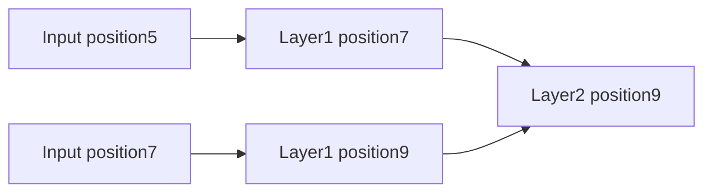

# Sliding-window attention: fewer connections, bounded reach

[Results](sliding-window-results.md) | [Frozen protocol](../../protocols/sliding-window.md)

## What changes?

Each query reads nearby keys. The softmax is normalized only over those visible keys. With zero-based positions, radius r and sequence length n:

| Policy | Visible key positions for query i | Maximum keys per query |
|---|---|---:|
| Bidirectional | max(0,i-r) through min(n-1,i+r) | 2r+1 |
| Causal | max(0,i-r) through i | r+1 |

Self is included. Here r counts neighbors on each permitted side, not total window width. At r=0, attention returns its own value vector. At r=n-1, it becomes full attention under the same causal policy.

For visible set S_i:

`a_ij = exp(q_i dot k_j / sqrt(d_k)) / sum[t in S_i] exp(q_i dot k_t / sqrt(d_k))`

`y_i = sum[j in S_i] a_ij v_j`

Removing keys generally changes the denominator and output. Local attention is therefore a different attention pattern. Explicitly gathering the allowed keys should match dense attention masked to that same pattern.

## How information travels

A causal radius2 layer lets position9 read positions7,8,9 (one-based labels). A second layer can receive position5 through position7. Each layer reads the preceding layer, so this takes two layers:

With L layers of the same window, possible input positions at output i are:

- Bidirectional: max(0,i-Lr) through min(n-1,i+Lr).
- Causal: max(0,i-Lr) through i.

This follows by taking the union of the previous layer's visible intervals. Pointwise FFNs, per-token normalization and residual connections do not create additional cross-token edges. Other cross-token operations would change the argument. A path permits influence; learned projections and cancellations can eliminate it. Our uniform-weight example proves influence is possible on every reachable pair, not that trained models use every path.

## Why the counts matter

For 0<=r<n, visible pairs per head are:

`bidirectional = n(2r+1) - r(r+1)`

`causal = n(r+1) - r(r+1)/2`

Sum the row lengths to derive these formulas; the subtracted terms account for sequence boundaries. Full counts are n^2 and n(n+1)/2. At fixed radius and head widths, useful score/value arithmetic grows linearly with n. If the radius grows with n, that conclusion changes.

Dense masking still allocates and computes dense scores in our reference. A sparse implementation must avoid those entries to realize savings. Kernel overhead, projections, FFNs and gradients also affect measured runtime and memory. Pair counts alone do not measure either.

## Connection to the paper

[Longformer v2, sections3.1-3.2](https://arxiv.org/html/2004.05150v2) describes sliding windows, growing receptive fields and implementation-dependent performance. Its bidirectional notation uses w/2 neighbors on each side; our r corresponds to w/2, with self counted explicitly. We test plain windows, including a causal variant. Global tokens, dilation, separate global projections and the paper's trained benchmarks are outside this study. This is a foundational check, not a survey of the latest sparse methods.
