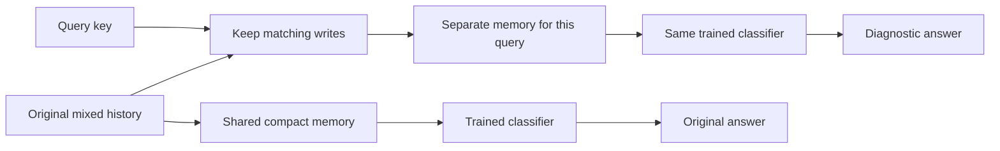

# Can the trained classifier read a clean memory?

Competing writes change a compact memory. A wrong answer can reflect that changed state, an inadequate classifier, or both. This diagnostic asks whether the existing reader and classifier work when competing writes are absent.

For `A:2, B:5, A:2`, querying A produces the filtered history `A:2, A:2`. Querying B produces `B:5`. The same trained model processes each filtered history. We supply the filtering rule; the model does not learn it.

## Math in a few steps

Our memory is a key-by-value matrix S. A write uses key k, value vector v and learned strength beta:

$$S' = S + \beta k(v-S^T k)^T,\qquad r=S^T k,\qquad z=Wr+b.$$

The write corrects the value currently read through k. The classifier converts read vector r into six class scores z. We inspected [Yang et al. (2024), section 2.2](https://arxiv.org/html/2406.06484v2#S2.SS2) for the delta correction and read equations. Our matrix orientation is transposed; our 615-parameter reader has tied normalized Q/K and one global beta, unlike their full input-dependent model.

Here every write of the target key carries the same value. Let $h=k^T k$. With only these writes, the read obeys

$$r_{j+1}=(1-\beta h)r_j+\beta h v,\quad r_0=0,$$
$$r_n=[1-(1-\beta h)^n]v.$$

This closed form is a **local derivation**. For a unit key, h=1. A single write gives beta times v; repeated writes approach v. We audit the actual norm rather than assuming normalization is exact.

Original loads 2/8/16/32 leave 16/4/2/1 target writes respectively. Length and repetition therefore change together across loads. These pools test stable associations, not changing a key's assigned value.

## What the result means

[Every tested cell reaches 100%](target-only-history-results.md), using unchanged parameters. This establishes clean-read sufficiency at both saved endpoints. Failures on mixed histories do not require an inability to decode the clean target value.

It does **not** show that the classifier handles corrupted mixtures well, that a single competing event causes each failure, or why training selected these parameters. Filtering changes the input distribution and uses knowledge of the task. All-query diagnostic success combines separate memories; it is not simultaneous storage of a complete map.

Earlier [query-order](query-write-order-results.md) and [orthogonal-key](key-geometry-retention-results.md) interventions also recovered older models. This check confirms clean-read sufficiency after exhaustive feedback and longer training; it is not the first evidence of recoverable decoding.
