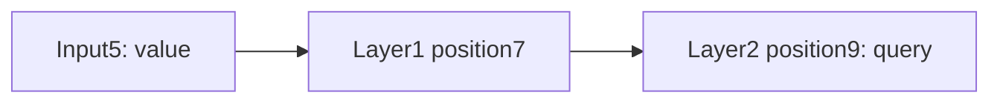

# Can local attention learn to relay information?

[Results](window-retrieval-results.md) | [Frozen protocol](../../protocols/window-retrieval.md) | [Window mathematics](sliding-window-guide.md)

## The task

Each sequence contains ordinary distractor symbols, one marked value and a final query. The answer is the marked value. Six values are possible. This is a simple location-independent retrieval task, not key/value association matching or natural language.

Example: `a b VALUE c d e f g QUERY`. The marked value is six positions before the query. Change VALUE while keeping the other symbols fixed and the correct answer changes.

## What the two models can access

Both models have two attention blocks and identical initial weights. Full causal attention lets the final query read any earlier position. The local version lets each position read itself and two earlier positions in each layer.

| Distance from value to query | Local access |
|---|---|
|1 |Direct, within one layer |
|3 or4 |Requires a path across two layers |
|5 or8 |Outside the two-layer receptive field |

For example, position9 can receive information from position5 through position7:

The bound is `maximum lookback = layers × radius = 2 × 2 = 4`. Each layer uses states from the previous layer. It cannot repeatedly move information across an entire sequence within one layer. Per-token FFNs, normalization, residuals and fixed positional rotations add no cross-token shortcuts.

## Why the unreachable control is decisive

Each distractor family includes all six possible marked values. For distances5/8, the local model's final receptive field is identical across those six examples. A deterministic predictor must produce the same answer for all six, so its accuracy is at most1/6, or16.67%. It can score lower if it predicts a non-answer class.

This is a bound for the declared fixed-depth local architecture and this data construction. More layers, another window or global connections would change the bound. Full attention can see the marked token, but still has to learn to use it.

There is also a loss bound. Across six indistinguishable examples, cross-entropy is `-(1/6) sum[y] log p(y) >= ln(6)`. Equality requires probability1/6 on each answer class and zero on other classes. Since two of five distance groups are unreachable, overall local loss is at least `(2/5) ln(6) = 0.716704`, even if all reachable examples are predicted perfectly. Finite logits can approach this bound. A loss near it is compatible with excellent reachable accuracy; it does not prove convergence.

## What successful training would establish

High held-out accuracy at distances3/4 would show usable information transfer across layers. It would not identify a unique intermediate position or internal encoding. Low training accuracy would leave learning adequacy unresolved. High training accuracy with weak held-out accuracy would establish a generalization gap.

Both arms receive the same360,000 sampled examples, initial parameters and optimizer settings. Training uses length9. Separate length9 tests measure new distractor families; length13 tests add four earlier distractors while preserving value-to-query distances. This longer test does not increase the required relay distance.

The [Longformer paper, section3.1](https://arxiv.org/html/2004.05150v2) motivates stacked local attention and expanded reach. Our task tests that opportunity in a tiny model; it does not reproduce the paper's benchmarks. Dense masked computation is used in both arms, so this study measures learning rather than sparse-kernel efficiency.
