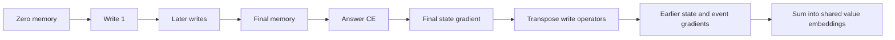

# How final errors send feedback through writes

[Measured results](write-credit-assignment-results.md) | [Protocol](../../protocols/write-credit-assignment.md)

The earlier replay showed forward interference: a write can improve its own value while damaging another answer. This diagnostic asks how the final training loss sends feedback backward through the actual zero-start computation. It does not train a repair.

## State transport

Our memory has shape 16 by 8. The delta write is

$$S_t=A_tS_{t-1}+\beta k_tv_t^T,\qquad A_t=I-\beta k_tk_t^T.$$

For final-state loss L, define $G_t=\partial L/\partial S_t$. The chain rule gives

$$G_{t-1}=A_t^TG_t,\qquad \frac{\partial L}{\partial v_t}=\beta G_t^Tk_t.$$

The first equation transports feedback to earlier memory. The second assigns feedback to that write's value activation. For unit keys and $0<\beta<1$, A contracts the written-key direction by $1-\beta$ and leaves orthogonal directions unchanged. Repeated transport can weaken feedback; it does not automatically erase it.

The zero initial state is fixed, not a trainable parameter. Its derivative measures transport only. Event activations are also not independent parameters: all occurrences of the same value share one learned embedding.

## Aggregation versus opposition

Let D_t be all histories' value-embedding contribution at position t. The actual gradient is $\sum_tD_t$. Report

$$R=\frac{\|\sum_tD_t\|}{\sum_t\|D_t\|}.$$

A small R means a small resultant relative to separate contributions. Even orthogonal vectors reduce this ratio. To establish opposition, inspect

$$C=\|\sum_tD_t\|^2-\sum_t\|D_t\|^2
=2\sum_{i<j}D_i^TD_j.$$

Negative C means net opposing cross terms. It does not mean every position pair opposes, or that removing this opposition improves learning. These vectors already pool different histories; within-history interference remains separate.

## What we learned

Error feedback reaches the first write at about 71-73% of its final state-gradient norm. Position-pooled value gradients have negative net cross terms in both seeds. Thus feedback survives, while shared-value contributions compete. Both are endpoint measurements; they do not identify how this situation developed during training or its causal contribution to accuracy.

Source inspected: [Yang et al., sections 2.2/3.1](https://arxiv.org/html/2406.06484v2#S2.SS2), published delta and affine recurrence. State orientation here is transposed. Reverse derivatives and cross-term statistics are our local derivations, verified independently. The paper's larger, input-dependent-beta architecture does not predict our scores.
