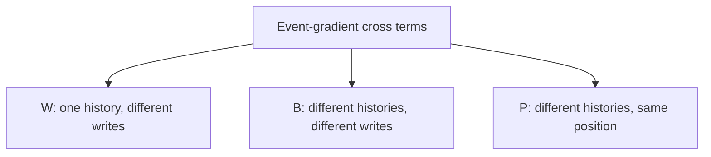

# Why writes can disagree inside one history

[Results](write-history-opposition-results.md) | [Frozen protocol](../../protocols/write-history-opposition.md)

The previous diagnostic found opposing position contributions after pooling histories. This check asks whether pooling created that opposition.

## Shared parameters matter

Consider `A:2, B:2`. A and B are different keys. Both writes use the same learned value embedding for 2. Their feedback therefore accumulates into the same parameter row and can oppose.

For `A:2, B:5`, the value gradients occupy different rows. Those rows are orthogonal in parameter space. Comparing only their raw eight-coordinate activation gradients would incorrectly treat different parameters as shared.

Here each history has 32 distinct keys and only six possible values. Keys do not repeat in this pool; value embeddings do.

## Three types of cross terms

Let a_(h,t) be the event gradient placed in its correct shared-value row. Define

$$E_0=\sum_{h,t}\|a_{h,t}\|^2,\qquad
J=\left\|\sum_{h,t}a_{h,t}\right\|^2.$$

Expanding the squared sum gives

$$J=E_0+W+B+P.$$

W, B and P are signed dot-product sums. Negative means net opposition; positive means net alignment. The earlier temporal statistic was W+B and excluded P. Keeping positive terms prevents a misleading story in which every interaction is harmful.

## What this explains

Within-history opposition exists in both seeds. It is not only a consequence of pooling different contexts. In the error cohort, B offsets W in seed 3461 and reinforces it in 3463.

But W is also negative in the correct-answer cohort. Opposition is therefore not sufficient to identify a failed answer or justify a repair. Each history's gradient still sums several query losses. We have not yet separated disagreement between queries from opposing contributions for one individual query.

Source inspected: [Yang et al., section 2.2](https://arxiv.org/html/2406.06484v2#S2.SS2), the underlying delta update. The parameter mapping and cross-term decomposition are our local derivation, checked independently. The paper does not predict these endpoint statistics.
