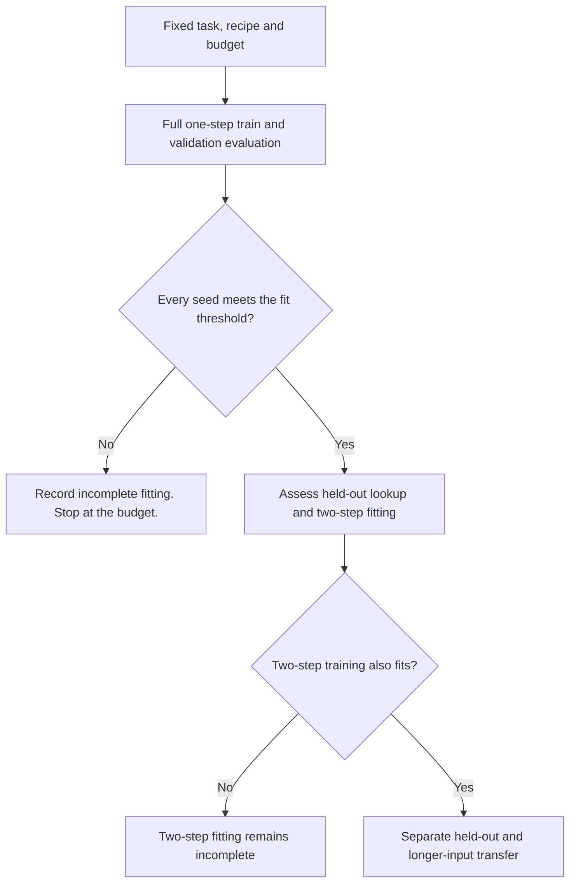

# Learning adequacy before composition

[Protocol](../../protocols/composition-learning-adequacy.md) · [Results](composition-learning-adequacy-results.md) · [Original task](recurrent-composition-guide.md)

## Why one-step lookup comes first

A context defines a mapping `f`. One-step lookup asks for `f(q)`. Two-step lookup asks for `f(f(q))`. For `A→B, B→C, C→D, D→A`, queryA returnsB after one step andC after two.

If a model struggles with `f(q)`, low two-step accuracy cannot isolate difficulty combining two successful lookups. The input encoding, optimization, exposure and capacity remain possible explanations. A fit gate prevents that overclaim.

Passing a threshold establishes performance on these pools. It does not prove the model learned the dictionary-walk algorithm.

## What the GPU recipe changes

The task and labels stay fixed. Width, batch, initialization, precision and exposure change together. This tests a recipe's feasibility. It cannot identify which change helped.

For batchB and updatesU, sampled examples `E = B × U`. AtB=1,024 andU=3,000, each run sees3,072,000 supervised examples. Sampling repeats the same training pools. More exposure is not more unique graphs. Both hop counts receive half the targets; only the final answer is supervised.

The loss is `L = mean[-log softmax(logits_last)[answer]]`. It uses15 output classes, although only12 node symbols can be correct. Group accuracy checks lookup, composition and both relevant-edge orders separately. A good mean can hide a weak seed or group.

## How the models calculate

Transformer blocks use `x ← x + Attention(LayerNorm(x))`, then `x ← x + FFN(LayerNorm(x))`. Attention is `softmax(QKᵀ/√32 + causal_mask)V`. Two query heads share one K/V head. Our RoPE implementation rotates Q/K coordinate pairs by position and leaves V unrotated. See the original [RoFormer paper, section3.2](https://arxiv.org/html/2104.09864v5).

The GRU updates a fixed-size state after each token:

`r = sigmoid(W_r x + U_r h + biases)`, `z = sigmoid(W_z x + U_z h + biases)`

`candidate = tanh(W_n x + b_n + r ⊙ (U_n h + c_n))`

`h_new = z ⊙ h + (1-z) ⊙ candidate`

These are the [PyTorch GRU equations](https://docs.pytorch.org/docs/2.11/generated/torch.nn.GRU.html), including its reset-gate convention. The state starts at zero for each sequence. Neither equation establishes how a trained model represents graph edges.

## What matching and memory mean

| Calculation | Result |
|---|---:|
| Transformer:2 blocks ×29,312 + final norm128 + embedding960 + output960 |60,672 parameters |
| GRU:3 ×110 ×(64+110+2) + embedding960 + output1,650 |60,690 parameters |

Near-equal parameter counts do not equalize sequential work, attention cost, depth or normalization. The shared embedding controls its initial values, not the entire initialization.

GPU profiling includes forward, backward and Adam-state allocation. Allocated memory tracks live tensors; reserved memory includes the allocator's cached blocks. Neither is total device usage. See [PyTorch memory management](https://docs.pytorch.org/docs/2.11/notes/cuda.html#memory-management). These short contexts need much less than8GB. Filling the remaining memory would not establish real-world validity.

The existing split prevents its defined renamed mapping families from crossing pools. It covers directed cycles with familiar symbols and limited orders. Reusing opened pools gives a diagnostic comparison, not fresh confirmation or evidence about arbitrary graphs.
