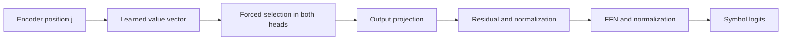

# Long-copy content: forcing aligned cross-attention

Replacing learned cross-attention weights with matching-position source selection recovers many longer copies. It does not solve the task. Six-symbol content accuracy rises from **1.56% to 55.99%**; eight-symbol accuracy rises from **0% to 27.86%**. These are diagnostic generations with early EOS blocked.

## What changes, and why

Cross-attention uses decoder queries and encoder keys/values. In each head:

\[
P_{jt}=\operatorname{softmax}_t(q_j^\top k_t/\sqrt{4}),
\qquad h_j=\sum_t P_{jt}v_t.
\]

Here each head has four channels. Our aligned intervention replaces content-row weights with \(P^*_{jt}=\mathbf{1}[t=j]\), making \(h^*_j=v_j\). It changes **where the head reads**, while keeping its learned value vectors. Query row zero predicts source symbol zero because the decoder receives BOS followed by earlier symbols.

Selecting a value does not insert the correct symbol into the answer. The remaining learned operations must still decode it. Encoder-decoder attention follows [Vaswani et al., section 3.2.3](https://arxiv.org/html/1706.03762v7); this intervention and its results are local evidence, not a reproduction of their translation experiments.

## Method and results

Reuse all three saved 1,888-parameter copy models, seeds 2371/2377/2381, and all eight original pools. CPU float64, one thread, **zero training updates**. Sham retains learned routing; aligned reads position j; shifted reads (j+1) modulo source length. Terminal EOS rows retain their own attention. All other weights and operations stay fixed.

Generation suppresses EOS for the first n outputs and uses the previous n+3 limit. **Content exact** means all n source symbols match; **full exact** also requires immediate EOS. Source length and the alignment rule are privileged information. These scores are not ordinary unconstrained generation performance.

Percentages below are equal-weight means over three seeds:

| Test symbols | Sham content | Aligned content | Sham full | Aligned full | Shifted content/full |
|---|---:|---:|---:|---:|---:|
| 3 | 99.48 | 98.96 | 98.96 | 98.44 | 0 / 0 |
| 4 | 95.83 | 98.44 | 94.27 | 96.88 | 0 / 0 |
| 6 | 1.56 | **55.99** | 0.52 | **25.78** | 0 / 0 |
| 8 | 0 | **27.86** | 0 | **1.04** | 0 / 0 |

Aligned long-input results, with 64 examples per group per seed. Cells show **content / full** accuracy (%). Distinct means every source symbol differs; repeated means at least one repeats.

| Seed | Symbols | Distinct | Repeated |
|---|---:|---:|---:|
| 2371 | 6 | 48.44 / 7.81 | 48.44 / 12.50 |
| 2377 | 6 | 48.44 / 37.50 | 68.75 / 60.94 |
| 2381 | 6 | 57.81 / 15.63 | 64.06 / 20.31 |
| 2371 | 8 | 15.63 / 1.56 | 10.94 / 3.12 |
| 2377 | 8 | 37.50 / 0 | 37.50 / 0 |
| 2381 | 8 | 35.94 / 0 | 29.69 / 1.56 |

## Correct prefixes still expose two problems

Teacher forcing supplies the correct earlier symbols. For the last two positions of six-symbol inputs, means across seeds are:

| Output position | Native matching-source attention mass | Sham correct, EOS excluded | Aligned correct, EOS excluded | Aligned correct, all classes |
|---|---:|---:|---:|---:|
| 5 | 15.67% | 22.40% | 89.84% | 45.57% |
| 6 | 0.66% | 8.07% | 64.32% | 8.07% |

Routing changes recover content choices even with correct prefixes. EOS competition still removes many of those gains. Content errors also survive after EOS exclusion. Native attention mass is descriptive; the intervention supplies stronger evidence that changing routing affects predictions.

The intervention is not universally beneficial: training content accuracy falls from 100% to 99.48% at three symbols and 98.05% at four. Forced identical routing in both heads can disrupt useful learned mixtures.

## What is established, and what remains open

Aligned selection is sufficient for **partial recovery** with unchanged values and downstream weights. It does not establish that routing alone caused the original failure. Remaining errors do not prove lost encoder information, a defective readout or an architectural impossibility. Head-specific mixtures, residual/position interactions and stopping remain possible contributors, not identified causes.

All 72 condition/pool/seed cells pass separate attention, normalization and projection equations. Maximum logit/weight discrepancy is 1.39e-13, with zero teacher argmax changes. An independent decoding controller matches all 8,064 sequences and 48,319 generated tokens; 44,928 teacher targets are checked. These counts represent three trained seeds. Sham matches archived teacher logits and the [previous EOS-blocking diagnostic](copy-stopping-results.md). Off-by-one selection is detected; terminal rows are preserved; relevant archived hashes remain unchanged.

The declared three-condition diagnostic is complete. No further head/value subdivision or training is selected. The copy failure is better localized, but reliable long copying remains unresolved.

Evidence: [frozen protocol](../../protocols/copy-aligned-routing.md), [executed script](../../../experiments/copy_aligned_routing.py), [report](../../../results/copy_aligned_routing/report.json), [all per-seed/group metrics](../../../results/copy_aligned_routing/metrics.csv), [saved logits, weights and generations](../../../results/copy_aligned_routing/evidence.pt). Original [copy training results](encoder-decoder-copy-results.md) remain unchanged.
