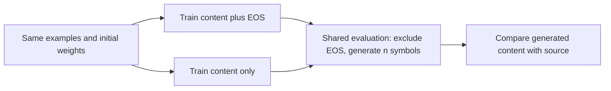

# Learning content versus learning when to stop

The earlier [stopping diagnostic](copy-stopping-results.md) blocked EOS after training. It could not tell us whether learning EOS had already changed the model's content predictions. The new [objective comparison](../../protocols/copy-eos-training.md) removes the positive terminal target during training in one arm.

## One changed loss term

For source length n and batch B:

\[
L_\alpha=\frac{\sum_{b,j<n}\mathrm{CE}(z_{bj},x_{bj})
+\alpha\sum_b\mathrm{CE}(z_{b,n},\mathrm{EOS})}{B(n+1)}.
\]

Alpha is 1 for EOS training and 0 for content-only training. The denominator stays the same. Thus the content terms have identical coefficients; removing EOS does not silently enlarge their gradients. At the same parameters and batch:

\[
\nabla L_1-\nabla L_0
=\frac{\nabla\sum_b\mathrm{CE}(z_{b,n},\mathrm{EOS})}{B(n+1)}.
\]

This describes the initial loss difference. After updates, parameters and subsequent content gradients can diverge.

EOS remains one of the 16 output classes. Without positive EOS targets it still receives gradients as a competing class in content softmax. Only terminal-position loss is removed. We compute the same decoder rows and keep the same architecture, initial weights, batches and update count within each pair.

## Why supply the correct length?

The evaluator supplies n. Both models use their own generated prefixes and learned attention. Neither can win this comparison merely by choosing a better stopping time. A successful content-only model still would not have demonstrated how to stop without supplied length.

**Oracle exact accuracy** requires all n symbols to match. **Teacher accuracy** supplies correct earlier symbols and checks each content prediction. Raw content CE uses all output classes; it remains comparable across arms. The total weighted losses include different terms, so a smaller training objective is not automatically better content quality.

## Fairness and limits

Each arm sees 4.083M content targets and the same 957,000 sequences. The EOS arm adds 957,000 terminal targets. Equal content feedback and identical forward shapes are deliberate; total active targets differ. Removing that feedback is the intervention, not an architecture change.

The frozen pools were already inspected in the length-exposure study. Fresh paired seeds provide a new objective comparison, not untouched confirmation or a new vocabulary split. Full training fit, seen-length reliability and longer-input scores must remain separate.

[Newman et al. (2020), sections 1 and 3](https://arxiv.org/html/2010.07174v1) compare EOS/no-EOS training under an oracle length on different tasks. Our fixed content weighting and local model/recipe differ. Their results motivate the question; neither their reported gains nor their hidden-state explanations are assumed here.

Read the [results](copy-eos-training-results.md) for the measured outcome. Stop at the declared six runs; no automatic objective-weight sweep or architecture proposal follows.
