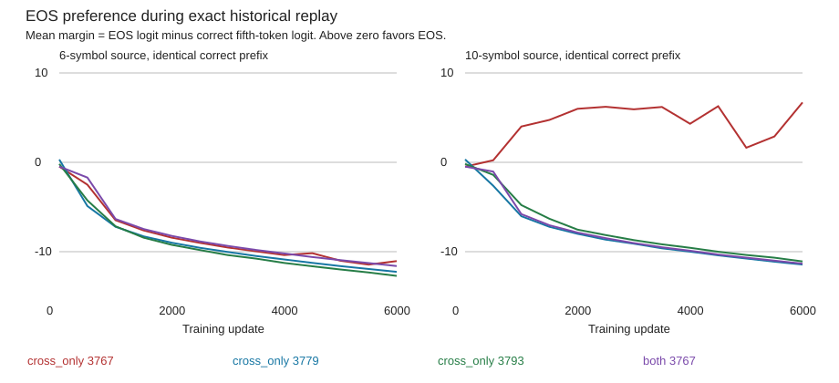

# When the copy failure develops

2026-10-07. **The weak seed's failure signature is present by update 1,000, before its first sampled short-training fit at 2,000.** None of the three successful controls meets that failure signature at any saved point. All four replays exactly reproduce historical endpoints, optimizer states, generators and sampling hashes. Intermediate weights were not saved originally; these are verified reconstructions.

[Frozen protocol](../../protocols/copy-learning-trajectory.md) · [Report and audit](../../../results/copy_learning_trajectory/report.json) · [All snapshot groups](../../../results/copy_learning_trajectory/metrics.csv)

## The question and method

When does source extension induce EOS while the short task is being learned? Replay the unchanged 6,000-update recipes for the weak cross-only seed, two successful cross-only seeds and the same-seed combined model. Save every 500 updates, including initialization. At each snapshot measure full short train/validation/test pools and paired six/ten-symbol sources at output position 5. Both paired sources receive BOS plus the same first four correct tokens.

Short-fit below means >=99% teacher-forced exact sequence accuracy in every short training-length distinct/repeated group, including terminal EOS. It differs from free generation. Failure signature means >=99% paired-short correctness with >=90% paired-long EOS. Thresholds were frozen; all occurrences are shown, not only the first.

| Model | First sampled short fit | Failure-signature updates | Final paired-short correct | Final paired-long EOS |
|---|---:|---|---:|---:|
| cross_only 3767 | 2000 | 1000, 1500, 2000, 2500, 3000, 3500, 4000, 4500, 6000 | 128/128 | 128/128 |
| cross_only 3779 | 500 | None | 128/128 | 0/128 |
| cross_only 3793 | 1000 | None | 128/128 | 0/128 |
| both 3767 | 1000 | None | 128/128 | 0/128 |

## Weak seed across training

All counts below are out of 128. Extension margin is the long minus short mean of `z_EOS - z_target`. Positive means extension increases EOS preference relative to the correct symbol.

| Update | Short training fit | Paired-short correct | Paired-long correct | Paired-long EOS | Extension margin |
|---:|---|---:|---:|---:|---:|
| 0 | No | 8 | 8 | 0 | -0.008 |
| 500 | No | 123 | 49 | 79 | +2.732 |
| 1000 | No | 128 | 2 | 126 | +10.482 |
| 1500 | No | 128 | 5 | 123 | +12.367 |
| 2000 | Yes | 128 | 1 | 127 | +14.418 |
| 2500 | Yes | 128 | 2 | 126 | +15.225 |
| 3000 | Yes | 128 | 2 | 126 | +15.466 |
| 3500 | Yes | 128 | 2 | 126 | +16.149 |
| 4000 | Yes | 128 | 12 | 116 | +14.689 |
| 4500 | Yes | 128 | 0 | 128 | +16.445 |
| 5000 | No | 128 | 36 | 92 | +12.649 |
| 5500 | Yes | 128 | 25 | 103 | +14.341 |
| 6000 | Yes | 128 | 0 | 128 | +17.752 |

## What this establishes

The weak model already predicts EOS on 79/128 long sources at update 500. By 1,000, paired-short predictions are all correct but 126/128 long predictions select EOS. Short fitting therefore does not remove this early divergence. Successful cross-only seed 3779 and combined seed 3767 reach 128/128 paired-long correctness at 1,000; cross-only 3793 reaches it at 2,000.

The weak trajectory is not monotonic. Long EOS counts fall to 92/128 and 103/128 at 5,000 and 5,500, then return to 128/128 at 6,000. Its short-training fit gate also fails at 5,000 after passing earlier. Do not describe these as stable convergence or a failure that begins only after short-task mastery. The 500-to-1,000 interval is a useful observed divergence window, not a uniquely identified causal transition.

This locates the failure along an exactly reproduced learning trajectory. It does not identify the parameter changes that create it. Different seeds have different initializations; the combined same-seed comparison changes positional exposure and therefore gradients throughout the model. The plotted margin is an actual final-output quantity, not an intermediate readout attribution.

The reused long pool is opened diagnostic evidence. Every snapshot uses supplied correct prefixes; the curves do not measure complete generated long copying. Transitions between saved points remain unresolved within 500 updates. Falling losses do not prove convergence. A future causal intervention needs a specific prediction derived from these trajectories.

## Checks, budget and sources

52 saved snapshots; four runs, 24,000 updates, 20.16M supervised targets and 3,828,000 training examples. CPU float64, one thread; batches 210/168/140/120 cycle over lengths 3/4/5/6 with 840 targets per update, no accumulation. The original complete-step profile is reused. CPU peak memory is unmeasured; GPU allocated/reserved memory is inapplicable.

Initialized saved reload, actual scalar audit, ties/absent groups and deliberate label/logit/missing-group faults pass. A two-update replay with observers exactly matches the unchanged trainer. Every snapshot's reference forward and scalar metric audit pass; persisted logits are checked separately. Final generated train/validation/test and layout metrics exactly reproduce the historical report. Shared forward helpers and PyTorch optimizer limit independence. Sources, checkpoints and protocols remain protected. The first preflight failed because synthetic logits were float32 against a float64 tolerance; fixtures were corrected before freezing or formal training, with no criterion change.

[Ruoss et al. (2023), section 3](https://arxiv.org/html/2305.16843v1#S3), inspected, describes ordered positional subset sampling. It supports the existing recipe, not the local scores or onset times. The replay, margins and temporal signatures are local measurements. Stop after this reconstruction; no mask, checkpoint-selected intervention or extra replay is queued.
