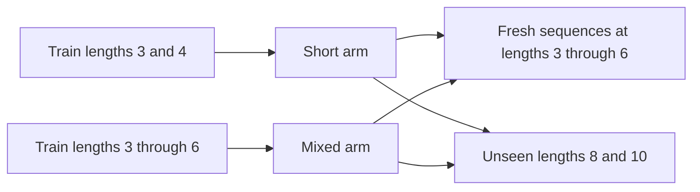

# Can broader training lengths improve copying?

The [routing diagnostic](copy-aligned-routing-results.md) recovered some long-copy content by forcing where attention reads. That used privileged alignment and blocked early EOS. This comparison asks whether the unchanged model can improve through training exposure, using ordinary generation.

## Seen lengths versus extrapolation

Two separately trained arms start from identical weights within each seed pair:

Length six is outside short's training range but inside mixed's. A gain there shows benefit from broader support. It does not show extrapolation by mixed. Lengths eight and ten remain unseen by both.

## Why match tokens?

For length n, a batch has B sequences and B(n+1) targets, including EOS. The loss is

\[
\mathcal L=-\frac{1}{B(n+1)}\sum_{b,j}\log p_\theta(y_{bj}\mid x_b,y_{b,<j}).
\]

We fix B(n+1)=840 at each update. Both arms receive 5.04 million targets over 6,000 updates. Short sees more sequences; mixed sees longer ones. Equal token exposure does not imply equal compute. EOS accounts for 22.50% of short targets and 18.99% of mixed targets. Thus the intervention changes a length mixture, including stopping supervision, rather than isolating one positional mechanism.

## How to read the evidence

First check full training fit. Then check unseen examples at training lengths. Finally inspect longer lengths, per seed and distinct/repeated group.

**Content exact** requires all source symbols to match. **Full exact** also requires immediate EOS. Early EOS can harm both. Teacher-forced accuracy supplies correct earlier symbols; free generation uses the model's own predictions. Their difference can reveal sensitivity to generated prefixes, but cannot identify its cause alone.

There are only eight content symbols. Ten-symbol inputs necessarily repeat. Their missing distinct group is a vocabulary constraint, not a failed measurement. Length-three held-out groups have only eight examples each; their scores are coarse.

[Newman et al. (2020), sections 1 and 3](https://arxiv.org/html/2010.07174v1) distinguish content generation from stopping and use an oracle length evaluation. Our comparison retains EOS during training and generation. It does not reproduce their tasks or establish their proposed hidden-state mechanisms.

See the [frozen protocol](../../protocols/copy-length-exposure.md) and [results](copy-length-exposure-results.md). One fixed comparison; no automatic tuning follows.
