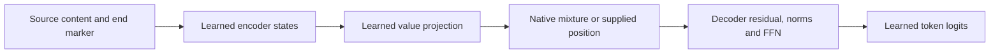

# Marked RoPE copying: supplied alignment recovers the answer

2026-10-04. Three saved checkpoints, zero training updates. **Forced matching-position cross-attention gives 100% full copying on every evaluated pool, seed and group.** Native longer copying remains weak. This is conditional recovery using supplied alignment, not a trained repair.

## What changes, and what stays learned

For n content tokens and decoder rows indexed from zero, native attention mixes projected encoder states:

\[
h_j^{(a)}=\sum_t P_{jt}^{(a)}V_t^{(a)}.
\]

In each head a, set \(P_{jt}^{(a)}=\mathbf1[t=j]\), so \(h_j^{(a)}=V_j^{(a)}\). Source position n is the end marker and is selected for the EOS prediction. A shifted control selects (j+1) modulo (n+1). Rows beyond n retain native attention.

We supply the **location**, not the answer token in the logits. Encoder states, learned V/output projections, decoder residuals, normalization, FFN and readout remain active. The source is content+EOS. Ordinary generation starts with BOS and feeds back its own predictions, with no EOS suppression. Alignment is task knowledge and cannot be counted as learned length transfer.

## Method

Seeds 3163/3167/3169; the existing 1,888-parameter RoPE models trained on lengths 3/4/5/6. Eight unchanged pools: train6, validation6, test6/8/10 and uniform6/8/10. Three conditions per pool: native, aligned, shifted. CPU float64, one thread. All earlier data and checkpoints remain unchanged. [Frozen protocol](../../protocols/copy-marker-alignment.md).

Correct-prefix scores use BOS+true content. Ordinary full exactness requires every content token and immediate EOS. Oracle content excludes EOS and generates n tokens using its own prefix. Uniform sources repeat one symbol; they remain a previously inspected challenge set, not independent confirmation. Length 10 has no distinct-symbol group.

## Results

Three-seed random-test means. All aligned minima across seeds/groups are also 100%.

| Symbols | Native full | Native oracle content | Aligned full | Aligned oracle content | Shifted full |
|---|---|---|---|---|---|
| 6 | 100.00% | 100.00% | 100.00% | 100.00% | 0.00% |
| 8 | 10.42% | 14.06% | 100.00% | 100.00% | 0.00% |
| 10 | 2.34% | 4.17% | 100.00% | 100.00% | 0.00% |

| Seed | Longer group | Native full | Aligned full | Native oracle | Aligned oracle |
|---|---|---|---|---|---|
| 3163 | 8 / distinct | 7.81% | 100.00% | 20.31% | 100.00% |
| 3163 | 8 / repeated | 4.69% | 100.00% | 9.38% | 100.00% |
| 3163 | 10 / repeated | 0.00% | 100.00% | 3.91% | 100.00% |
| 3167 | 8 / distinct | 6.25% | 100.00% | 6.25% | 100.00% |
| 3167 | 8 / repeated | 1.56% | 100.00% | 1.56% | 100.00% |
| 3167 | 10 / repeated | 1.56% | 100.00% | 2.34% | 100.00% |
| 3169 | 8 / distinct | 20.31% | 100.00% | 23.44% | 100.00% |
| 3169 | 8 / repeated | 21.88% | 100.00% | 23.44% | 100.00% |
| 3169 | 10 / repeated | 5.47% | 100.00% | 6.25% | 100.00% |

Native and aligned train6/validation6/test6 scores are all 100%; shifting gives 0% full copying. Uniform results below include stopping.

| Symbols | Native uniform full | Aligned uniform full | Shifted uniform full |
|---|---|---|---|
| 6 | 100.00% | 100.00% | 0.00% |
| 8 | 58.33% | 100.00% | 0.00% |
| 10 | 50.00% | 100.00% | 0.00% |

Correct-prefix diagnostics measure failures before generated errors can contaminate later prefixes. EOS accuracy here assumes the entire correct prefix; it is not ordinary stopping success.

| Symbols | Native content tokens correct | Native terminal EOS correct | First content token wrong | Content CE native / aligned |
|---|---|---|---|---|
| 6 | 100.00% | 100.00% | 0/384 | 0.0002 / 0.000169 |
| 8 | 80.53% | 97.66% | 177/384 | 1.1561 / 0.000203 |
| 10 | 71.41% | 97.66% | 174/384 | 1.6155 / 0.000203 |

At length 8, 316/344 incorrect teacher sequences first fail within the first 3 content positions. At length 10, 366/375 incorrect teacher sequences first fail within the first 5 content positions. Errors therefore occur inside positions seen during training, not only after position 6. Attention weights and margins for every position are saved in the report; their correlations alone are not causal proof.

## What we can conclude

**Observed:** supplied alignment recovers all 768 random longer sequence evaluations, including stopping. It also preserves all short controls and recovers uniform probes. The frozen all-group oracle-gain and short-preservation rule passes. The shifted route fails, supporting the specificity of the selected position.

**Supported interpretation:** the learned encoder/value/downstream path can produce correct longer answers when given matching positions. Replacing cross-attention weights is sufficient for recovery on these inputs. The previous native failure is not evidence that useful content is unavailable to every decoder read.

**Unknown:** why training learned cross-attention that transfers poorly; whether Q, K, their interaction, encoder context changes or optimization account for it; and whether a learned routing change would preserve this recovery. A one-hot route changes both selection and mixture sharpness, so this does not isolate the wrong-position effect from dilution. Joint head intervention does not assign individual-head responsibility. No minimal circuit, universal RoPE result, arbitrary-length algorithm or deployable repair is established.

The [original unmarked alignment study](copy-aligned-routing-results.md) gave only partial recovery with early EOS blocked. This diagnostic uses different, marker-trained models and permits ordinary EOS. Their scores are not paired evidence for the marker's training effect. The [unmodified training results](copy-marker-training-results.md) and all failed native extrapolation criteria remain valid.

Close this diagnostic and consolidate the copy branch. No extra training, token/head subdivision or parameter sweep is selected.

## Checks and sources

Four preflight tests pass, including 27 initialized equation/all-parameter-gradient cases, checkpoint reload, the actual evaluator/audit entry, absent groups, known-answer logits, shifted-selector and criterion-error controls. Native scores reproduce the saved originals.

Independent audit: 72 cells, 53,208 teacher rows, 6,552 sequence evaluations, 49,511 ordinary tokens and 46,656 oracle tokens. Zero teacher argmax or generated-sequence differences. Maximum logit/weight error 1.613e-13; scalar/position metric error 8.882e-15, tolerance 1e-9. Dependency/checkpoint hashes are unchanged. Explicit rotations/layer equations and direct value indexing share projection utilities with the producer; this is bounded numerical corroboration. Evaluation counts are not independent seeds.

[Report and position diagnostics](../../../results/copy_marker_alignment/report.json), [all scalar metrics](../../../results/copy_marker_alignment/metrics.csv), [audit](../../../results/copy_marker_alignment/audit.json), [preflight](../../../results/copy_marker_alignment/preflight.json), [producer](../../../experiments/copy_marker_alignment.py), [independent equations](../../../experiments/audit_copy_marker_alignment.py), [tests](../../../tests/test_copy_marker_alignment.py).

[RoFormer v5, sections 2.1 and 3](https://arxiv.org/html/2104.09864v5), reviewed 2026-10-04, supplies the weighted-value equations and Q/K rotation identity. The imposed copy alignment and all scores here are local evidence. The paper does not establish this intervention's outcome or guarantee our model's extrapolation.
