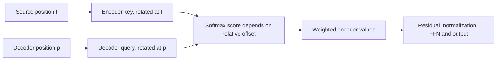

# Why test RoPE for copying?

Our copy models fit their training sequences but fail at longer lengths. Removing terminal EOS supervision did not reliably improve content. A distinct question is whether positional representation makes alignment easier to learn.

## Two ways to supply position

| Sinusoidal baseline | RoPE treatment |
|---|---|
| Add a position vector to each embedding | Rotate projected Q and K inside each head |
| Position enters residuals, values and attention inputs directly | Position enters Q/K scores directly, then influences later representations through attention |
| Existing encoder-decoder implementation | Same learned parameters, different position operations |

RoPE does not rotate V directly. Later V projections can still receive representations affected by earlier positional attention. Removing additive positions and adding rotations is one combined treatment.

For two coordinates:

\[
R_p=\begin{bmatrix}\cos(p\theta)&-\sin(p\theta)\\\sin(p\theta)&\cos(p\theta)\end{bmatrix},\qquad
(R_pq)^T(R_tk)=q^TR_{t-p}k.
\]

The score depends on relative offset t-p. With head width 4, the two rotation frequencies are 1 and .01. They use the **head width**, not model width 8. Softmax, scaling by sqrt(4), and the weighted value sum remain in place.

## What cross-attention means here

Both streams start at zero. Decoder row p predicts source symbol p. The matching source therefore has offset zero. This supplies a position relation; it does not force attention to select that source or insert the correct symbol. Learned Q/K content, other keys and downstream layers still matter.

Moving both streams by the same offset leaves these RoPE scores unchanged. Increasing sequence length is different: it adds keys, relative offsets and decoder steps. **Shift invariance is not proof of length generalization.**

## How to read the comparison

| Check | What it answers |
|---|---|
| Full training exactness | Did each recipe learn its supplied sequences? |
| Ordinary full exactness | Did generation copy every symbol and stop correctly? |
| Oracle-length content exactness | Are content errors left when EOS is excluded and length supplied? |
| Independent equations and negative controls | Does the implementation agree within the checked scope? |

The six runs share initial tensors, sampled batches, EOS targets and update budget. The data pools were already inspected, so this is a diagnostic, not fresh confirmation. A missed fit gate prevents calling the gap purely length transfer. No architecture-wide winner follows from this tiny task.

## A limit of this particular variant

If every source symbol is A, each encoder value starts identical. Then \(\sum_t P_{pt}v=v\), since attention weights sum to one. Rotating Q/K alone cannot distinguish the values. The encoder's residual/FFN operations retain identical memory vectors, and cross-attention again returns the same value regardless of source length.

At prefix `BOS A A A`, source `A A A` requires EOS, while `A A A A` requires A. This variant produces the same logits for both. All 48 saved-checkpoint boundary probes confirm the ambiguity. It applies to our source format with no end marker and no positional values, not to every model using RoPE. The [results](copy-rope-results.md) separate this proven boundary from the still-unidentified causes of varied-content errors.

The [frozen protocol](../../protocols/copy-rope-training.md) specifies the gates and stopping rule. [RoFormer, section 3](https://arxiv.org/html/2104.09864v5) supports the rotation identity. Its translation section describes rotary self-attention; our shared-origin cross-attention is a local convention, not a reproduction of that experiment.
