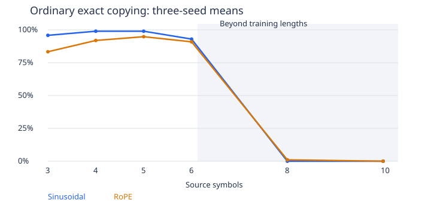

# RoPE versus sinusoidal encoder-decoder copying

2026-10-03. Six fresh matched runs, executed and independently checked. This tests positional representation on the already opened copy pools. It is distinct from decoder-only retrieval and is not fresh confirmation.

## Methods and math

Three paired seeds, 1,888 learned parameters, one width 8 post-norm encoder/decoder, two width 4 heads, ReLU FFN width 16, dropout zero. Same learned initialization, sampled indices, EOS objective and 6,000 Adam .001 updates per run. Training lengths 3/4/5/6, 840 targets/update: 957,000 sampled sequences and 5.04M supervised targets each. CPU float64, one thread; GPU unused. Recorded training-loop total 569.90 seconds includes scheduled evaluation/saving and is not a speed benchmark.

Sinusoidal adds the original positional vectors. RoPE removes them and rotates projected Q/K in both self-attentions and cross-attention, with frequencies (1, .01). V is not directly rotated. For fixed Q/K, \( (R_pq)^T(R_tk)=q^TR_{t-p}k \). Source and decoder share origin zero; decoder row p predicts source p. This is a local copy convention, not forced alignment. Additive-position removal and Q/K rotation change together.

Ordinary full exactness requires the entire source followed by immediate EOS. Oracle content excludes EOS and supplies length, but uses learned attention and the model's own generated prefix. All 16 output classes otherwise remain available. See the [learning guide](copy-rope-guide.md) and [frozen protocol](../../protocols/copy-rope-training.md).

## Results

Percentages below are means across three seeds; subgroup/seed detail follows. Length 10 cannot have a distinct-symbol group.

| Test symbols | Ordinary sinusoidal | Ordinary RoPE | Oracle sinusoidal | Oracle RoPE |
|---|---|---|---|---|
| 3 | 95.83% | 83.33% | 100.00% | 100.00% |
| 4 | 98.96% | 91.93% | 99.22% | 99.48% |
| 5 | 98.96% | 94.79% | 98.96% | 100.00% |
| 6 | 92.97% | 90.89% | 97.66% | 99.48% |
| 8 | 0.00% | 1.04% | 3.39% | 4.43% |
| 10 | 0.00% | 0.00% | 0.26% | 0.00% |

Worst distinct/repeated cell within lengths 3/4/5/6, separately per seed. These are minima, not means. Training requires 99%; seen-length test reliability requires 95%.

| Seed | Training sinusoidal | Training RoPE | Seen test sinusoidal | Seen test RoPE |
|---|---|---|---|---|
| 3119 | 100.00% | 99.22% | 93.75% | 75.00% |
| 3121 | 100.00% | 100.00% | 87.50% | 75.00% |
| 3137 | 100.00% | 99.22% | 78.12% | 50.00% |

| Seed | Longer group | Ordinary sinusoidal | Ordinary RoPE | Oracle sinusoidal | Oracle RoPE |
|---|---|---|---|---|---|
| 3119 | 8 / distinct | 0.00% | 1.56% | 4.69% | 4.69% |
| 3119 | 8 / repeated | 0.00% | 4.69% | 7.81% | 12.50% |
| 3119 | 10 / repeated | 0.00% | 0.00% | 0.78% | 0.00% |
| 3121 | 8 / distinct | 0.00% | 0.00% | 1.56% | 3.12% |
| 3121 | 8 / repeated | 0.00% | 0.00% | 3.12% | 3.12% |
| 3121 | 10 / repeated | 0.00% | 0.00% | 0.00% | 0.00% |
| 3137 | 8 / distinct | 0.00% | 0.00% | 0.00% | 0.00% |
| 3137 | 8 / repeated | 0.00% | 0.00% | 3.12% | 3.12% |
| 3137 | 10 / repeated | 0.00% | 0.00% | 0.00% | 0.00% |

| Seed | Ordinary gain at 8, points | Gain at 10, points | Seen groups preserved within 5 points |
|---|---|---|---|
| 3119 | +3.12 | +0.00 | no |
| 3121 | +0.00 | +0.00 | no |
| 3137 | +0.00 | +0.00 | no |

Length 8: mean teacher content CE 3.2869/2.3201; ordinary early-EOS rate 98.70%/73.96% (sinusoidal/RoPE).
Length 10: mean teacher content CE 4.9426/3.2032; ordinary early-EOS rate 99.74%/87.50% (sinusoidal/RoPE). Full training/validation/test losses and stopping groups are in the linked CSV. Early stopping rates describe behavior, not its unique cause.

## Observations, limits and closure

Both training-fit gates pass. A longer-input gap can therefore be distinguished from failure to fit the supplied training sequences.
The frozen RoPE benefit rule **fails**. It requires both fit gates, a 10-point ordinary exact gain at both longer lengths in every seed, and seen-length preservation.
Seen-length reliability: sinusoidal fails, rope fails.
RoPE extrapolation: length 8 fails, length 10 fails. This includes the seen-length reliability prerequisite.

RoPE's relative-position identity holds in the preflight, but it does not predict these trained accuracy scores. Adding tokens changes the attention denominator and available offsets. The trained alignment/readout mechanism and cause of the varied-content test failures are not identified. No universal RoPE winner or isolated cross-attention effect follows. Shared symbols/subsequences, opened pools and the small fixed recipe limit scope.

## A structural boundary, checked after training

For identical source symbols, the encoder starts with identical vectors. RoPE changes Q/K weights, but every V is identical, so normalized attention returns the same vector at every position. Residuals, normalization and the FFN preserve this equality. Cross-attention again averages identical values. At a common decoder prefix, source length therefore disappears from this variant's logits in ideal arithmetic.

Example: source `A A A` versus `A A A A`, decoder prefix `BOS A A A`. The correct next tokens are EOS and A, respectively. Identical logits cannot choose both. Source inputs here have no distinct end marker; this witness does not cover positional values or source formats that add such a marker.

A separately declared **posthoc** boundary check tests all eight symbols, source length pairs 3/4 and 6/8, and all three saved RoPE checkpoints: 48 paired probes, no training. Every pair has the same argmax and fails to get both conflicting labels correct. Maximum logit difference 4.804e-14, below 1e-9. Explicit equations agree within 5.951e-14. The sinusoidal control distinguishes all 48 pairs above 1e-6. This confirms a representation limit for uniform sources, not its contribution to aggregate errors on the original pools. Frozen quality criteria remain unchanged.

[Boundary design](../../../results/copy_rope_training/uniform_source_witness_design.json), [all probes](../../../results/copy_rope_training/uniform_source_witness.json), [checker](../../../experiments/check_copy_rope_uniform_source.py). This is a correctness/capability boundary within the comparison, not another training study. Do not tune the current representation as if its exact uniform-source ambiguity were an optimizer failure.

Close this six-run diagnostic at its declared budget. No automatic frequency/length-scaling search, loss-weight sweep, replacement seed or extra training is selected.

## Checks and evidence

Five reusable tests include 18 initialized model cases, all parameter gradients, a finite-difference direction, common-shift identity, causal/source/memory masks, wrong-rotation/frequency controls, criterion corruption, supplied logits and checkpoint reload into the actual final evaluator/audit cell. An environment checkpoint-access failure and duplicate test-report key were fixed before training, [recorded separately](../../../results/copy_rope_training/preflight-development.md); equations and tolerances were unchanged.

The final audit checks 84 pool cells, 66,048 teacher rows, 10,176 sequences, 55,872 oracle content tokens and 61,499 ordinary generated tokens. Zero teacher argmax, ordinary-sequence or oracle-sequence differences. Maximum logit error 2.378e-13; scalar metric error 5.329e-15, against 1e-9 tolerance. Initial states, optimizer counts, streams, exposure, criteria, pretest snapshot and relevant dependency hashes pass. Native SDPA is checked against explicit rotations/exponential attention and separate normalization/FFN equations; projection/shape utilities are shared, so this is not a wholly disjoint implementation.

[Report](../../../results/copy_rope_training/report.json), [all per-group losses/metrics](../../../results/copy_rope_training/metrics.csv), [audit](../../../results/copy_rope_training/audit.json), [preflight](../../../results/copy_rope_training/preflight.json), [full-step profile](../../../results/copy_rope_training/profile.json). Producer: [training](../../../experiments/copy_rope_training.py), [model](../../../experiments/copy_rope_model.py), [independent audit](../../../experiments/audit_copy_rope_training.py), [reusable tests](../../../tests/test_copy_rope.py).

[Su et al., RoFormer, section 3](https://arxiv.org/html/2104.09864v5) supports the rotation identity. Its section 4.1.2 describes rotary self-attention for translation. Our small copy setup and shared-origin cross-attention differ; neither paper reproduction nor an exhaustive recent-literature survey is claimed.
