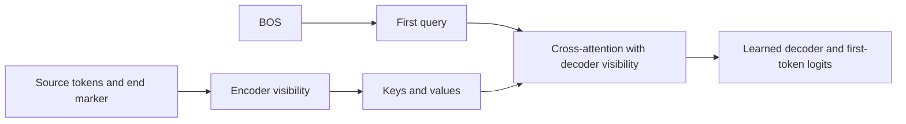

# Why can copying fail before the first token?

The model sees a source and starts its answer with BOS. In this one-block decoder, the first query is computed before reading the source. Source length can change the encoder's keys and values, and the number of positions competing for attention. It cannot change that first query within a fixed model.

For each head,

\[
s_j=q_0^\top k_j/\sqrt{d},\qquad
p_j=\frac{e^{s_j}}{\sum_{t\in M}e^{s_t}},\qquad
h=\sum_{j\in M}p_jv_j.
\]

Here M is the set of source positions the decoder may read. The encoder has its own visibility mask. Changing encoder visibility can change K and V. Changing decoder visibility holds them fixed and changes the mixture.

We keep the first six content positions and the end marker visible. We independently hide later content positions from the encoder and from decoder cross-attention. The marker stays at its long-source position in all four conditions. A separate ordinary short source checks the effect of moving it back.

| Change | What it tests |
|---|---|
| Hide extra encoder inputs only | Whether removing their contextual influence helps |
| Hide extra decoder read positions only | Whether their participation in the read causes avoidable errors |
| Hide both | Whether the combined intervention recovers the answer |

Masked encoder slots still have token residuals and are computed as queries. If the decoder is allowed to read them, their representations are not zero. A mask is an intervention on information access, not removal of model parameters.

**Measured result:** decoder-only exclusion recovers every tested long-source first-token error. Encoder-only exclusion has mixed effects. Thus the native full-source encoder already supplies representations sufficient for correct first-token prediction under the restricted read.

This does not prove that the attention denominator alone is responsible. Removing positions also removes their value contributions and changes sharpness. It does not establish wrong-key ranking, a learning cause, or recovery of the rest of the sequence. The mask uses the task's known first-token requirement; it is a diagnostic, not a deployable copy algorithm.

Competing-value failures and attention scaling already appear in [Chiang and Cholak (2022), sections 5.1-5.3](https://aclanthology.org/2022.acl-long.527.pdf), which were inspected. Our mask contrast and outcomes are local evidence, not a novel attention rule or a reproduction of their FIRST experiment.

[Measured results](copy-source-visibility-results.md) | [Frozen protocol](../../protocols/copy-source-visibility.md)
