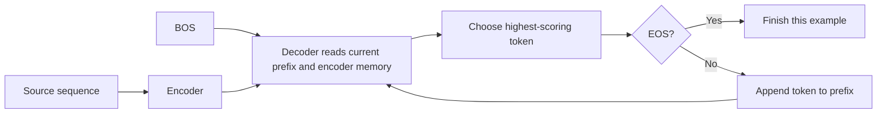

# Learning to copy a complete sequence

[Results](encoder-decoder-copy-results.md) · [Frozen protocol](../../protocols/encoder-decoder-copy.md) · [Verified encoder-decoder contract](../foundations/encoder-decoder-guide.md)

## The task

Source `[A,C,A]` should produce `[A,C,A,EOS]`. Repeated symbols are allowed. Distinct-symbol and repeated-symbol groups are scored separately. Exact inputs are held out across splits, while symbols and shorter patterns are shared.

We train on three or four content symbols. Tests at six and eight also require more decoding steps. This is a synthetic sequence task; it does not measure translation or general language ability.

## Two different ways to evaluate

| Mode | Prefix supplied to the decoder | What the score measures |
|---|---|---|
| Teacher forcing |BOS followed by correct earlier symbols |Next-token prediction under a correct prefix |
| Free-running greedy generation |BOS followed by the model's own predictions |The complete output produced by the model |

The model selects the largest next-token logit, then appends that token to its prefix. Each example stops at its first EOS. No correct answer tokens are supplied during generation. A fixed limit, source length+3 new tokens, catches missing EOS without forcing an answer.

The loop also ends at its fixed token limit. PAD, BOS and unused output classes remain possible mistakes; they are not suppressed to improve scores.

## Loss, exactness and stopping

For source `x` and target `y = [x,EOS]`, training minimizes:

`L = -(1/N) sum log p(y_t | x, y_before_t)`

HereN counts all supervised tokens, including EOS. This is the autoregressive factorization used by the [original encoder-decoder Transformer](https://arxiv.org/html/1706.03762v7).

Token accuracy can be high while complete outputs are wrong. One wrong symbol, extra symbol or misplaced EOS makes exact-sequence accuracy zero for that example. An on-time EOS only checks output length; its preceding content can still be incorrect.

| Finding | Permitted interpretation |
|---|---|
| Strong training results, weaker held-out results |A generalization gap exists; its cause is open |
| Weak training and held-out results |This recipe did not master the task |
| Strong short held-out performance, weak longer outputs |A length-transfer boundary exists under these conditions |

Teacher-forced and free-running scores use different prefixes. Their difference alone does not isolate a mechanism or prove that a particular training change will help. Perfect finite training accuracy does not prove either an exact copying algorithm or memorization.

## What is fixed

The previously audited1,888-parameter model is trained from scratch with three seeds. CPU float64 preserves the verified numerical path. The GPU is not used for this small baseline. Each run receives6,000 updates,384,000 sampled sequences and1,728,000 target tokens. Repeated exposure does not add unique examples.

All final train, validation and test pools are evaluated. The95% short criterion applies to every seed and both groups; a strong mean cannot rescue a weak group. Training and validation are shown separately so the criterion's failure is not automatically described as failure to fit training data. No failed threshold triggers further tuning.
