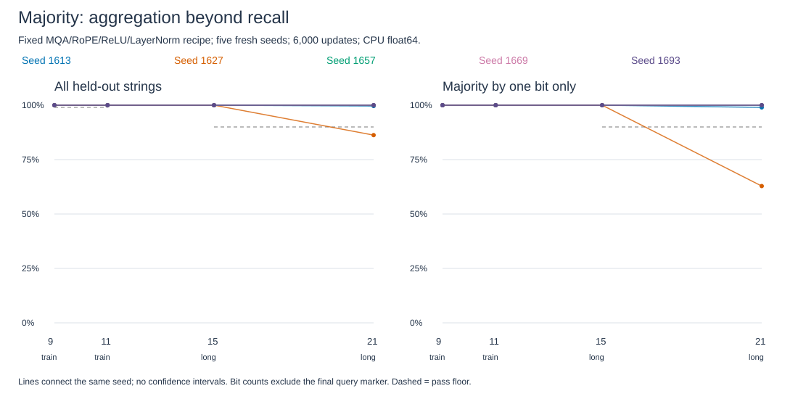

# Majority transfer: aggregation works, reliability has a boundary

**Closed.** All five seeds reach100% held-out accuracy at9,11 and15 bits. At21 bits, seed1627 scores86.25%, with62.84% on one-bit majorities. The fixed all-seed transfer rule fails. Mean accuracy97.18% does not erase that failure.

## Task and mathematics

The input contains binary tokens and a final query marker. Predict whichever bit occurs more often. Example: `0 1 1 0 1 [query] -> 1`. Odd lengths avoid ties. This requires aggregation rather than retrieving one associated value. We train from scratch; recall weights are not transferred.

For bits b_i:

\[
s=\sum_{i=1}^{n}(2b_i-1),\qquad y=\mathbf1[s>0],\qquad m=|s|.
\]

The margin m=1 means the winner appears exactly once more than the other bit. These are the closest cases to a tie. Training minimizes cross-entropy, `-log softmax(final_logits)[y]`.

An abstract attention head can represent the rule: set all Q/K scores to zero, bit values to `2b_i-1`, and the marker's value to0. Uniform softmax gives:

\[
h=s/(n+1);\qquad \mathbf1[h>0]=y.
\]

The smallest absolute h is1/(n+1). This represents majority in one abstract head. It does not reconstruct our trained network or establish its normalization/FFN mechanism. An exact integer counter also solves majority in O(n) time. Transformer training does not outperform that algorithm here.

## Method and data

The [frozen protocol](../../majority-transfer-protocol.md) fixes MQA/RoPE, width16, two pre-norm blocks, two query heads, ReLU FFN32 and LayerNorm with learned gains/biases, epsilon1e-5. New binary embeddings/readout give4,016 parameters. Five fresh seeds,6,000 Adam updates each, lr.001, batch64, alternating9/11 bits. CPU float64, one thread. No tuning or seed replacement.

Families group a string with its reverse, complement and reversed complement. Splits share none of these variants. Labels are balanced. Training uses302/1,364 strings at9/11 bits; validation74/194. Together with test, these lengths partition their complete supports. Longer tests sample200 families each. Bit counts exclude the marker.

| Bits | Test families / strings | m=1 strings | Mean accuracy | Mean m=1 accuracy | First/last-bit baseline |
|---|---:|---:|---:|---:|---:|
|9, trained length|36 /136|62|100%|100%|63.24%|
|11, trained length|128 /490|216|100%|100%|59.18%|
|15, longer|200 /798|288|100%|100%|62.16%|
|21, longer|200 /800|296|97.18%|92.36%|61.25%|

Constant prediction scores50%; exact counting scores100%. Baselines use the actual tests. Passing requires every seed>=99% at9/11 and>=90% overall and at m=1 at15/21.

| Seed | Accuracy at9/11/15 | Accuracy at21 | m=1 accuracy at21 |
|---|---:|---:|---:|
|1613|100% /100% /100%|99.625%|98.99%|
|1627|100% /100% /100%|86.25%|62.84%|
|1657|100% /100% /100%|100%|100%|
|1669|100% /100% /100%|100%|100%|
|1693|100% /100% /100%|100%|100%|

All113 errors at21 bits occur on m=1 inputs with correct label1. Seed1627 contributes110;1613 contributes3. Every tested m>=3 string is correct. Seed1627 scores100% for class0 and72.50% for class1. This localizes the failure to a class-asymmetric boundary region; its internal cause remains unknown.

## Math checks and paper comparison

[Exact checks](../../../results/majority_math.json) cover2,730 strings and28,218 single-bit flips. At odd n and m=1, exactly(n+1)/2 flips change majority; at m>=3 none do. Under uniform independent bits:

\[
\mathbb E[\#\text{label-changing flips}]
=n\binom{n-1}{(n-1)/2}/2^{n-1}.
\]

For9/11 bits this is2.46094/2.70703. Uniform attention produces zero classification errors in these rational-arithmetic checks. These mathematical witnesses are separate from trained accuracy.

[Hahn/Rofin2024, sections3/7 and appendixE](https://aclanthology.org/2024.acl-long.800.pdf) distinguishes expressivity, sensitivity and learnability. Its encoder experiments examine sharpness with MSE/AdamW and different widths/positions. Our causal classifier measures transfer with CE/Adam/RoPE. We do not measure sharpness or reproduce its theorem. Majority success cannot establish parity success or arbitrary-length extrapolation.

## Verification and closure

Pretraining output/gradient and2,560 label checks pass. Last-bit/flipped-label controls fail as intended. All five runs complete6,000 finite updates. Each uses4,224,000 tokens and46,848,000 dense attention entries per layer/head. Summed loop time204.80s includes validation, excludes checkpoint writes; this is not a speed comparison.

The [independent audit](../../../results/majority_transfer_audit.json) checks20 evaluations and11,120 predictions, split integrity, initialization, optimizer counters and replayed batch hashes. Maximum logit disagreement1.05e-13; predictions and independent metrics agree. Retained: [results](../../../results/majority_transfer.json), [data](../../../results/majority_transfer_data.json), [checkpoints](../../../results/majority_transfer_checkpoints), [prediction tensors](../../../results/majority_transfer_scores.pt), [plot data](../../../results/majority_transfer_plot_data.csv).

Five seeds share one test collection; family variants are dependent. Other distributions, longer lengths and natural language remain untested. Accuracy does not prove exact counting or permutation invariance. This recipe handles a second task and some length transfer, but reliable21-bit transfer fails. Study closed; no extra seeds, budget extension or tuning is selected.
