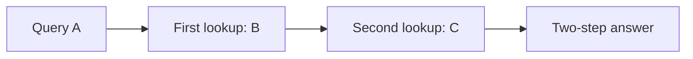

# Learning to combine two relationships

Earlier retrieval asked for one stored association. This study asks for a destination reached through one or two links. Both models receive the graph in the input; they must use its current relationships.

## Example

Graph: `A→B, B→C, C→D, D→A`. The input can list these edges in a different order.

| Query | Correct answer | What it checks |
|---|---|---|
| One step from A | B | Find A's successor |
| Two steps from A | C | Use B as the next source |

This diagram describes the correct algorithm. Accuracy alone cannot establish that a trained model implements it internally.

## Mathematics

Each context defines a successor function f. The target is `f(q)` for one step and `f(f(q))` for two. The intermediate result is an input to the second lookup.

Equivalently, let P[a,b]=1 when an edge connects a to b, and0 otherwise. The row vector `e_qᵀ Pʰ` identifies the answer for hop count h. Each source has exactly one successor, so the answer is unambiguous. Shuffling the edge list preserves P.

Training minimizes `L = -log softmax(logits)[answer]` at the final query position. Intermediate endpoints are neither supplied as inputs nor supervised. Both one-step and two-step queries are trained equally; this is not zero-shot composition.

## Why the controls matter

| Control | Purpose | Limit |
|---|---|---|
| One-step queries | Check whether ordinary lookup was learned | Success does not prove two-step computation |
| Disjoint mapping families | Test new whole graphs | Individual edges can recur across pools |
| All12 cyclic symbol renamings | Balance answer labels and group equivalent mappings | Not all possible symbol permutations or unseen symbols |
| One shuffled edge order and its reverse | Balance which required edge appears earlier | Not exhaustive order invariance |
| Full training and held-out evaluation | Separate incomplete fitting from a generalization gap | Does not identify the cause |
| Eight-edge test | Add distractors and extend the sequence | Hop count stays fixed; length and distractors change together |
| Independent graph walk and model arithmetic | Check labels, outputs, gradients and reported scores | Numerical agreement does not prove general reasoning |

The GRU carries context through a28-dimensional state. The Transformer has two16-dimensional attention blocks and can access earlier token representations. Their parameter totals are close, but their depth, normalization, width and initialization differ. A measured gap compares these complete recipes; it cannot isolate attention or recurrence as the cause.

## Relation to papers

[Vaswani et al.](https://arxiv.org/abs/1706.03762) supplies the attention architecture. The installed [PyTorch2.11 GRU definition](https://docs.pytorch.org/docs/2.11/generated/torch.nn.GRU.html) supplies the recurrent gate equations.

[Ye et al.,2025, sections2.1 and2.4](https://arxiv.org/html/2505.23653v2) study implicit composition of facts learned during training and report exposure-dependent generalization. Here the facts are explicitly supplied in each context, so our task and scores do not reproduce their experiment.

[Yehudai et al., NeurIPS2025](https://papers.neurips.cc/paper_files/paper/2025/file/4e839c9c398c58c878a394633b806ccd-Paper-Conference.pdf) analyze architecture tradeoffs for a different class of compositional questions under stated assumptions. Their results do not imply that a failure of our finite training recipe proves impossibility.

[Frozen methods and stopping rule](../../protocols/recurrent-composition.md). [Measured results](recurrent-composition-results.md).
