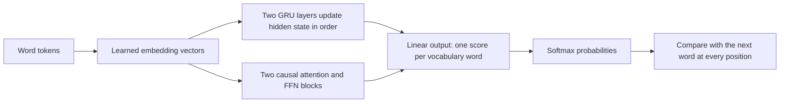

# GRU versus Transformer: predicting the next word

**[Executed result](recurrent-language-results.md):** Transformer validation PPL396.64 versus GRU597.34,33.60% lower across three paired seeds. Both beat unigram; all24 final pools pass independent loss audit. Loss was still falling at the budget limit, so the eventual ranking remains unknown. Study closed.

Language prediction asks for a probability distribution over the next word. Unlike the retrieval study, every input position receives a target.

| Input | Target |
|---|---|
| the | cat |
| the cat | sat |
| the cat sat | row-end token |

The model only sees the prefix at each position. Our data use words, not subwords:33,278 training-vocabulary entries, including unknown and row-end tokens.

## How the models use context

The GRU carries a16-component vector per layer. Its gates mix old state and a candidate state. See the [gate equations](recurrent-state-guide.md#the-update-in-a-few-equations). The Transformer uses contextual word vectors and `softmax(QK^T/sqrt(8)+mask)V`, followed by the existing residual/normalization/FFN operations. Neither design guarantees good language prediction.

## What the loss means

For target word y, `loss = -log p(y | available prefix)`. Average over the scored tokens, then `perplexity = exp(mean loss)`. Lower is better. Perplexity measures assigned probabilities, not the percentage of correct guesses or a claim about reasoning. Top1 accuracy is reported separately.

Our unigram baseline uses `(training_count(word)+1)/(training_tokens+vocabulary_size)`. It ignores word order. Beating it shows that the trained model predicts this corpus better than that fixed baseline; it does not identify the model's internal algorithm.

## What is controlled?

Both models have two processing layers and width16. Embedding/output matrices start at identical values; paired runs receive identical training windows. Each gets6,000 updates with64 input words and all next-word targets supervised. Initial processing weights and architecture details differ. Nearly equal total parameter counts hide a17.07% difference in processing-core size because the large vocabulary matrices dominate.

The earlier GRU studies used one hidden28 layer for state tracking and one hidden27 layer for retrieval. This language study uses two hidden16 layers so both models share the16-wide vocabulary readout. These are different complete model/task recipes, not one unchanged GRU evaluated across all tasks.

Hidden state/context resets for every window. This comparison does not test a GRU carrying state through a whole document. The128-word test provides more context before a reset than the64-word test. Its changed context and position exposure prevent a pure length-transfer interpretation.

Training fit uses a fixed65,536-target subset spread across the training stream. It is not the full training pool. Validation/test include every next-word target once, including unknown and row-end words. Separate group scores expose whether common special tokens hide weaker ordinary-word prediction.

The [frozen protocol](../../protocols/recurrent-language.md) sets three paired seeds and a validation-based decision. Stop at the budget, retain weak runs and check losses independently. Reused WikiText-2 splits and tiny models limit claims beyond this setup.

Sources: [Merity et al., WikiText construction and evaluation](https://arxiv.org/html/1609.07843v1), [PyTorch2.11 GRU convention](https://docs.pytorch.org/docs/2.11/generated/torch.nn.GRU.html), and [Vaswani et al., attention](https://arxiv.org/html/1706.03762v7). We use their definitions; this study does not reproduce their published model results.
