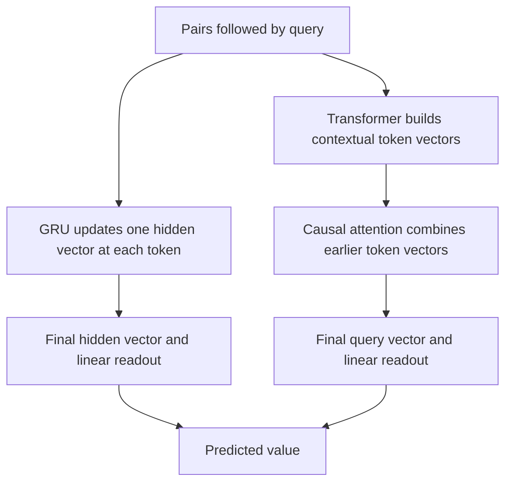

# GRU versus attention: retrieving an association

**[Executed result](recurrent-retrieval-results.md):** Transformer six-pair R/U-balanced mean97.82%, GRU23.36%. The GRU also fits short training examples poorly. This reverses the state-study ranking within these two tested setups, without identifying a universal winner.

State tracking asks for the current state after updates. Retrieval asks which stored value belongs to a query. A model can succeed at one and struggle at the other.

## What is a pair?

Example: `A:2, B:5, A:4, QUERY A`. The answer is4, because the latest A replaces the earlier A. Query B instead, and the answer is5. These are symbolic input associations, not learned attention K/V vectors.

| Query type | Required behavior | Shortcut checked |
|---|---|---|
| Repeated key, A | Find its latest value | First-match retrieval gives the wrong answer |
| Unique key, B | Select its only value | Returning the final context value ignores the query |

Every context is queried at every distinct key. Training uses3/4 pairs; six pairs tests longer inputs. Families stay within their assigned split, including their reordered and value-renamed variants. The dataset was used before, so this is not an untouched benchmark.

## Two ways to carry the information

The GRU updates `h_t = GRU(embedding(token_t), h_(t-1))`, starting from zero. The [gate equations](recurrent-state-guide.md#the-update-in-a-few-equations) describe how old state and a candidate mix. This vector must retain information useful for the later query. We do not assume each component stores one pair.

Attention computes `A = softmax(Q K^T / sqrt(8) + causal_mask)` and `H = A V`. Q/K receive RoPE. Our Transformer has two query heads sharing one K/V head, plus residual, normalization and FFN operations. Attention access does not by itself prove correct retrieval or reveal a learned algorithm.

Both models predict19 token classes. Their loss is `-log softmax(logits)[correct_value]` at the final query position only. No intermediate labels are provided. Thus this comparison changes both task and supervision relative to the earlier state study; cross-task score changes cannot isolate either factor.

## What would the result mean?

| Observation | Supported interpretation |
|---|---|
| Low training and test accuracy | This recipe did not master the task within budget |
| High training, weaker same-length test | A generalization gap exists |
| Strong short performance, weaker six-pair test | Length transfer fails under these conditions |
| One architecture consistently better | A scoped advantage for that complete model/training package |

The models have4,544 versus4,462 parameters, a1.80% difference. Shared initial embeddings and batches control some variation. Different hidden widths, normalization and computational structure remain. Equal updates are not equal compute; three seeds do not establish an overall architecture winner.

[Frozen protocol](../../protocols/recurrent-retrieval.md). Sources: [Cho et al., recurrent encoder-decoder](https://aclanthology.org/D14-1179.pdf), [PyTorch2.11 GRU equations](https://docs.pytorch.org/docs/2.11/generated/torch.nn.GRU.html), and [Vaswani et al., attention](https://arxiv.org/abs/1706.03762). These motivate the mechanisms, not the outcome of our experiment.
