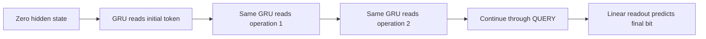

# GRU versus Transformer: how state is carried

Both models receive the same initial bit, operations and QUERY token. Both learn from final and intermediate state labels. Their architecture differs.

| Feature | Transformer control | GRU baseline |
|---|---|---|
| Sequence processing | Two causal attention/FFN blocks | One learned update repeated across tokens |
| Representation | Width16 token vectors | Width28 recurrent hidden vector |
| Order | Causal attention and RoPE | Sequential hidden-state updates |
| Parameters |4,080|4,032|
| Target feedback | Final CE + mean operation CE | Identical objective and label count |

Attention can use earlier token representations. A GRU compresses past information into its hidden vector. These are different ways to carry information; neither structure guarantees that training learns our state rule.

## The update in a few equations

Let `x` be the current token embedding and `h` the previous hidden vector. PyTorch's GRU computes:

`r = sigmoid(W_ir*x + b_ir + W_hr*h + b_hr)`

`z = sigmoid(W_iz*x + b_iz + W_hz*h + b_hz)`

`c = tanh(W_in*x + b_in + r * (W_hn*h + b_hn))`

`h_next = z*h + (1-z)*c`

Products outside matrix multiplication are elementwise. The reset gate `r` controls the recurrent contribution to the candidate. The update gate `z` mixes old state and candidate; a value near1 preserves more of the old component. Gate values themselves depend on `h`, so the full gradient is more than the direct factor`z`. Good gradient flow or long memory is not guaranteed.

These learned continuous gates are not the task's symbolic SET/FLIP operations. The model must learn how token inputs produce useful updates. Its hidden vector is not assumed to equal the true bit.

Targets supervise predictions but never enter this input chain. Every new example starts from zero hidden state.

## What is controlled?

Each fresh seed pair shares initial embedding values and sampled training batches. The remaining parameters differ in shape and initialization. Both get3,000 updates and the same supervision. Comparable parameter count does not equalize hidden-state dimension, normalization, position handling, optimization difficulty or computation.

For total token length`L`, our dense forward MAC estimates are`3616L+64L^2` for the Transformer and`3752L` for the GRU. These count projections and attention products, excluding nonlinearities, normalization, elementwise gates and backward work. Sequential execution can also affect runtime. Counts alone do not establish speed.

## How to interpret the outcome

First inspect training fit and short held-out accuracy. Strong long-input results support this specific model/task combination. If short fitting differs, the comparison combines learning and extrapolation differences. Even a clear GRU win cannot identify recurrence alone as the cause: several architectural properties changed together.

The [frozen protocol](../../protocols/recurrent-state.md) fixes one model per architecture, three seed pairs and a stopping rule. The [original GRU paper, sections2.1/2.3](https://aclanthology.org/D14-1179.pdf) supplies the recurrent idea. [PyTorch2.11 documentation](https://docs.pytorch.org/docs/2.11/generated/torch.nn.GRU.html) defines our exact gate convention: reset is applied after the recurrent projection, which differs from the original paper. This experiment does not replicate its translation results.

**Observed outcome:** [all three GRU seeds score100%](recurrent-state-results.md) on every evaluated group through24 operations. The Transformer controls still fit difficult short groups incompletely and score near50% on hard long-input tests. The scoped GRU performance rule passes; equal short-task fitting does not. This supports the complete GRU package for this task/budget, without isolating recurrence alone.
