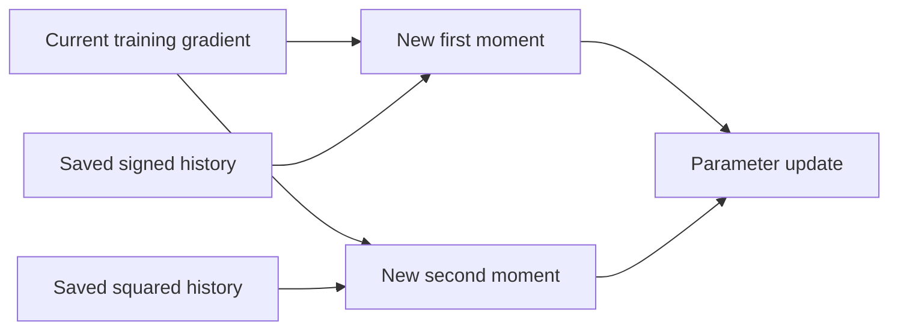

# What saved Adam momentum changes

Executed 2026-10-03. Three saved independent-exposure checkpoints; training pools only. Six one-step optimizer probes on disposable copies, no training continuation or saved-checkpoint changes. [Protocol](../../protocols/state-adam-momentum.md) | [Source](../../../experiments/state_adam_momentum.py) | [Raw results](../../../results/state_adam_momentum/report.json) | [Every group](../../../results/state_adam_momentum/metrics.csv).

**Saved momentum changes the local learning direction. For seed 3023 it turns this hypothetical update into an ascent step. Clearing its first-moment history reverses that. For weak seed 3019, clearing that history still does not remove the loss/invariance tradeoff.** Neither observation establishes a continued-training repair or explains the historical seed ranking.

## How Adam uses history

Adam stores two optimizer variables for each parameter. The first moment m averages recent signed gradients. The second moment v averages squared gradients and rescales the update. These variables are saved separately from model weights.

For supplied gradient g, the next-step equations are:

`m_new = 0.9*m_old + 0.1*g`

`v_new = 0.999*v_old + 0.001*g²`

`u = -lr * [m_new/(1-0.9^t)] / [sqrt(v_new/(1-0.999^t)) + epsilon]`.

Operations are coordinatewise. Here t=6001, lr=0.0001 and epsilon=1e-8. Compare **saved_m** with **zero_prior_m**, which zeros only m_old. Both retain v_old, the step counter and all other settings. This does not disable momentum for a complete training run.

Use the exact mean length-8 gradient, because lengths previously alternated and the hypothetical next length is 8. Its group weights are 1/3 reset-free, 1/3 mixed, 1/6 reset agree and 1/6 disagree. Adam applied to this mean is not the mean Adam update over random minibatches. The original budget ended at step 6000; this is a controlled probe, not an assumed next training step.

## Does the update lower the objective?

The direction slope is `g_cycle dot (u/||u||)`, evaluated against the original expected objective across both lengths. Negative means locally decreasing CE. Symmetric probes at equal tiny parameter distance check direction independently of step size. The last column instead applies each full hypothetical update at the saved learning rate.

| Seed | First-moment condition | Cycle CE slope | Full-probe cycle CE change |
|---|---|---:|---:|
| 3011 | Saved | -0.263558 | -0.000275458 |
| 3011 | Zero prior m | -0.306662 | -0.000032156 |
| 3019 | Saved | -1.191671 | -0.002220639 |
| 3019 | Zero prior m | -1.249986 | -0.000314286 |
| 3023 | Saved | +0.635846 | +0.001024659 |
| 3023 | Zero prior m | -1.339519 | -0.000453050 |

The length-8 objective has the same slope signs. Seed 3023's saved direction raises loss in all eight groups; zeroing prior m lowers all eight. This isolates a local first-moment effect with the same second-moment denominator. Seed 3023 was a stronger fitted model, so this cannot explain why seed 3019 was weakest.

Zeroing prior m shrinks update norms: saved/zero are 0.001211/0.000106, 0.002368/0.000261 and 0.001372/0.000357 across seeds. Therefore larger full-step CE reductions do not establish a better direction. With prior m zero, the positive denominator makes the supplied length-8 gradient a descent direction by construction; improvement of the cycle objective is separately measured.

## Weak-seed reset behavior remains mixed

At length 12, reset-disagree training accuracy was 79.49%. For pairs with the same reset/suffix/answer and opposite initial bits, baseline both-correct rate was 78.125% and mean absolute class-1 probability difference was 0.2138905.

| Seed 3019 full probe | Disagree-group CE change | Probability sensitivity change | Both-correct rate |
|---|---:|---:|---:|
| Saved m | +0.002366030 | +0.003903028 | 77.92969% |
| Zero prior m | -0.000238171 | +0.000151457 | 78.32031% |

Clearing the first moment improves this group's CE and one pair's joint correctness, yet probability sensitivity still increases. Tiny equal-distance probes also increase length-12 sensitivity in both conditions. Thus clearing first-moment history is insufficient to make CE descent imply reset invariance.

Across all 2,560 training inputs, saved probes rescue/harm 1/1, 8/5 and 0/1 examples; zero-prior-m probes rescue/harm 0/1, 1/1 and 0/0. These are unweighted counts, not a matched multi-step quality comparison. No tiny probe changes an original class prediction.

## Evidence and limits

All six Adam probes match independent scalar update/moment equations: maximum displacement error 2.17e-16; moment error 2.78e-17. Update differences equal the isolated saved-m contribution within 2.87e-16. Reversed update signs are detected. All 48 group finite differences pass, maximum slope error 4.39e-9.

All 53,760 baseline/probe example evaluations match independent normalization/RoPE/causal SDPA, with zero native/reference argmax changes. Maximum logit error 8.71e-14, scalar metric error 7.78e-16. Baseline logits match the previous diagnostic exactly. Labels, scalar prediction/pair reductions and parameter restoration pass; targeted prior artifacts remain unchanged. Prediction counts are not additional training seeds.

[PyTorch 2.11 Adam equations](https://docs.pytorch.org/docs/2.11/generated/torch.optim.Adam.html), matching the installed version, define the verified update. The earlier [Adam primary-paper reference](https://arxiv.org/abs/1412.6980v9) supplies the method's context. This is not a paper benchmark reproduction, a stochastic-update replay or a convergence result.

Close the local optimizer diagnostic here. Momentum can change a saved checkpoint's direction, but it is not a sufficient explanation or remedy for the weak seed. A further learning claim requires a separately frozen multi-step training intervention and confirmation, not more one-step subdivisions. Longer-input transfer remains unresolved.
