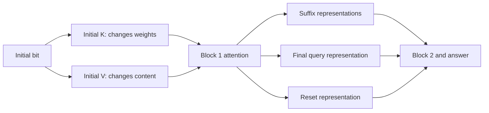

# How block 1 carries the initial-bit effect

Executed 2026-10-03, three saved independent-exposure checkpoints, no training. [Frozen protocol](../../protocols/state-block1-transport.md) | [Source](../../../experiments/state_block1_transport.py) | [Raw evidence](../../../results/state_block1_transport/report.json) | [Every metric](../../../results/state_block1_transport/metrics.csv).

**The initial cue enters other tokens through block-1 attention. Its K and V changes act together; the weak seed's effect reaches suffix representations and the final query.** This explains a transport route in the saved model, not why training learned it or how to repair it.

## What K and V change

For a noninitial query at position j:

`p(j,t) = softmax_t(q_j · k_t / sqrt(8))`

`h_j = sum_t p(j,t) v_t`.

Matched inputs differ only at initial position 0. Before block-1 attention, every noninitial q_j and residual is identical between the two inputs. Changing k_0 changes its attention score and the softmax denominator, so weights on other keys can also change. Changing v_0 changes the content supplied by that source while keeping its weights fixed.

Replace initial K, V or both with the opposite-initial-bit donor values, then recompute the FFN and block 2. This is done within each saved model, in both pair directions. We preserve initial row 0's outgoing state unless explicitly testing that route.

The diagram shows tested destination groups. Suffix transport concerns eleven positions; RESET and query each concern one, so group rates do not rank individual tokens.

## Which substitutions recreate the donor class?

Test length 12 has 512 directional inputs. The following rates use only baseline class-changing directions: 8/120/12 for seeds 3011/3019/3023, corresponding to 4/60/6 distinct pairs. Small stronger-seed denominators limit comparisons. Donor agreement is not correct-answer accuracy.

| Block-1 intervention | Seed 3011 | Seed 3019 | Seed 3023 |
|---|---:|---:|---:|
| Initial K to all noninitial readers | 50.00% | 30.00% | 41.67% |
| Initial V to all noninitial readers | 50.00% | 70.83% | 58.33% |
| Initial K/V to all noninitial readers | 87.50% | 92.50% | 100.00% |
| Initial K/V to RESET reader only | 12.50% | 9.17% | 8.33% |
| Initial K/V to suffix readers only | 87.50% | 47.50% | 25.00% |
| Initial K/V to final query only | 12.50% | 45.83% | 75.00% |
| Initial K/V through head 0 only | 62.50% | 55.00% | 25.00% |
| Initial K/V through head 1 only | 37.50% | 50.83% | 75.00% |
| Initial outgoing state only | 12.50% | 7.50% | 0.00% |

The weak seed also shows joint transport on training inputs: K 26.11%, V 72.78%, K/V 93.89%, among 180 directional class-changing cases. This is not solely held-out behavior.

The source K/V projections are shared across MQA heads. Head-specific patches artificially change which head receives donor K/V; they do not establish separate learned source memories. Both heads and multiple destination groups affect behavior, so no single exclusive carrier is established.

## These effects interact and can harm answers

For seed 3019 test inputs, combined K/V donor-gap recovery is 77.73%, compared with -24.24% for K and 17.48% for V alone. Recovery is the earlier aggregate distance-to-donor measure, `1 - sum(|g_patch-g_donor|)/sum(|g_original-g_donor|)`, with g=logit1-logit0. A negative value means farther from donor gaps. These rates are not additive causal responsibility.

| Weak-seed condition | Accuracy on all 512 inputs | Rescued | Harmed |
|---|---:|---:|---:|
| Original | 85.16% | 0 | 0 |
| K alone | 65.04% | 17 | 120 |
| V alone | 67.19% | 46 | 138 |
| K/V jointly, noninitial readers | 83.98% | 59 | 65 |

Separating K and V produces mixed activations the model may never have seen. It often harms predictions outside the original class-changing subset. The result supports joint dependence in this intervention setting; it does not recommend deleting or independently modifying K or V, or establish that their joint patch is a task repair.

## What the controls establish

Joint K/V replacement recreates every noninitial block-1 outgoing state of the matched donor exactly. This follows from identical noninitial embeddings/Q, shared other K/V and tokenwise FFN/normalization. It is an arithmetic control, not a new learned property. The initial row remains different; replacing its outgoing state too recreates donor final logits exactly. Omitting that replacement leaves differences of 0.39 to 6.50 logit units across the six seed/pool cells.

All 55,296 baseline/patched example evaluations match independent normalization/RoPE/causal-SDPA equations, zero argmax changes. Maximum patched logit error is 1.03e-13; block-1 state error is 1.78e-15; scalar metric error is 1.71e-12. Original logits match archives within 1e-10. Sham, noninitial-state and full-donor reconstruction controls pass. Independent reductions and prior last-block initial-K/V equivalence are checked from saved logits. Targeted sources, reports, inputs and checkpoints remain unchanged.

Scope: three saved seeds, previously opened train/test length-12 inputs and eleven frozen conditions. No long-input patching, training repair, convergence or exclusive-circuit claim. The earlier [initial-bit path study](state-initial-paths-results.md) links this source transport to block-2 residual and attention routes. Its primary-source discussion of patching limitations remains applicable; no additional literature reproduction is claimed.

## Where this leaves the question

We now have an explanatory chain: correlated exposure encourages cue dependence; independent exposure reduces it; the remaining effect is transported through block-1 K/V into other token representations and through block-2 residual/attention to the readout. The exposure comparison supports a contributor, not a sole training cause. Internal initial-bit retention can be legitimate; the failure is its effect on answers after a SET.

Stop this transport branch here. Finer token/neuron searches are not selected. What remains unresolved is why optimization leaves that answer dependence and why longer inputs fail differently across seeds. Those need a distinct question and intervention, not another subdivision of the same patch table.
