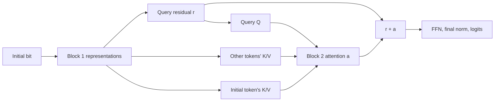

# Where does the initial-bit effect travel?

Executed 2026-10-03, saved independent-exposure models only. [Protocol](../../protocols/state-initial-paths.md) | [Source](../../../experiments/state_initial_paths.py) | [Raw results](../../../results/state_initial_paths/report.json) | [All metrics](../../../results/state_initial_paths/metrics.csv).

**At the second block, the weak seed's initial-bit effect is carried through the query residual and attention using other token representations. Swapping only the initial token's K/V recreates little of the class effect.** This localizes sensitivity at a block boundary; it does not identify an exclusive circuit or explain why training learned it.

## What gets replaced?

Recipient and donor differ only in the initial bit. Their reset, suffix and correct answer match. Donors come from the same model, in both directions. We substitute activations, not weights.

At the last query in block 2, let r be the incoming residual and a the projected attention output:

`t = r + a`

`z = t + W2 ReLU(W1 LN2(t) + b1) + b2`

`logits = Wout LNfinal(z)`.

Replace r, a, or both; then recompute the FFN and normalization. Residual here means block 2's skip path. It can already contain initial-bit information delivered by block-1 attention and transformed by its FFN.

The diagram shows available paths, not a discovered minimal circuit. Other tokens include RESET, suffix positions and the final query.

## Which swaps recreate the donor's class?

Only inputs whose original and donor classes differ enter this table. Test length 12 has 512 directional inputs per model, but just 8/120/12 class-changing inputs for seeds 3011/3019/3023. These correspond to 4/60/6 distinct initial-flip pairs, so the stronger-seed percentages have small denominators.

| Block-2 substitution | Seed 3011 | Seed 3019 | Seed 3023 |
|---|---:|---:|---:|
| Query residual | 25.00% | 42.50% | 58.33% |
| Attention output | 75.00% | 57.50% | 41.67% |
| Query Q only | 0.00% | 5.00% | 0.00% |
| Initial token K/V | 12.50% | 7.50% | 0.00% |
| All other tokens K/V | 75.00% | 62.50% | 41.67% |
| Residual + attention, control | 100.00% | 100.00% | 100.00% |

Replacing all Q/K/V reproduces the attention-output substitution. Replacing residual and attention together reproduces donor logits by construction; its 100% is a correctness control, not a research discovery.

Seed 3019 shows the same ordering on training inputs: initial K/V 6.11%, other K/V 67.22%, among 180 directional class-changing inputs. Thus the test finding is not purely a held-out phenomenon. Other K/V and the query residual were built from block-1 representations. Only attention mixes tokens in that block; its FFN and normalization operate tokenwise. Initial-bit effects at other positions therefore passed through block-1 attention. This does not identify a particular head, token or neuron as solely responsible.

## Continuous effects do not add up

Let g be `logit1 - logit0`. Define aggregate recovery as `1 - sum(|g_patch-g_donor|)/sum(|g_original-g_donor|)`. It measures movement toward donor gaps across all inputs, not accuracy or a fraction of causal responsibility. Negative means farther from the donor; no per-example division is used.

For seed 3019 test inputs, recovery is 25.03% for residual, 19.97% for attention, 0.71% for initial K/V, and 23.92% for other K/V. Both is effectively 100%. Nonlinear downstream computations and mixed activation combinations prevent treating isolated effects as additive contributions.

These patches are not a repair. Weak-seed accuracy is 85.16% originally, 82.81% with residual-only or attention-only substitution, and 85.94% with other K/V. Donors have the same true labels, but can carry the model's own mistakes. Recreating donor behavior is distinct from improving correctness.

## Attention inspection and verification

Weak-seed block-2 query heads put mean initial-token weights of 0.27%/1.93%, while block-1 heads put 17.42%/7.03%. These descriptive weights are consistent with earlier transport but do not establish it alone. [All per-head source weights](../../../results/state_initial_paths/attention.csv).

All 41,472 baseline/patched evaluations match separate normalization/rotation/SDPA equations within 1e-10, with zero argmax changes. Captured residual/attention/Q/K/V/weight tensors also agree. Sham, both-equals-donor and all-QKV-equals-attention controls pass in all six seed/pool cells. Intentionally omitting attention breaks donor reconstruction by 4.04–8.05 logit units. Independent scalar metrics agree within 1.71e-12; targeted sources/data/reports/checkpoints remain unchanged.

Scope: three saved seeds, train/test length-12 inputs already opened, eight fixed conditions. Activation mixtures may be outside the learned distribution. Internal representations may retain the initial bit; the task requires the final answer to ignore it after a SET. The precise block-1 source and downstream amplification remain unresolved; no retraining, architecture change or automatic extension is selected.

[Zhang and Nanda, ICLR 2024](https://proceedings.iclr.cc/paper_files/paper/2024/hash/06a52a54c8ee03cd86771136bc91eb1f-Abstract-Conference.html), abstract-screened, show that patching metrics and intervention methods can change localization conclusions. This motivates reporting class effects and continuous gaps separately; it does not validate our circuit interpretation or constitute a paper reproduction.
