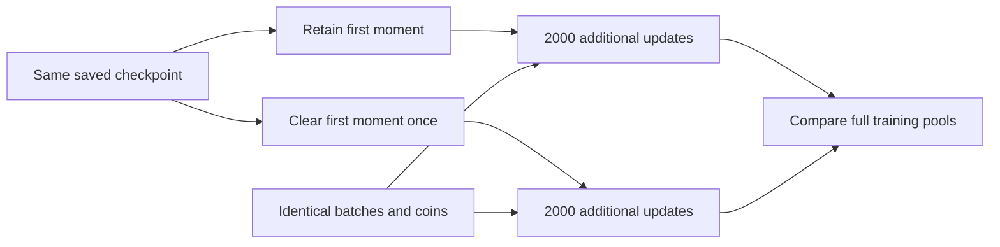

# Does clearing momentum help after more training?

Executed 2026-10-03. Three paired continuations, six actual training runs. [Protocol](../../protocols/state-momentum-training.md) | [Source](../../../experiments/state_momentum_training.py) | [Results](../../../results/state_momentum_training/report.json) | [All 48 final groups](../../../results/state_momentum_training/metrics.csv) | [Numerical audit](../../../results/state_momentum_training/audit.json).

**Both arms substantially improve the weak seed's training fit. Clearing first-moment history once adds only one correct length-12 disagree example over the retained control. It slightly worsens weighted CE in the other two seeds. Neither recipe passes the full training-fit gate, so no confirmation candidate is selected.**

## What changed, and why this comparison matters

Start both arms from the same saved weights, second moments, optimizer step and random-generator states. Retained keeps the first moment; clear_once sets it to zero once. Then both train normally on identical batches and augmentation coins for 2,000 additional updates at the final learning rate .0001.

Model, loss and reset exposure stay fixed. Each arm adds 128,000 supervised examples and 1,536,000 input tokens, reaching 8,000 total updates. Earlier runs remain preserved.

Adam rebuilds momentum after clearing. The direct old-history coefficient is `0.9^t`, about 7e-10 after 200 updates. Later gradients depend on the changed parameter trajectory, so differences need not decay at that rate. [Adam equations](state-adam-momentum-results.md#how-adam-uses-history).

## Full training fit

Worst-group accuracy is the minimum across eight cells covering 2,560 training-support inputs. Eligibility requires >=99% in every cell and seed; worst-cell CE selects only among eligible recipes.

| Seed | Starting worst group | Retained, final | Clear once, final |
|---|---:|---:|---:|
| 3011 | 97.66% | 98.44% | 98.44% |
| 3019 | 79.49% | 94.92% | 95.12% |
| 3023 | 97.85% | 98.83% | 98.83% |

Limiting groups: length-8 disagree for 3011, length-12 disagree for 3019, length-12 mixed for 3023. Cleared 3023's length-12 agree ties its minimum. The CSV includes every cell. Both recipes fail eligibility.

| Seed | Final weighted CE, retained | Final weighted CE, clear once |
|---|---:|---:|
| 3011 | 0.011478 | 0.011501 |
| 3019 | 0.066341 | 0.065621 |
| 3023 | 0.012872 | 0.013508 |

Weights remain 1/6 per reset-free/mixed cell and 1/12 per agree/disagree cell. Clearing has mixed effects. Seed 3023's locally uphill probe did not predict a better cleared trajectory after 2,000 updates.

## What improved in the weak seed?

Length-12 training has 512 matched initial-bit pairs. Each pair has identical reset, suffix and answer. Both-correct requires both initial variants to be answered correctly. Probability sensitivity measures their mean absolute class-1 probability difference.

| Seed 3019, training length 12 | Disagree accuracy | Both-correct pairs | Probability sensitivity |
|---|---:|---:|---:|
| Starting checkpoint | 79.49% | 78.13% | 0.213890 |
| Retained continuation | 94.92% | 93.95% | 0.067502 |
| Clear-once continuation | 95.12% | 94.14% | 0.062136 |

Retained gains 15.43 percentage points on disagree examples; clear_once gains 15.63. Their difference is 0.1953 points, one example out of 512. Added training under this continuation helps much more than the first-moment intervention. It does not establish an optimal budget or convergence.

Across all training inputs, clearing rescues/harms 1/0, 3/1 and 0/1 examples relative to retained, by seed. These are unweighted counts; a net gain can coexist with newly introduced errors.

Progress is not monotonic: weak-seed disagree scores fall near 76% after 50 updates. At 1,000 updates retained is 90.23%, cleared 89.65%; their final ordering reverses. All seven observations are saved, but only the frozen final endpoint determines selection.

## Evidence, scope and stopping

All six runs complete 2,000 added updates. Starting weights, streams, exposure counts, generator states and optimizer counters/rate pass. A separate sampler reconstruction checks 384,000 paired-stream labels by a backward reset/parity rule. All first-step gradients/Adam updates pass independent equations; wrong-label controls are detected.

All 48 final cells/15,360 predictions match independent model equations within 9.69e-14, zero argmax changes. Scalar reductions verify 107,520 trajectory predictions, errors <=5.86e-17. Intermediate model equations were not separately replayed from saved weights. Parent artifacts remain unchanged.

CPU float64, one thread, batch 64, 4,080 parameters. Complete-step profiles include 36 Adam states/65,424 tensor bytes. GPU allocation is zero; CPU peak memory unmeasured. Loops total about 179 seconds including measurements/checkpoints, not a speed benchmark. [Verified Adam equations](https://docs.pytorch.org/docs/2.11/generated/torch.optim.Adam.html) are reused.

Validation/test were not evaluated. These three inspected checkpoint pairs are development evidence. Held-out improvement and length transfer remain unestablished. Close one-time momentum development here: no extra updates, tuning, best-checkpoint selection or confirmation after the failed fit gate.
