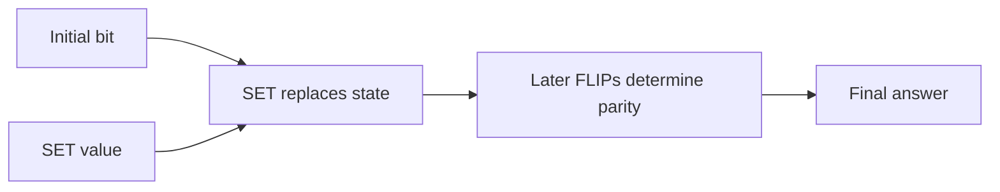

# Does removing a reset cue improve state tracking?

Executed 2026-10-03: three fresh matched pairs, six completed runs. [Frozen protocol](../../protocols/state-reset-exposure.md) | [Source](../../../experiments/state_reset_exposure.py) | [Raw report](../../../results/state_reset_exposure/report.json) | [Every accuracy and CE](../../../results/state_reset_exposure/metrics.csv).

**Removing the initial/reset correlation improves disagreeing-input accuracy in all three pairs. It does not reliably solve reset handling or length transfer.** The architecture is unchanged. All adoption criteria remain frozen and adoption fails.

## Results on held-out twelve-operation suffixes

Each agree/disagree cell contains 256 examples. Both-correct checks the same 256 suffix/reset pairs under both initial values.

| Seed | Control agree | Control disagree | Independent agree | Independent disagree | Independent both correct |
|---|---:|---:|---:|---:|---:|
| 3011 | 84.77% | 14.84% | 98.44% | 98.44% | 97.66% |
| 3019 | 95.70% | 5.47% | 95.70% | 74.61% | 73.44% |
| 3023 | 95.31% | 17.58% | 98.44% | 98.44% | 97.27% |

Paired disagree gains are **83.59/69.14/80.86 percentage points**. Initial-bit changes alter 71.48%/93.36%/78.52% of control predictions, versus 1.56%/23.44%/2.34% with independent exposure. This supports training correlation as a contributor to cue dependence; it does not identify the internal circuit.

## Fitting and longer inputs still limit the conclusion

The >=99% gate applies to every training-support cell. The control excludes disagreeing long-tail inputs it never sees; the independent arm includes them. Both see the same original no-reset/mixed groups.

| Seed | Control worst fit | Independent worst fit | Independent test-24 both correct | Behavioral rule |
|---|---:|---:|---:|---|
| 3011 | 90.23% | 97.66% | 29.30% | Pass |
| 3019 | 91.02% | 79.49% | 42.58% | Fail |
| 3023 | 92.77% | 97.85% | 42.97% | Pass |

Behavioral rule requires >=20-point disagree gain and >=90% both-correct at test length 12 in every seed. Seed 3019 misses the second requirement and has incomplete disagree training fit. Its weakness is not purely held-out transfer. All six training-fit gates fail, so adequacy-qualified adoption also fails. At length 24, all three treatment models remain weak despite strong shorter scores in two seeds. No universal state-tracking algorithm, convergence or architectural impossibility is established.

## Why the initial bit should not matter

For a sequence beginning with SET, the correct answer is:

`last SET value XOR (number of later FLIPs mod 2)`.

The initial bit disappears from this equation. Earlier long-tail training examples always made it equal the first SET value. A model could use the initial bit as a substitute and still score well on that distribution.

| Initial bit | Operations | Correct answer |
|---|---|---:|
| 0 | SET0, FLIP, KEEP | 1 |
| 1 | SET0, FLIP, KEEP | 1 |

Replacing state means that either initial value must lead to the same answer once SET and the suffix are fixed. It does not require that every internal representation forget the initial bit.

## What changes during training?

Both arms use the same sampled suffixes, reset values, targets, starting weights and learning-rate schedule. The control retains the original initial/reset correlation. The treatment flips the initial bit on half the sampled long-tail examples in expectation. Labels stay unchanged. No-reset and mixed-reset examples stay unchanged.

This is a training-exposure intervention. Architecture, supervision and example count stay fixed, but the treatment encounters more distinct full inputs. Independence holds by the sampling rule, with finite empirical combination counts reported separately.

## How to read the measurements

Agree and disagree refer to the initial bit and the first SET value. Accuracy on disagreeing examples checks whether the old correlation is required. Both-correct accuracy requires correct answers for both initial values of the same suffix/reset example. Class invariance alone is insufficient: a model can consistently return the wrong answer.

Full training-support accuracy separates incomplete fitting from transfer failure. Validation/test suffixes are disjoint from training and from each other within each length. Eight-operation disagree validation accuracy is 93.75%/96.88%/96.88%; test accuracy is 98.44%/92.19%/95.31%. Twelve-operation disagree validation accuracy is 97.66%/78.91%/99.22%; test scores appear above. These are held out from these runs. Of newly split held-out suffixes, 48/48 at length 8 and 17/192 at length 12 occurred in historically inspected pools; none of the 128 length-24 suffixes did. No-reset/mixed guard pools are reused explicitly. This is not untouched project-wide confirmation.

## Budget, verification and stopping

Same 4,080-parameter model and .001 warmup/cosine schedule in both arms, 6,000 updates at batch 64. Each run processes 384,000 examples/final targets and 4,608,000 input tokens; total 2,304,000 targets. CPU float64, one thread, Python 3.14.7/PyTorch 2.11.0+cu128. Complete-step profiling allocates all Adam states, 65,424 tensor bytes. GPU allocated/reserved bytes are zero; CPU peak unmeasured. Loops plus periodic full-training evaluation took 314.05 seconds, excluding setup/final evaluation/audit. No speed comparison.

All 5,056 evaluation labels agree with independent parity/reset and recurrent rules; constant baselines score 50%. The wrong initial-plus-suffix-parity rule fails on 1,376 labels. Three initialization output/gradient cases and wrong-label gradient controls pass. All 156 final cells and 30,336 predictions match independent full-model equations, zero argmax changes, maximum logit error 8.62e-14. Python scalar CE/accuracy error <=4.00e-15; paired-reset metric error <=6.67e-16. Six initializations/index/coin streams, optimizer steps/rates and exposure counts are verified. Treatment disagree exposure is approximately half in both lengths; controls have zero. Targeted historical artifacts remain unchanged. [Independent audit](../../../results/state_reset_exposure/audit.json).

Six runs complete the declared budget. No architecture change, replacement seed or extra training is selected. The remaining explanatory question is why seed 3019 still responds to the irrelevant initial cue after independent exposure. Inspect its saved checkpoint before another training search. Original results remain valid for their original correlated distribution, with the narrower interpretation now explicit.

## Relation to papers

[Liu et al. (ICLR 2023)](https://www.microsoft.com/en-us/research/publication/transformers-learn-shortcuts-to-automata/) establish that Transformers can represent and learn finite-state computations in their settings. Their computational shortcuts mean fewer sequential computation steps, not necessarily dependence on a spurious cue. [Li, Guo and Andreas (ICML 2025)](https://proceedings.mlr.press/v267/li25r.html) report state-tracking mechanisms on permutation composition and steering through intermediate tasks. Our intervention changes input exposure with final-answer supervision. It can test a cue dependence, but cannot identify their internal algorithms. Abstract-screened context, no paper reproduction.
