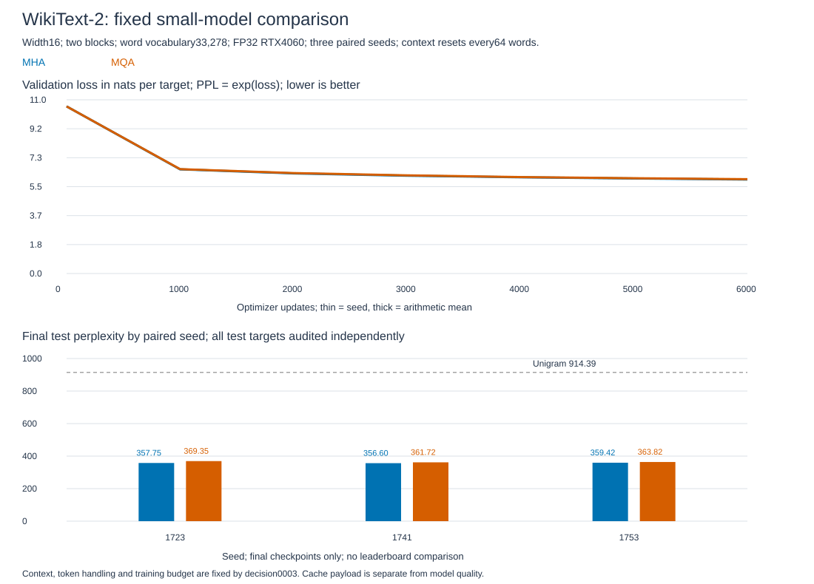

# WikiText-2: shared K/V with measured quality loss

**Completed and independently audited.** MQA passes the frozen tradeoff rule, with geometric mean perplexity 1.96% higher than MHA and worse quality in every seed. Compact K/V payload halves. This accepts a measured quality cost; it does not establish equal or improved quality.

## What the result means

This is next-word prediction on external natural text, rather than synthetic recall or majority. [The guide](wikitext2-comparison-guide.md) explains target shifting and perplexity. Lower perplexity is better. It is not percentage accuracy.

| Seed | MHA test PPL | MQA test PPL | MQA/MHA | Quality change |
|---|---:|---:|---:|---:|
| 1723 | 357.75 | 369.35 | 1.03241 | 3.24% worse |
| 1741 | 356.60 | 361.72 | 1.01438 | 1.44% worse |
| 1753 | 359.42 | 363.82 | 1.01226 | 1.23% worse |
| Geometric mean | 357.92 | 364.95 | 1.01964 | 1.96% worse |

The training-count unigram baseline scores 914.39. All six arms beat it by more than the required 0.05 nats/token, passing the chosen learning sanity check. This comparison does not identify which context mechanism produces the gain.

For paired losses, the comparison is:

\[
R_s=\exp(L_{\mathrm{MQA},s}-L_{\mathrm{MHA},s}),\qquad
\bar R=\exp\left(\tfrac13\sum_s(L_{\mathrm{MQA},s}-L_{\mathrm{MHA},s})\right).
\]

Mean extra loss is 0.01945 nats/token. Every ratio stays below 1.10; the geometric mean stays below 1.05. These are the [predeclared tolerances](../../decisions/0003-wikitext2-matched-baseline.md), not an accuracy improvement or a significance test.

Thin lines show individual seeds; thick lines show mean validation loss. The final bars show test perplexity. [Plot data](../../../results/wikitext2_training_plot_data.csv) and [hash manifest](../../../results/wikitext2_training_plot_manifest.json) tie the figure to the audited results.

## Method and resource accounting

Three paired seeds, two arms, 6,000 updates each. Width 16, two pre-norm blocks, two query heads, RoPE, ReLU FFN32 and LayerNorm remain fixed. Only K/V-head count changes. Common initialization and sampled token starts match within seed. Each arm trains on 3,072,000 next-word targets, batch 8/context 64, Adam lr 0.001. Final checkpoints only; all attempts finish before test scoring.

| Resource | MHA | MQA | Meaning |
|---|---:|---:|---|
| Parameters | 1,069,376 | 1,068,832 | 544 fewer, 0.051% |
| Compact FP32 K/V at 64 tokens, per sequence | 16 KiB | 8 KiB | 50% smaller potential cache payload |
| Full training/inference memory and speed | Uncompared | Uncompared | Cache arithmetic does not predict these |

Vocabulary matrices dominate parameter count. The earlier recall study's 10.69% total parameter reduction does not apply here. Training does not use a cache, and shared K/V is expanded for the two query heads during attention.

## Data and verification

The pinned publisher's word-level files reproduce published train/validation/test totals 2,088,628 / 217,646 / 245,569. Vocabulary 33,278 uses training only. Each row receives one `<eos>`, including blank rows. No additional unknown-word mappings occur; existing test `<unk>` tokens are 6.31% of words. [Encoding](../../../results/wikitext2_encoding.json) and [independent regex/window audit](../../../results/wikitext2_data_audit.json) pass. All 245,568 test targets are scored exactly once per model; validation's 45-token tail is retained.

Native Windows RTX 4060, FP32, deterministic settings, TF32 off. All six [GPU preflights](../../../results/wikitext2_gpu_verification.json) pass; maximum output error 6.20e-7 versus CPU float64, gradient relative error 2.98e-7. Every training step passes finite loss/gradient/parameter checks. Summed loop time 1,265.88 s includes periodic validation, excludes initial validation/setup/checkpoint writes/test/audit; it is not a controlled speed comparison.

The [independent final audit](../../../results/wikitext2_training_audit.json) passes all six models: 1,473,408 test-token losses recomputed with CPU float64 and saved FP32 weights. Maximum token-loss error is 9.55e-6 (limit 1e-4); maximum mean-loss error is 1.15e-8 (limit 1e-5). Replayed training starts, initialization, update counts and artifact hashes also pass.

One argmax prediction differs for seed 1753 MHA; the other five models have none. Predictions are therefore not exactly identical across precision paths. The loss-based rule still passes; the cause of that single difference was not isolated. [Raw results](../../../results/wikitext2_training.json), [checkpoints](../../../results/wikitext2_training_checkpoints) and [per-token evidence](../../../results/wikitext2_training_scores.pt) are retained. Exact parsing, windows and tolerances are in the [execution protocol](../../wikitext2-execution-protocol.md).

## Paper comparison and stopping boundary

[Merity et al. 2016](https://arxiv.org/html/1609.07843v1) establishes WikiText and its original evaluation conventions. [Shazeer 2019](https://arxiv.org/html/1911.02150v1) defines shared K/V attention. Our tiny, fixed-budget 64-position decoder does not reproduce either paper's quality or speed benchmarks. Relevant original methodology takes priority over age.

Three seeds share one official test stream. They do not establish population-wide reliability. Validation loss still decreases at the last recorded interval in every arm; convergence is not established. Different widths, contexts, domains, precision and budgets remain untested. This result supports a scoped MQA quality/resource tradeoff, not necessity or optimality of every recipe component. **Study closed:** no tuning, seed replacement or budget extension.
