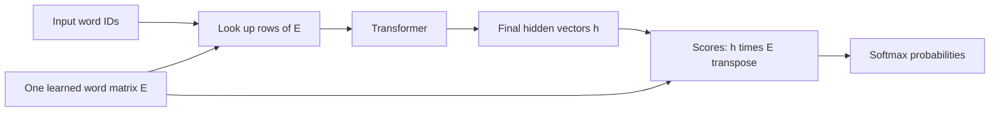

# Weight tying: one word matrix, two roles

An input embedding turns a word ID into a learned feature vector. The output matrix turns the final hidden vector into scores for every possible next word. Weight tying uses the same matrix for both jobs.

These word vectors differ from attention's projected Q/K/V vectors.

## The math

Let vocabulary size be V and feature width d. Both matrices have shape V by d. Our readout has no bias.

| Step | Untied | Tied |
|---|---|---|
| Input word i | `x=E[i]` | `x=E[i]` |
| Transformer | `h=Transformer(context)` | Same operations |
| Vocabulary scores | `logits=h O^T` | `logits=h E^T` |
| Next-word probability | `softmax(logits)` | Same formula |

The score for word j is the dot product of h with that word's output vector. With tying, that vector is also its input embedding. These scores are not cosine similarities unless additional normalization makes them so. Tying does not supply the correct word or replace attention.

## Two gradient roles

For one target y, let `r=softmax(logits)-one_hot(y)`.

The direct output-role gradient is `G_output=r^T h`. For a mean loss, average this over scored positions. The input-role gradient flows backward through the transformer to embedding rows looked up in the context. Repeated IDs accumulate contributions.

With independent matrices, E and O receive separate gradients. With sharing:

`dL/dE = G_input + G_output`.

Both terms are evaluated at the same matrix values. A row absent from the input can still receive an output-role gradient. Individual output-row terms may cancel when summed over positions. With Adam, applying one update to the summed gradient differs from separately updating two matrices and averaging them.

The [local math checks](../../../results/weight_tying_math.json) verify six small nonlinear models and90 gradient entries with finite differences and independent Decimal loss arithmetic. The [full-model preflight](../../../results/weight_tying_verification.json) also checks the gradient sum. These verify implementation and equations; they do not predict which arm learns better.

Equal values are not sharing. Two copied parameters can start with identical predictions and then diverge. Genuine tying uses one parameter object, one optimizer registration and one accumulated gradient. Checkpoints record two names, but the model must restore their shared ownership.

## What can we claim?

At V33,278 and d16, tying removes `V*d=532,448` learned parameters. Our whole-model count falls1,068,832 to536,384, saving49.82%. The final vocabulary projection still runs. This does not establish half runtime, whole training memory or better quality.

The untied function class contains the tied case; it also permits independent input/output vectors. That extra freedom need not produce a better trained model. The [frozen comparison](../../decisions/0006-wikitext2-weight-tying.md) starts both matrices at the same small uniform values in both controls, then changes only shared versus separate ownership. Both controls differ from the older embedding initialization. Three fixed training pairs test this specific constraint and initialization, not all tying recipes.

The [completed results](weight-tying-results.md) show 49.82% fewer parameters with 6.41% worse validation perplexity. That misses the permitted 5% average loss. The measured tradeoff fails; it does not make the gradient identity false or reject tying at other scales.

[Press/Wolf2017](https://aclanthology.org/E17-2025/) analyzes the two gradient roles. [Inan et al.2017](https://arxiv.org/html/1611.01462v3) connects embedding reuse to a loss framework and recurrent experiments. Their quality gains motivate testing; they do not predict ours. No additional projection or augmented loss is used here.
