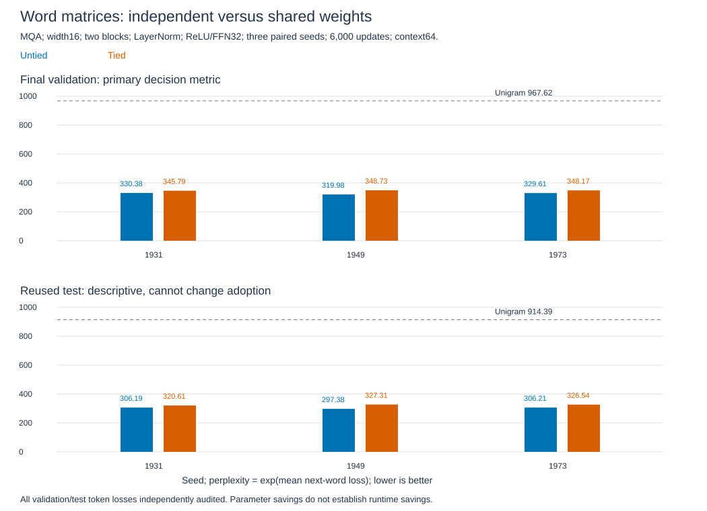

# Weight tying: parameter savings and quality loss

**Sharing saves49.82% of parameters, but fails the quality tolerance.** Geometric mean validation perplexity326.62 to347.56,6.41% worse. The permitted average loss was5%. Every paired seed loses quality. Reused test worsens7.12%. This rejects the tested tradeoff, not weight tying in general.

All six runs and twelve independent evaluations pass. **Study closed; original recipe retained without tuning.**

## What changed

Input embedding E looks up word vectors. Readout O scores next words: `logits=h O^T`. Tying imposes `O=E` as one shared parameter. Its gradient sums both roles: `G_input+G_output`. The [guide](weight-tying-guide.md) explains the equations and diagram. Equal-valued copies are not sharing; they can learn different values.

| Unique learned parameters | Untied | Tied |
|---|---:|---:|
| Vocabulary matrices, V33,278 and width16 |1,064,896|532,448|
| Remaining model |3,936|3,936|
| Total |1,068,832|536,384|

Saving532,448 parameters does not remove the vocabulary projection. Whole runtime, training memory and checkpoint disk savings are not established. The saved parameters are not redistributed into a larger transformer.

## Method and paired results

[Decision0006](../../decisions/0006-wikitext2-weight-tying.md) was fixed before evaluation. Keep the original MQA architecture, two pre-norm blocks, width16, two query/one KV heads, RoPE offset4, biased ReLU/FFN32 and LayerNorm gain/bias/epsilon1e-5.

Both controls copy the template's output initialization into the input embedding: uniform+/-0.25. Untied matrices have equal initial values but separate ownership; tied uses one parameter. All initial tensors and predictions match within each pair. Both controls change the older embedding initialization, so historical scores are not paired controls. This tests sharing under a declared common start, not all tying initializations.

Three new paired seeds1931/1949/1973; identical sampled training starts per pair. Six runs,6,000 default Adam.001 updates each, batch8/context64,3,072,000 targets/run,18,432,000 total. Native Windows RTX4060 Laptop, PyTorch2.11 CUDA12.8 FP32, deterministic settings and TF32 off. Alternate execution order. No warmup, clipping, dropout, tuning, scale/projection addition or favorable checkpoint selection.

| Seed | Untied validation PPL | Tied validation PPL | Change | Untied test PPL | Tied test PPL |
|---|---:|---:|---:|---:|---:|
|1931|330.38|345.79|+4.67%|306.19|320.61|
|1949|319.98|348.73|+8.98%|297.38|327.31|
|1973|329.61|348.17|+5.63%|306.21|326.54|
|Geometric mean|326.62|347.56|+6.41%|303.23|324.81|

Primary PPL is `exp(mean next-word NLL)`. The aggregate ratio is `exp(mean_seed(NLL_tied-NLL_untied))=1.064114`. Each model scores217,645 validation and245,568 test targets, including the45-token validation tail. Context restarts every nonoverlapping64 tokens. Both official splits are reused benchmark evidence; test is descriptive, not fresh confirmation. Tokens are not independent training runs.

Final scores, not convergence curves. The dotted line is the add-one training-count unigram.

## Checks and decision

Six tiny nonlinear cases and90 gradient entries pass analytical/autograd/finite-difference checks. Independent60-digit Decimal loss arithmetic agrees within2.22e-16. Maximum gradient-sum error4.16e-17; finite-difference error2.57e-11. Omitting either gradient role is detected.

All six actual-vocabulary preflights pass: CPU-double output/gradient errors3.72e-15/1.11e-16, CUDA output error1.56e-6 and relative gradient error4.24e-7. Paired initial logits and full-model shared-gradient sums agree exactly. CPU/CUDA alias, optimizer registration, reload, causal-prefix and deliberately cloned-sharing controls pass.

The independent CPU-double audit recomputes all 2,779,278 validation/test token losses using manual normalization/RoPE and SDPA. Maximum token NLL error 7.68e-6, mean error 1.17e-8 and fixture logit error 1.46e-5, all within frozen tolerances. One argmax differs in seed1949's tied test split; no bitwise prediction equivalence is claimed, and its cause was not localized. Initialization/stream replay, optimizer counters, checkpoint sharing, hashes, exact coverage, unigram and the independently reconstructed validation decision pass.

Completion, unigram-learning sanity, at least45% parameter saving and every validation ratio<=1.10 pass. Only the average ratio<=1.05 fails. The validation decision was frozen before test scoring. These limits are research tolerances, not significance or equivalence claims.

Recorded loop time totals1,159.26 seconds (19.32 minutes), including periodic validation and excluding setup, checkpoint writing, final scoring and audit. Run times vary; no controlled speed finding. All final validation intervals still improve, so convergence is unproven.

## Papers and stopping boundary

[Inan et al.2017, table1](https://arxiv.org/html/1611.01462v3) reports small recurrent WikiText-2 test PPL105.9 to100.5 with embedding reuse. That model has200 units and variational dropout; our width16 transformer and fixed Adam budget differ. We observe the opposite quality direction, without reproducing or refuting their setting. [Press/Wolf2017](https://aclanthology.org/E17-2025/) motivates sharing and analyzes gradient roles; our local checks verify the sum, not their empirical benchmarks.

Why this constraint loses quality, other initializations/scales and speed remain unknown. Preserve the loss and savings. No extra seeds, initialization sweep, larger model or training extension follows. The original recipe remains unchanged.

Evidence: [report](../../../results/weight_tying.json), [math](../../../results/weight_tying_math.json), [preflight](../../../results/weight_tying_verification.json), [scores](../../../results/weight_tying_scores.pt), [audit](../../../results/weight_tying_audit.json), [plot data](../../../results/weight_tying_plot_data.csv), [figure manifest](../../../results/weight_tying_plot_manifest.json). Code: [runner](../../../experiments/weight_tying.py), [auditor](../../../experiments/audit_weight_tying.py). No further experiment is selected.
