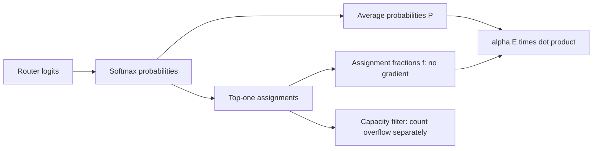

# MoE load balancing: encouragement, not a certificate

The router can send too many tokens to one expert. A balancing loss adds pressure to spread assignments. It does not check whether experts learned useful specialties.

## Two different averages

For T valid tokens and E experts:

\[
f_i=\frac{\#\{t:\arg\max_j p_{tj}=i\}}{T},\qquad
P_i=\frac1T\sum_t p_{ti},\qquad
L_{bal}=\alpha E\sum_i f_iP_i.
\]

**f counts actual choices before capacity filtering. P averages soft probabilities.** They need not agree. Alpha sets the auxiliary loss weight. This objective is defined in [Switch Transformers, section 2.2, equations 4-6](https://www.jmlr.org/papers/volume23/21-0998/21-0998.pdf).

## Where does the gradient go?

Holding the discrete choices fixed, our derivation gives

\[
\frac{\partial L_{bal}}{\partial z_{tj}}
=\frac{\alpha E}{T}p_{tj}\left(f_j-\sum_i f_ip_{ti}\right).
\]

The loss differentiates through P, not argmax. When f is uniform, this gradient is zero. When an expert's f exceeds the probability-weighted average, its logit derivative is positive; gradient descent locally pushes that logit down. This is a local derivative, not a guarantee about the next assignments or eventual training.

At exact ties, we report the implementation's fixed-choice gradient, not a verified derivative across the selection boundary.

## Why the score can mislead

Our four-token, two-expert fixtures use alpha 1 and two slots per expert:

| Fixture | Choices | Mean probabilities | Loss | Overflow |
|---|---|---|---:|---:|
| Balanced | 2 / 2 | .50 / .50 | 1.000 | 0 |
| Uniform probabilities, tied choices | 4 / 0 | .50 / .50 | 1.000 | 2 |
| Uniform mean, no ties | 3 / 1 | .50 / .50 | 1.000 | 1 |
| Below-one counterexample | 3 / 1 | .385 / .615 | .885 | 1 |

The last fixture uses [.51,.49] for three tokens and [.01,.99] for one. Check it directly: `2 * (.75*.385 + .25*.615) = .885`.

Thus **1 is the uniform reference value, not a universal lower bound** for this coupled hard-choice/soft-probability objective. A smaller score does not necessarily mean more balanced choices. These witnesses qualify a minimization interpretation; they do not refute the paper's training measurements.

Track assignment counts, overflow and task quality separately. Better utilization and useful specialization are different outcomes. [Audit results](moe-balancing-results.md) | [Prior routing guide](moe-routing-guide.md).
