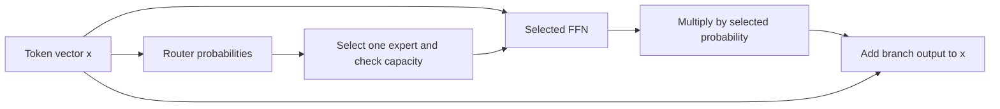

# Mixture of experts: choosing an FFN

A dense FFN uses the same weights for every token. An MoE layer contains several FFNs, called experts, and a router selects which one processes a token. The name does not guarantee that experts learn meaningful specialties.

## The local equations

Our fixture uses bias-free, smooth experts:

\[
p=\mathrm{softmax}(xW_r),\quad e=\arg\max_i p_i,
\quad E_e(x)=\tanh(xW_{1,e})W_{2,e}.
\]

An accepted token produces \(y=p_eE_e(x)\). The residual output is \(x+y\). This is a small routing audit, not a trained Switch Transformer.

**Attention selects information from tokens. This router selects an FFN for a token.** They solve different selection problems.

## How can a discrete router learn?

Away from a selection boundary, hold the chosen index fixed. For router logits \(z\):

\[
\frac{\partial p_e}{\partial z_j}=p_e(\mathbf{1}_{j=e}-p_j),
\qquad
\frac{\partial y}{\partial z_j}=E_e(x)\frac{\partial p_e}{\partial z_j}.
\]

This gradient passes through the probability, not through argmax. All router logits can participate through softmax. Only the selected expert receives this token's expert-weight gradient. At a selection tie, the function can be discontinuous; our finite differences verify stable choices only.

In our scalar witness, the router gradient magnitude is **0.23989**. Detaching the probability removes it. The unselected expert's gradient is zero. These statements concern the audited output loss; an additional balancing loss would add gradients.

## What happens when an expert is full?

Our declared capacity is \(C=\lceil cT/E\rceil\): valid-token count \(T\), expert count \(E\), factor \(c\). First arrivals fill slots. Padding consumes none. Overflow contributes zero branch output, so the residual carries the original input.

With two valid tokens choosing the same expert and capacity one, only the first is processed. Changing batch order can therefore change which token gets processed. This is a consequence of the declared policy, not measured model quality.

## More parameters does not mean all are used per token

| Local fixture | Stored parameters | Used per accepted token, including router |
|---|---:|---:|
| Two experts | 104 | 56 |
| Three experts | 156 | 60 |

Both use width 4 and expert hidden width 6. The counts include every router weight and one selected FFN. They do not measure runtime, activation memory or communication.

## Paper connection and limits

[Switch Transformers, sections 2.1–2.2](https://www.jmlr.org/papers/volume23/21-0998/21-0998.pdf) supplies the top-one probability-weighted routing and capacity framework. Our tanh activation, rounding, padding and tie conventions define a local test. We omit auxiliary balancing loss, routing noise and distributed execution. We have not reproduced its training or speed results.

[Measured results](moe-routing-results.md) | [Frozen protocol](../../protocols/moe-routing.md).
