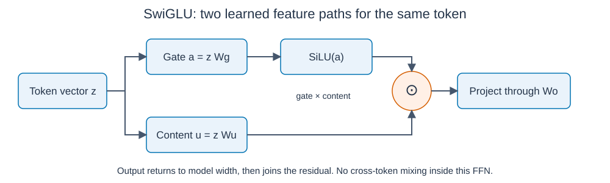

# SwiGLU: what the gate actually does

SwiGLU is a feed-forward layer with a learned multiplicative gate. It processes each token's vector separately. Attention still handles interactions across tokens. [Shazeer2020, equations5-6](https://arxiv.org/html/2002.05202v1) defines this structure. Our [comparison results](swiglu-results.md) keep the mathematical and trained evidence separate.

## Follow one token

Let z be the normalized vector entering the FFN. Using row vectors and omitting biases:

\[
a=zW_g,\quad u=zW_u,\quad
s(a)=a\odot\sigma(a),\quad
f(z)=[s(a)\odot u]W_o.
\]

`W_g` learns gate features. `W_u` learns content features. Multiplication combines corresponding channels. `W_o` projects them back to model width. The residual adds `f(z)` to the token's existing state. These matrices are learned; the layer does not contain named rules about which words matter.

SiLU is `a*sigmoid(a)`, also called Swish with beta 1. SwiGLU adds the other projection and multiplication; it is more than replacing ReLU with SiLU. [Installed-version definition](https://docs.pytorch.org/docs/2.11/generated/torch.nn.functional.silu.html).

## A gate is not a probability

For one channel with content u=2:

| Gate input a | SiLU gate s(a) | Product s(a)*u | Interpretation |
|---:|---:|---:|---|
| -1 | -0.26894 | -0.53788 | Can reverse the content's sign |
| 0 | 0 | 0 | Suppresses this channel's forward contribution |
| 3 | 2.85772 | 5.71544 | Can amplify content |

Only the sigmoid factor lies between 0 and 1. SiLU itself can be negative or greater than 1. Multiplication lets one learned feature modulate another within the same token.

## How gradients flow

For one channel, h=s(a)u:

\[
s'(a)=\sigma(a)+a\sigma(a)(1-\sigma(a)),\qquad
\frac{\partial h}{\partial a}=us'(a),\qquad
\frac{\partial h}{\partial u}=s(a).
\]

At a=0, `s'(0)=0.5`: a zero gate output need not mean zero gradient into the gate. But u=0 blocks that channel's gate gradient; a=0 blocks its content gradient. Smoothness does not guarantee non-vanishing gradients or stable whole-model training.

For upstream gradient r into h, both paths contribute:

\[
\nabla_z L=(r\odot u\odot s'(a))W_g^T
 +(r\odot s(a))W_u^T.
\]

[Live math checks](../../../results/swiglu_math.json): 21 scalar cases agree with 60-digit Decimal arithmetic; nine matrix cases check input/all-weight gradients and directional finite differences. Deliberately omitted products and wrong derivatives are detected. These verify the tested arithmetic, not trained quality.

## Compare cost fairly

ReLU uses two projections: `ReLU(zW_1)W_2`. SwiGLU uses three. With model width d, hidden widths h and g, bias-free FFN weights are `2dh` versus `3dg`. Choosing `g=2h/3` matches projection weight count and multiply-adds, as in the original paper.

Our [frozen comparison](../../decisions/0004-swiglu-matched-ffn.md) uses d=16, ReLU h=33 and SwiGLU g=22: 1,056 weights per block in either arm. Activation/product operations and temporary storage still differ. Both arms remove FFN biases; the earlier biased width-32 result is not their baseline. This compares a narrower gated FFN package, rather than isolating the gate alone.

The original paper reports improved T5/C4 denoising scores in its setting. It does not establish gains for our tiny next-word decoder, identify a universal reason for improvement, or prove runtime superiority here.

Our [completed comparison](swiglu-results.md) finds 2.00% worse mean validation perplexity for SwiGLU, with all three pairs worse. Its math is valid; improved prediction under this budget is not supported. Why it loses here remains unresolved. The study is closed.
