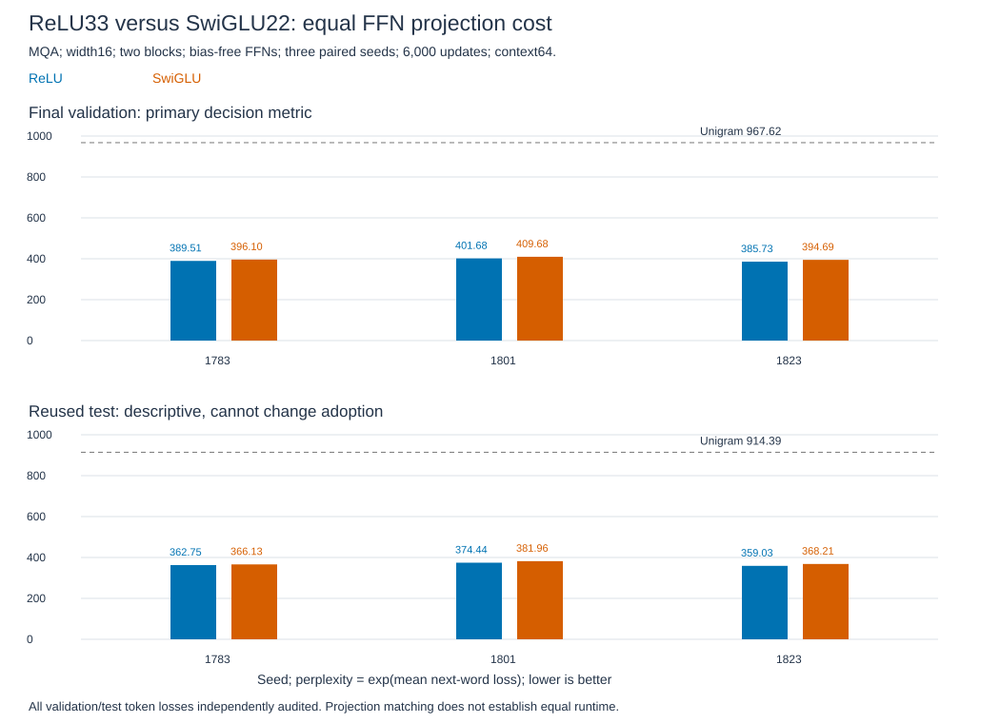

# SwiGLU versus ReLU: matched FFN projection cost

**Completed and independently audited.** SwiGLU worsens geometric mean validation perplexity 2.00%; every pair is worse. Adoption fails. The existing recipe is retained. [Learn the gate and gradients](swiglu-guide.md).

## Final quality

Lower perplexity is better. It is `exp(mean next-word negative log probability)`, not percentage accuracy.

| Seed | ReLU validation PPL | SwiGLU validation PPL | Validation change | ReLU reused test PPL | SwiGLU reused test PPL |
|---|---:|---:|---:|---:|---:|
| 1783 | 389.51 | 396.10 | 1.69% worse | 362.75 | 366.13 |
| 1801 | 401.68 | 409.68 | 1.99% worse | 374.44 | 381.96 |
| 1823 | 385.73 | 394.69 | 2.32% worse | 359.03 | 368.21 |
| Geometric mean | 392.25 | 400.10 | 2.00% worse | 365.35 | 372.03 |

The validation ratio is

\[
\bar R=\exp\left(\tfrac13\sum_s[L_{\mathrm{SwiGLU},s}-L_{\mathrm{ReLU},s}]\right)=1.020016.
\]

Extra validation loss is 0.01982 nats/token. Required: mean ratio<=0.98 and every seed<=1.00; both fail. All six finite runs beat validation unigram PPL 967.62, passing the learning sanity check. Reused test ratio 1.018307 is 1.83% worse; it cannot change adoption.

Top: primary validation metric. Bottom: descriptive reused test. [Plot data](../../../results/swiglu_training_plot_data.csv) and [hash manifest](../../../results/swiglu_training_plot_manifest.json).

## What this tests

Does a narrower gated FFN improve fixed-budget word prediction at equal projection cost? MQA attention, vocabulary, normalization and training streams remain fixed. Gating is not isolated from hidden width.

| Resource | ReLU | SwiGLU | Limit |
|---|---:|---:|---|
| Hidden width | 33 | 22 | Fewer gated channels |
| FFN projection matrices | 2 | 3 | Gate adds one projection |
| FFN weights per block | 1,056 | 1,056 | Both FFNs omit biases |
| Projection MACs per token/block | 1,056 | 1,056 | Activations/product/backward are not counted |
| Total parameters | 1,068,800 | 1,068,800 | Equal count does not mean equal function or speed |

These fresh bias-free controls do not replace the original biased width32 recipe or use its historical scores as a baseline.

## Method and decision

[Decision0004](../../decisions/0004-swiglu-matched-ffn.md): three paired seeds, 6,000 updates and 3,072,000 targets per arm. Native RTX 4060 FP32; Adam lr 0.001, batch 8/context 64. Non-FFN initialization and token starts match; FFN shapes/initialization differ. Final checkpoints only, without tuning.

The **final validation** decision was saved/hashed before test scoring. Its 2% target is not statistical significance. Both official splits were used in the MHA/MQA study; they are reused evidence, not fresh confirmation.

## Verified before training

| Check | Result | What it establishes |
|---|---|---|
| Scalar math | 21 cases agree with 60-digit Decimal arithmetic | Tested gate outputs and derivatives |
| Matrix gradients | Nine cases; max analytical/autograd error 2.84e-14 | Input/all-weight gradients and directional finite differences |
| Error controls | Sigmoid-only gate, omitted product and wrong derivative detected | These checks reject the specified shortcuts |
| CPU/GPU preflight | Six actual-vocabulary models pass; max GPU output error 7.98e-7, gradient relative error 2.69e-7 | Tested numerical/causal implementation |
| Original ReLU compatibility | Forward and gradient checks pass | Unchanged attention/residual computation agrees with the frozen prior path |

[Math evidence](../../../results/swiglu_math.json), [model verification](../../../results/swiglu_training_verification.json).

The [final audit](../../../results/swiglu_training_audit.json) passes all twelve cells: **2,779,278 token losses**, CPU float64 with saved FP32 weights. Max token error 1.18e-5 (limit 1e-4); max mean error 1.26e-8 (limit 1e-5). Zero argmax differences. Initialization, starts, optimizer counters, coverage, counts/hashes, unigram baselines and the validation-only decision pass.

[Raw results](../../../results/swiglu_training.json), [checkpoints](../../../results/swiglu_training_checkpoints), [per-token evidence](../../../results/swiglu_training_scores.pt), [producer](../../../experiments/swiglu_training.py) and [auditor](../../../experiments/audit_swiglu_training.py). Loop time 1,315.44 s includes periodic validation, excludes setup/initial validation, writes/final scoring/audit. This is not a controlled speed comparison.

Use the producer's `forward_device`; its factory supplies parameters, while the template's inherited forward is not the SwiGLU path.

## Paper comparison and boundary

[Shazeer2020, Table1](https://arxiv.org/html/2002.05202v1): long-budget T5/C4 denoising log-perplexity 1.677 (ReLU) versus 1.636 (SwiGLU). Our task, capacity, optimizer and budget differ; scores are not directly comparable. This does not reproduce or refute those benchmarks.

Why SwiGLU loses here is unresolved; width, gating and initialization were not isolated. Every arm's validation loss still falls at the last interval; convergence is unestablished. Three seeds on one reused corpus do not reject SwiGLU globally. Speed and recall retention were not compared. **Study closed:** no seed replacement, sweep or budget extension.
