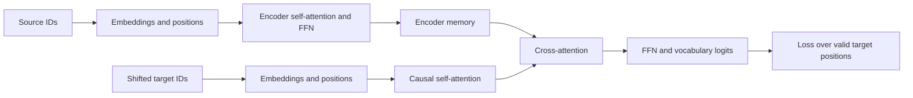

# Encoder-decoder: inputs, masks and loss

[Results](encoder-decoder-results.md) · [Protocol](../../protocols/encoder-decoder-contract.md) · [Cross-attention mathematics](../attention/cross-attention-guide.md)

## One complete path

The encoder reads the source. The decoder reads earlier target symbols and the encoder's output. This audit includes embeddings, sinusoidal positions, all attention layers, residuals, normalization, FFNs and the vocabulary projection. It uses one encoder layer and one decoder layer with random initial weights.

Each attention/FFN sublayer uses `x_new = LayerNorm(x + sublayer(x))`. This is **post-norm**, following the structure of the [original Transformer](https://arxiv.org/html/1706.03762v7). Our small model is not a reproduction of its translation experiment.

## Shifting means predicting the next symbol

| Position | Decoder input | Correct target |
|---|---|---|
|0 |BOS |A |
|1 |A |B |
|2 |B |EOS |
|3 |PAD |PAD, excluded from loss |

BOS starts the sequence. EOS is a valid target that marks its end. PAD fills unused batch positions. FeedingA at the position supposed to predictA leaks the answer, even if future positions are masked.

## Padding needs more than one mask

| Location | Purpose |
|---|---|
| Encoder source mask | Stop valid source states from reading padding |
| Decoder memory mask | Stop cross-attention from reading padded encoder output rows |
| Decoder causal mask | Hide future target inputs |
| Target key-padding mask | Exclude padded target keys |
| Target loss mask | Exclude padded answer positions from training feedback |

A padded query can still produce a nonzero state. Masking keys does not erase that state's residual path. This is why the decoder needs a source-memory mask even when the encoder already masked source keys.

For logits `z`, valid-position indicator `m`, and `N = sum(m)`, the unweighted loss is:

`L = -(1/N) sum[b,t] m[b,t] log softmax(z[b,t])[y[b,t]]`

All16 vocabulary classes remain in the softmax denominator. Ignoring PAD **positions** does not remove the PAD **class** from other positions. The loss gradient is zero at ignored positions. This matches [PyTorch's class-index cross-entropy convention](https://docs.pytorch.org/docs/2.11/generated/torch.nn.CrossEntropyLoss.html). Empty valid-target reductions are rejected in our wrapper.

## Parallel training and sequential decoding

Teacher forcing supplies the correct target prefix. A causal mask allows all its positions to be evaluated together. Computing a position from the same prefix alone should give the same logits when dropout is off. We checked135 such prefix positions.

Free-running generation supplies the model's own previous predictions. A wrong prediction changes the next prefix, so teacher-forced correctness does not establish generation accuracy. This audit does not test a generation loop, EOS stopping or KV caching.

The result establishes a finite numerical contract. Whether this model learns useful sequences requires a separate training experiment with fitting and held-out measurements.
