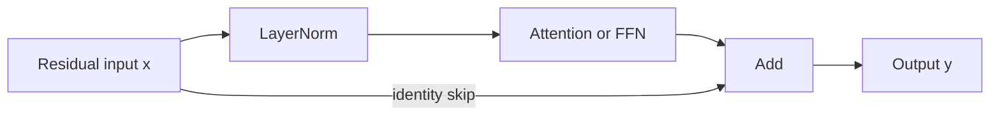
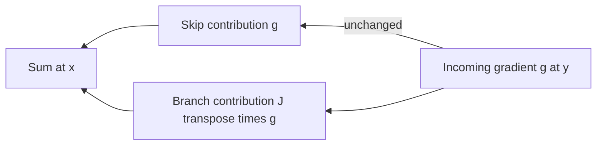
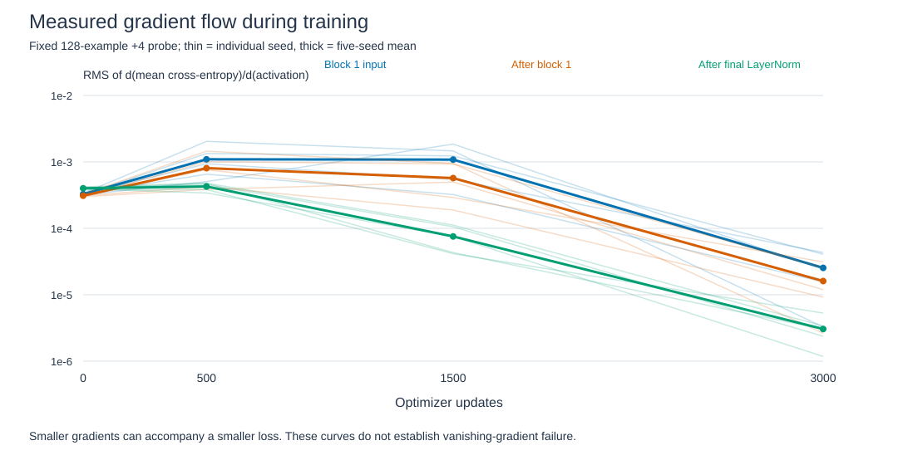
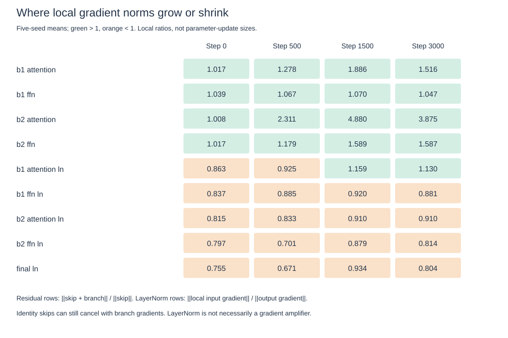

# Gradient flow through residual connections and normalization

Completed five deterministic training replays and audited all 20 measured states. Residual gradients are sums of skip and branch contributions; LayerNorm can shrink or amplify local gradients. Neither operation guarantees gradient stability on its own. [Protocol](../../gradient-flow-protocol.md).

## What flows backward?

A gradient says how a small change in an activation changes the loss locally. It is not an importance score or an optimizer update. Adam also uses accumulated gradient statistics to choose parameter updates.

Our pre-norm block computes u=x+Attention(LN1(x)), then y=u+FFN(LN2(u)). LayerNorm is inside each branch; the skip path bypasses it. A separate final LayerNorm still sits before the vocabulary projection and loss.

The diagram above is forward computation. Backward computation adds two contributions:

## Residual math and its limitation

For y=x+B(x), the chain rule gives g_x=g_y+J_B(x)^T g_y. B includes normalization and attention or FFN. Thus the skip passes a copy of the incoming gradient, but the branch can reinforce or oppose it.

Squared norm identity: ||g_x||^2=||g_y||^2+||g_branch||^2+2||g_y||||g_branch||cos(theta). A negative cosine indicates opposing components; it does not by itself imply complete cancellation.

The executed generic residual counterexample B(x)=-x gives g_x=0 despite an identity skip. This is not a claim that our pre-norm branch implements -x. It refutes the blanket statement that adding an identity skip always prevents vanishing gradients.

## LayerNorm math and its limitation

For one token, mu=mean(x), sigma=sqrt(mean((x-mu)^2)+epsilon), h=(x-mu)/sigma, and LN(x)=gamma*h+beta. Given gradient g at its output, set w=gamma*g. Then:

g_input = [w - mean(w) - h*mean(w*h)] / sigma.

Means operate across features, not batch examples or tokens. The two subtraction terms matter; LayerNorm backward is not merely division by sigma. It removes sensitivity to adding a constant to every feature. Small variance can amplify other directions. The epsilon term is included; variance-scale invariance is not exact when epsilon is nonzero.

## Measurement design

Replay the five original varied-position training runs for 3,000 Adam updates. Preserve initialization, minibatches and sampled offsets. Probe at 0/500/1500/3000 on the same 128 validation examples at +4, with mean cross-entropy. No test evaluation or changes to the training recipe. This instrumentation asks what gradients are doing, not which architecture would train best.

Gradient RMS is computed across all 128x8x16 activation entries, including zero gradients. Final-token supervision creates different gradient support at different sites. Residual ratios compare total with skip norms. LayerNorm ratios compare its local input with output gradient, excluding bypass paths. These ratios have different meanings.

## Training measurements and visualizations

The final weights of all five replays exactly equal their original checkpoints. Training losses and parameter gradients were finite throughout. Instrumentation therefore reproduced these known runs without changing their training outcome. These are replays of the existing recipe, not five independent new confirmations.

| Updates | Probe loss, mean | Probe accuracy, mean | Input activation-gradient RMS | After-final-LN gradient RMS |
|---|---:|---:|---:|---:|
| 0 | 3.1153 | 10.16% | 3.27e-4 | 4.01e-4 |
| 500 | 1.1194 | 48.44% | 1.09e-3 | 4.27e-4 |
| 1500 | .02646 | 99.53% | 1.08e-3 | 7.56e-5 |
| 3000 | .001197 | 100% | 2.54e-5 | 3.05e-6 |

This is accuracy on the fixed 128-example probe, not the full validation or test set. Input gradient RMS first rises, then falls as the loss becomes small. Calling the late decrease a vanishing-gradient failure is unsupported by these measurements.

Thin traces show every seed; thick traces show arithmetic means. The vertical axis is logarithmic. Lines connect only four measurements; behavior between them was not recorded. [Open the standalone plot](../../figures/gradient-flow-training.svg).

Each cell is a five-seed mean ratio. Green denotes ratios above one; orange below one. Colors indicate direction, not statistical significance or training quality. [Open the ratio plot](../../figures/gradient-flow-ratios.svg).

At step 3000, block-2 attention's total/skip gradient norm ratio averages 3.87, while the final LayerNorm local input/output ratio averages .804. The branch and normalization can therefore have quite different effects on local gradient size. Do not interpret these as fractions of an optimizer update or multiply the displayed means to reconstruct the full network gradient.

Skip/branch cosine ranges from -.322 to .685 over the measured sites and states. Opposing components occur in these trained models. Their total depends on both magnitudes and angle, not on the skip connection alone.

Two of the 80 measured residual sites have total/skip ratios below one: seed 509's block-1 FFN at step 3000 (.9790), and seed 571's block-2 attention at initialization (.9993). Most sampled sites amplify the norm; an identity skip is still not a monotonic-norm guarantee.

## Mathematical checks and challenged claims

| Claim or check | Executed evidence | Conclusion |
|---|---|---|
| Residual gradient equals skip plus branch | Maximum componentwise error 3.47e-18 over 80 sites/states | Chain-rule decomposition verified locally |
| Analytical LayerNorm input gradient | Maximum autograd discrepancy 2.78e-17 over 100 sites/states | Formula agrees with implementation |
| LayerNorm directional derivative | Maximum centered-difference discrepancy 8.43e-13, 100 tested directions | Independent numerical check at tested points |
| Identity skip always prevents cancellation | Generic B(x)=-x fixture yields exactly zero gradient | Blanket claim false; not a trained-model example |
| LayerNorm always preserves or reduces gradients | Constant direction vanishes; zero-variance fixture amplifies an orthogonal direction by 316.23 with epsilon=1e-5 | Direction and variance matter; amplification fixture is not typical trained behavior |

These tests check derivatives of the computation. They do not demonstrate that pre-norm is better than post-norm, or that clipping/warmup is unnecessary generally. No competing architecture was trained.

## Concrete answer and remaining question

An identity residual path preserves an additive gradient route, not a guaranteed total gradient. LayerNorm transforms gradients through centering, feature-direction subtraction, learned scaling and variance-dependent scaling. The measured training trajectories satisfy those equations and successfully replay this two-block recipe.

We have a bounded answer for how gradients propagate here. We have not established why this optimizer/architecture combination succeeds relative to alternatives, how behavior scales with depth, or whether another probe distribution gives the same ratios. A causal optimization claim would require a separately controlled training comparison. No additional training recipe or architecture change is selected from these plots.

## Sources and scope

[He et al., Identity Mappings in Deep Residual Networks (2016)](https://arxiv.org/abs/1603.05027) analyze direct propagation through identity paths in residual networks. Our local chain-rule checks share that rationale, but do not reproduce their image-model experiments.

[Xiong et al., On Layer Normalization in the Transformer Architecture (2020)](https://proceedings.mlr.press/v119/xiong20b.html) connect normalization placement with initialization gradients and warmup under their analysis and experiments. We measure only a two-block pre-norm recipe. We do not compare post-norm, test their mean-field assumptions or establish superiority at larger depth. Publication pages/abstracts checked; full paper/code reproduction is absent.

Small gradients late in training can accompany small loss. Neither their size alone nor a successful two-block run proves freedom from vanishing/exploding gradients in other settings. Replaying known runs is not fresh generalization evidence. Measurements on one fixed probe batch may differ from other inputs or minibatches; only four times per seed are sampled.

## Evidence and reproducibility

[Training instrumentation](../../../experiments/gradient_flow.py), [raw measurements](../../../results/gradient_flow.json), [probe indices](../../../results/gradient_flow_probe.json), [checkpoint audit](../../../results/gradient_flow_audit.json), [plot generator](../../../experiments/plot_gradient_flow.py), [plotted numeric data](../../../results/gradient_flow_plot_data.csv), [plot provenance](../../../results/gradient_flow_plot_manifest.json).

The audit reloaded all 20 checkpoints and reproduced every probe metric exactly. Independent norm-sum arithmetic passed. Explicit/library logits agree within 1.60e-14 and parameter gradients within 3.25e-15. Initial/minibatch hashes match the earlier runs; final parameters are identical. SVGs are generated from the recorded data, include value tooltips, and parse as valid XML. The replay and audit share PyTorch and the probe implementation; finite differences add a separate numerical check but not an independent framework reproduction.
