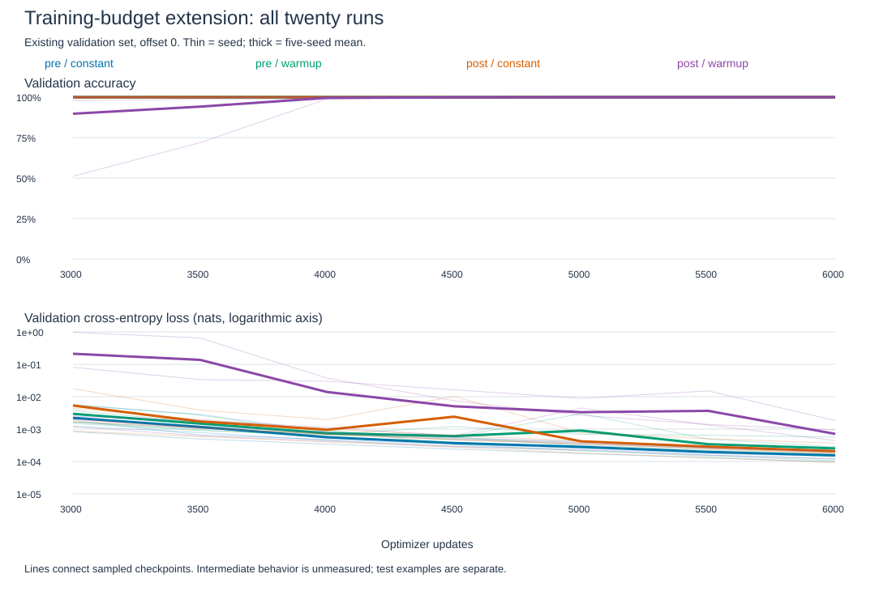

# Does more training resolve the weak normalization runs?

All twenty runs pass every-seed 99% at 6,000 updates. Both earlier weak seeds recover on fresh mappings. Their 3,000-update failure was budget-dependent in this recipe; its internal cause remains unknown. [Fixed protocol](../../norm-extension-protocol.md).

## Question and method

At 3,000 updates, two post-norm warmup seeds missed 99% test accuracy. We extend every condition to 6,000 updates. This tests whether that failure persists under one larger budget. It does not isolate why those seeds learned slowly.

Same twenty models, original training/validation mappings, batch size 64, offset stream 0..4, CPU float64 and Adam. The rate is .001 throughout updates 3,001..6,000. No architecture change, checkpoint selection or learning-rate tuning. Both variants retain a separate final LayerNorm, as in the [original comparison](norm-placement-results.md).

Original checkpoints stored weights only. Each run replays its first 3,000 updates. Every parameter must match exactly, as must minibatch and offset hashes. Continuation uses that same optimizer. New checkpoints also preserve Adam and RNG states every 500 updates.

## Why preserve Adam?

Adam remembers earlier gradients, element by element:

`m_t = .9 m_(t-1) + .1 g_t`; `v_t = .999 v_(t-1) + .001 g_t^2`.

After bias correction, `theta_t = theta_(t-1) - eta_t m_hat_t / (sqrt(v_hat_t) + 1e-8)`.

Here `g_t` is the loss gradient, `m_hat_t=m_t/(1-.9^t)` and `v_hat_t=v_t/(1-.999^t)`, starting from zero averages. Squaring, square root and division are elementwise.

Restarting those averages changes the next parameter update, even with identical weights and examples. Exact replay reconstructs their history. More updates also mean more sampled training examples: this is a training-budget comparison, not an equal-compute architectural comparison.

## Fresh evaluation

Generator 20261230 reserves 400 mappings absent from all 8,420 earlier three-pair mappings. Each supplies all eighteen order/query variants, giving 7,200 examples. Answers and query ranks are balanced. The independent units are whole mappings, not individual variants.

Evaluate original and extended checkpoints on these same examples after all training attempts finish. The rule remains every seed >=99%. This follow-up was chosen after seeing the original failures; fresh examples do not erase that adaptive choice.

## Paired fresh-test results

Both columns use the new test set. They therefore differ slightly from the original report's older test scores. Loss is cross-entropy in nats. Means summarize five seeds.

| Condition | Accuracy 3,000 to 6,000 | Loss 3,000 to 6,000 | Fully correct mappings 3,000 to 6,000 | All seeds >=99% at 6,000 |
|---|---:|---:|---:|---|
| Pre / constant | 99.969% to 100.000% | 0.002008 to 0.000136 | 99.55% to 100.00% | Passed |
| Pre / warmup | 99.967% to 99.997% | 0.002662 to 0.000284 | 99.60% to 99.95% | Passed |
| Post / constant | 99.933% to 99.997% | 0.005135 to 0.000244 | 99.05% to 99.95% | Passed |
| Post / warmup | 89.758% to 99.978% | 0.209231 to 0.001006 | 76.75% to 99.70% | Passed |

Every seed is retained below. Entries show accuracy at 3,000 to 6,000 updates.

| Seed | Pre constant | Pre warmup | Post constant | Post warmup |
|---|---:|---:|---:|---:|
| 601 | 100.000% to 100.000% | 99.972% to 100.000% | 99.986% to 100.000% | 100.000% to 100.000% |
| 631 | 100.000% to 100.000% | 99.903% to 100.000% | 100.000% to 100.000% | 100.000% to 100.000% |
| 659 | 99.889% to 100.000% | 100.000% to 100.000% | 99.931% to 100.000% | 97.875% to 99.889% |
| 683 | 99.958% to 100.000% | 100.000% to 100.000% | 99.764% to 99.986% | 50.917% to 100.000% |
| 719 | 100.000% to 100.000% | 99.958% to 99.986% | 99.986% to 100.000% | 100.000% to 100.000% |

Mean paired accuracy gains are +0.0306, +0.0306, +0.0639 and +10.2194 percentage points in the table order. Loss falls in every run. All condition means are now within 0.023 percentage points of each other; that is not proof of equivalence. Post-warmup seed 659 still makes eight errors, despite passing the threshold.

## What changed during training?

Thin lines show seeds; thick lines show arithmetic means. Loss uses a logarithmic axis. These are existing-validation measurements, not repeated fresh-test evaluations.

| Previously weak post-warmup seed | Validation at 3,000 | First sampled validation >=99% | Validation at 6,000 | Fresh-test gain |
|---|---:|---:|---:|---:|
| 659 | 97.681% | 4,500 | 99.958% | +2.014 points |
| 683 | 51.167% | 4,500 | 99.986% | +49.083 points |

The observed crossings are sampled every 500 updates. They do not identify exact convergence times. Occasional dips remain visible. The fixed final checkpoint passes without selecting a favorable intermediate step.

## Interpretation

The earlier result remains valid at 3,000 updates. It no longer supports describing these seeds as unable to learn the task. Continuing the same Adam trajectories was sufficient to cross the criterion. This does not establish that extra compute is the most efficient remedy or explain why warmup delayed these runs. Close this bounded normalization-budget comparison.

## Verification

All twenty replayed weight states and batch/offset hashes matched their originals exactly at 3,000. All twenty continuations finished finitely. The audit checked corpus exclusion, complete variants, balance, paired streams, validation replay equality and saved Adam step counts. All forty checkpoint evaluations reproduced the saved logits and metrics with maximum logit error zero through the explicit forward. This shares PyTorch; it is not an independent-framework replication.

[Saved logits](../../../results/norm_extension_scores.json), [audit](../../../results/norm_extension_audit.json), [plot data](../../../results/norm_extension_plot_data.csv), [plot provenance](../../../results/norm_extension_plot_manifest.json). The SVG is generated from recorded data and XML-validated.

## Paper comparison and limits

[Xiong et al., ICML 2020](https://proceedings.mlr.press/v119/xiong20b.html) connect normalization placement to initialization gradients and report pre-norm training without warmup. Their publication abstract was checked. Our shallow recall model, shared final-normalization convention and fixed recipes differ. A budget extension here cannot reproduce or refute their broader result.

The observed recovery establishes that the 3,000-update failure was not permanent for these runs. It does not identify the internal cause, establish a universal placement ranking, or solve length generalization. This extension stops at 6,000.

## Execution notes

The first launch stopped before data generation or training: the hash helper received a string instead of a Path. Corrected before the recorded execution. No experimental setting changed. Checkpoint resume support is present; an interrupted continuation has not been exercised in this run.

## Evidence

[Runner](../../../experiments/extend_norm_placement.py), [reserved examples](../../../results/norm_extension_inputs.json), [raw report](../../../results/norm_extension.json), [reload audit code](../../../experiments/audit_norm_extension.py).
