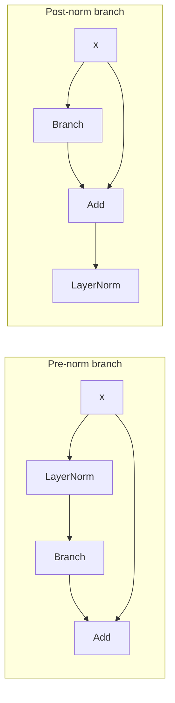
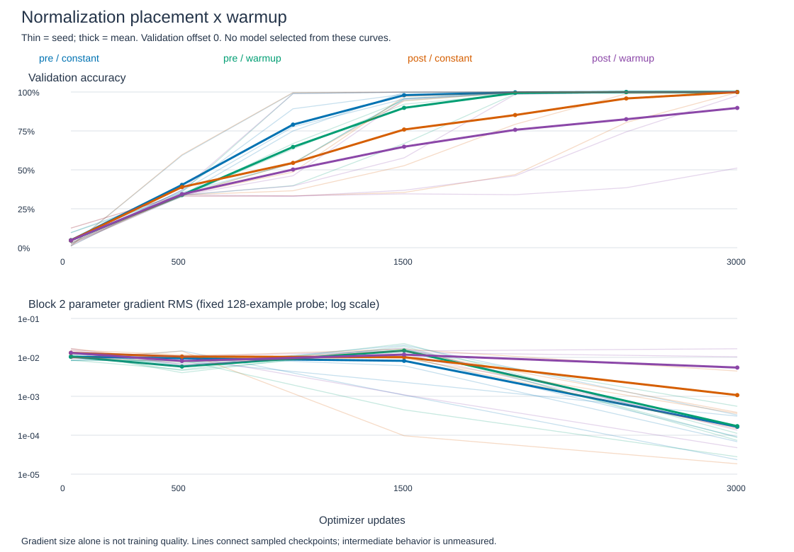

# Internal normalization placement and warmup

Follow-up: the [fixed extension to 6,000 updates](norm-extension-results.md) recovers both weak seeds on fresh mappings. The results below retain their original 3,000-update scope.

All 20 runs completed with finite losses and gradients. Pre-norm passes the five-seed test criterion with either schedule; post-norm passes without warmup but fails with warmup. This is a bounded result for the chosen task, final-normalization convention, rate and budget. [Predeclared protocol](../../norm-placement-protocol.md).

## What changes mathematically?

For a residual branch B, pre-norm computes y=x+B(LN(x)). Post-norm computes y=LN(x+B(x)). The same tensors are initialized in both cases, but the resulting functions and gradients differ.

Pre-norm backward: g_x = g_y + J_LN^T J_B^T g_y. Post-norm backward: g_x = (I+J_B)^T J_LN^T g_y. Jacobians are evaluated at their respective inputs. Pre-norm has a local identity gradient route around normalization. Post-norm normalizes the combined residual, so both routes pass through that normalization. This alone does not prove which will learn better.

Both branches in each block follow the selected placement. Attention still precedes the FFN. We retain the same separate final LayerNorm before the vocabulary projection in both models. This isolates internal placement, but differs from post-norm implementations that omit a separate final normalization.

## Matched comparison

Five seeds, four conditions: pre/post placement crossed with constant rate/linear warmup. Same 5,088-parameter two-block model, initial tensors, examples, minibatch indices and offset stream within each seed. Train 3,000 updates of 64 examples with Adam, peak rate .001 and offsets 0..4. Warmup uses rate .001*min(step/300,1); no other schedule, clipping or early stopping.

Warmup changes the cumulative learning-rate sum from 3.0000 to 2.8505 (4.98% lower). Equal updates do not imply equal integrated learning rate, and that sum is not an Adam update norm. This is a test of these two complete recipes, not a pure early-rate comparison with an equal-rate-budget control.

All 2,400 new mappings are absent from the 6,020 prior matching-task mappings. Split 1,600/400/400 whole mappings into training/validation/test, with all 18 order/query variants and balanced answers/ranks. Test predictions begin only after all twenty training attempts finish. Final checkpoints only. A 128-example validation probe records parameter-gradient RMS; full validation curves use 7,200 examples at offset 0.

## Execution recovery

The original process became unavailable after five completed runs and the sixth run's saved step-1500 metrics. Its full report was [archived](../../../results/norm_placement_interrupted.json). A [verified recovery runner](../../../experiments/resume_norm_placement.py) checks hashes, reuses the original training/test loops, skips completed conditions, and restarts only the interrupted condition from its fixed seed. No mid-run weights or optimizer state were saved for that unfinished condition. The audit compares its replayed partial curves/probes exactly and verifies completed checkpoint hashes. This is an execution interruption, not evidence of numerical instability.

## Reserved-test results

Each row summarizes five seeds. Mapping correctness requires all 18 order/query variants to succeed. The test contains 400 mapping units, not 7,200 independent mappings.

| Placement / schedule | Mean accuracy | Mean loss, nats | Fully correct mappings | Every seed >=99% |
|---|---:|---:|---:|---|
| Pre / constant | 99.981% | .002010 | 99.65% | Passed |
| Pre / warmup | 99.958% | .002695 | 99.40% | Passed |
| Post / constant | 99.911% | .005845 | 98.85% | Passed |
| Post / warmup | 89.356% | .215518 | 76.55% | Failed |

| Seed | Pre constant | Pre warmup | Post constant | Post warmup |
|---|---:|---:|---:|---:|
| 601 | 99.972% | 99.972% | 100% | 100% |
| 631 | 100% | 99.875% | 100% | 100% |
| 659 | 99.931% | 99.986% | 99.931% | 96.861% |
| 683 | 100% | 100% | 99.639% | 49.931% |
| 719 | 100% | 99.958% | 99.986% | 99.986% |

Warmup is not an automatic improvement in this setting. Two post-norm warmup runs fail the criterion; none encounters nonfinite loss or gradients. This separates a learning failure under the fixed budget from floating-point divergence.

## Paired comparisons

Each difference uses matching seeds. Accuracy differences are percentage points; loss differences are nats. Positive accuracy favors the first-named condition; positive loss is worse.

| Difference | Mean accuracy difference | Seed range | Mean loss difference | Loss range |
|---|---:|---:|---:|---:|
| Post minus pre, constant | -.0694 | [-.3611, +.0278] | +.003835 | [-.000576, +.017987] |
| Post minus pre, warmup | -10.6028 | [-50.0694, +.1250] | +.212823 | [-.004005, +.974533] |
| Warmup minus constant, pre | -.0222 | [-.1250, +.0556] | +.000684 | [-.003066, +.004213] |
| Warmup minus constant, post | -10.5556 | [-49.7083, .0000] | +.209673 | [-.000173, +.956545] |

Only the two contrasts involving post-norm warmup exceed the predeclared one-point magnitude margin. The other differences are below margin, not demonstrated equivalence. These are descriptive paired results, not significance tests. The poor mean is strongly influenced by seed 683; retain that losing case rather than discarding it.

## Learning and gradient visualization

[Standalone figure](../../figures/norm-placement.svg). Thin lines preserve all five seeds; thick lines are arithmetic means. The gradient panel uses a fixed 128-example validation probe and block-2 parameter gradients, not the entire training stream. Lines join recorded checkpoints only.

| Condition | First scheduled validation >=99%, seeds 601/631/659/683/719 |
|---|---|
| Pre constant | 2000 / 1000 / 2000 / 1500 / 2000 |
| Pre warmup | 2500 / 1500 / 2000 / 2000 / 2500 |
| Post constant | 2000 / 1000 / 3000 / 3000 / 2000 |
| Post warmup | 2500 / 1500 / not reached / not reached / 2000 |

Validation was sampled every 500 updates. These are first observed threshold crossings, not exact convergence times or guaranteed sustained performance. Warmup never reaches this observed threshold earlier within the matched placement/seed pairs in this run.

At initialization, block-2 gradient RMS averages .01040 for pre-norm and .01308 for post-norm; schedules are identical before any update. Maximum absolute parameter gradients observed during training range by condition up to 5.31 (pre constant), 3.58 (pre warmup), 2.04 (post constant), and 4.66 (post warmup). These maxima and probe curves do not isolate the cause of the failed runs. Finite, larger or smaller gradients alone are not a training-quality ranking.

## Bounded conclusion

For this matched two-block recipe, internal normalization placement interacts with the selected warmup schedule. Post-norm can learn the task without warmup, while this warmup recipe is unreliable across seeds within 3,000 updates. Pre-norm succeeds under both tested schedules. This does not establish that pre-norm always wins or warmup is generally harmful.

The matched intervention supports an effect of these complete recipes on these runs. It does not identify the internal reason for seed 683's failure or predict outcomes at larger depth, other rates or longer budgets. Stop without tuning this opened test set. Any broader optimization claim requires a new, explicitly bounded comparison.

## Paper comparison and limits

[Xiong et al., ICML 2020](https://proceedings.mlr.press/v119/xiong20b.html) analyze normalization placement and initialization gradients, and report benefits of pre-norm without warmup in their settings. Our shallow recall task, rate, final normalization convention and data differ. This is not a reproduction or a refutation of their broader findings. Source publication/abstract checked; a full implementation audit is absent.

Five seeds on one task and one dataset split cannot establish general superiority. Accuracy can saturate while losses or learning trajectories differ. Report the predeclared one-percentage-point descriptive margin; a smaller difference is below that margin, not proof of equivalence. No statistical significance claim or post-test tuning.

## Verification and evidence

[Training code](../../../experiments/norm_placement.py), [fresh splits](../../../results/norm_placement_splits.json), [raw report](../../../results/norm_placement.json), [saved test logits](../../../results/norm_placement_test_scores.json), [checkpoint audit](../../../results/norm_placement_audit.json), [plot data](../../../results/norm_placement_plot_data.csv), [plot provenance](../../../results/norm_placement_plot_manifest.json).

All 20 final checkpoints were reloaded and evaluated through the explicit forward. Test logits and metrics reproduced exactly. Initial forward/parameter-gradient parity passed for both placements with zero discrepancy. Whole-mapping exclusion, complete variants, label/rank balance, paired initialization/batch/offset hashes, learning-rate sums and criteria passed. The interrupted condition's archived curves and probes reproduced exactly; completed checkpoints were preserved. The audit initially had a missing parenthesis, corrected before any audit result was produced; training artifacts were unaffected. Verification shares PyTorch and is not an independent framework replication. SVGs are data-generated and XML-validated.
