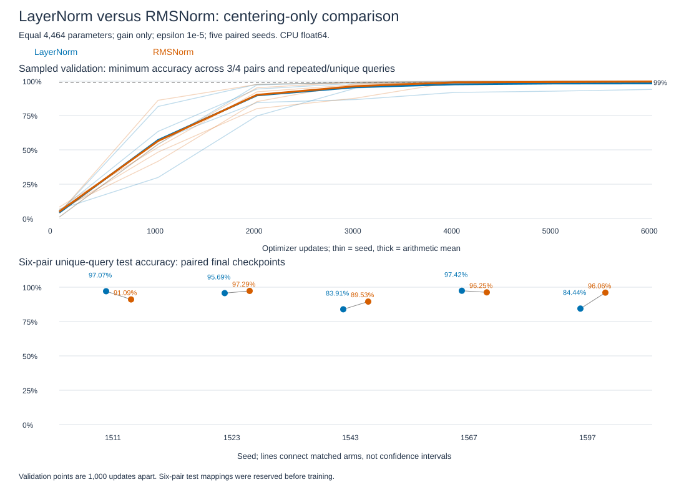

# LayerNorm versus RMSNorm: trained recall results

**RMSNorm improves averages but fails the fixed adoption rule.** Six-pair unique-query mean accuracy rises from 91.71% to 94.04% (+2.34 percentage points). Three seeds improve and two worsen. One RMS seed misses 90%; paired losses exceed the allowed 1 point. Retain centered normalization as the baseline under this rule. Both methods still have reliability limits.

All ten runs finish 6,000 updates with finite losses and gradients. All 30 independent checkpoint evaluations pass. The [protocol](../../rmsnorm-training-protocol.md) was fixed before training and test evaluation; comparison closed.

## What changes, and why?

Both normalize each token's features using a learned gain gamma. LayerNorm subtracts their mean mu first; RMSNorm retains it:

`LN(x)=gamma*(x-mu)/sqrt(mean((x-mu)^2)+epsilon)`.

`RMS(x)=gamma*x/sqrt(mean(x^2)+epsilon)`.

Removing mu changes outputs and gradients during learning. The [mathematical study](rmsnorm-math-results.md) derives those differences. This comparison changes all five normalization sites together; it cannot identify which site explains a gain or loss.

Both arms use gain only, no normalization bias, epsilon 1e-5 and 4,464 parameters. All initial parameter values match within each paired seed. Other components: width 16, two pre-norm blocks, two query heads, one shared K/V head, RoPE offset 4, ReLU/FFN32. The prior accepted MQA study learns normalization biases and has 4,544 parameters; its percentages are separate historical evidence.

CPU float64, Adam at 0.001, batch 64, alternating three/four-pair updates, 6,000 updates and 3,456,000 tokens per run. Both arms receive identical index streams and query exposure. Final checkpoints are tested after all attempts finish.

Four-pair families800/100/200 train/validation/test and six-pair200 test families exclude7,820 prior families. The exhausted three-pair160/20/40 split is reused diagnostic evidence. Every family has36 order/value variants; every context is queried for all present keys. Test decisions per model:2,880 /21,600 /36,000. Variants and queries from one family are dependent.

## Accuracy findings

R queries the repeated key and requires its latest value. U queries a key occurring once. Means use all five seeds; pp means percentage points.

| Pairs | LN R | RMS R | LN U | RMS U |
|---|---:|---:|---:|---:|
|3, reused|99.208%|99.986%|99.361%|100.000%|
|4, training length|98.456%|99.794%|98.860%|99.981%|
|6, longer inputs|93.781%|96.786%|91.708%|94.044%|

Every RMS seed passes the 99% floors at three/four pairs. LN has short-length misses, including seed 1597 at 94.50% overall four-pair accuracy. Successful short-length RMS training is supported here; that does not guarantee length transfer.

| Seed | LN six R | RMS six R | R gain pp | LN six U | RMS six U | U gain pp |
|---|---:|---:|---:|---:|---:|---:|
|1511|96.083%|93.333%|-2.750|97.066%|91.087%|-5.979|
|1523|94.639%|97.028%|+2.389|95.694%|97.292%|+1.597|
|1543|90.833%|96.361%|+5.528|83.913%|89.528%|+5.615|
|1567|99.736%|99.167%|-0.569|97.424%|96.253%|-1.170|
|1597|87.611%|98.042%|+10.431|84.441%|96.059%|+11.618|

Seed 1597 contributes +11.62pp unique gain; the other four paired unique gains sum to only +0.0625pp. The overall positive mean is sensitive to the weak baseline seed, which remains included. LN also has two six-pair unique scores below 90%; retaining it does not certify reliability.

Mean six-pair unique cross-entropy falls from 0.51883 to 0.39650 nats. Mean fully correct six-pair contexts rises from 67.00% to 74.92%. These descriptive improvements cannot replace the adoption criteria.

## Fixed decision

Three checks fail: RMS seed 1543 unique accuracy 89.528% misses 90%; unique losses for 1511/1567 exceed 1pp; repeated loss for 1511 is 2.750pp, exceeding 1pp. Equal parameters, all short-length RMS floors, six-pair repeated floor, unique mean gain>=1pp and repeated mean-loss tolerance all pass.

The90% boundary and loss tolerances are predefined research decisions, not mathematical discontinuities. Preserve the gains alongside the failed rule. No seed removal or extra training follows.

## Learning during training

Top: minimum validation accuracy across both query types at three/four pairs; thin lines are seeds and thick lines are means. Bottom: paired six-pair unique test scores. Connecting lines are not confidence intervals.

| Seed | First sampled LN validation>=99% across all four conditions | RMS milestone |
|---|---:|---:|
|1511|5,000|3,000|
|1523|4,000|4,000|
|1543|5,000|4,000|
|1567|3,000|3,000|
|1597|Not reached|4,000|

Validation is sampled every1,000 updates. Milestones are first observed crossings, not exact convergence times or guarantees of sustained performance. Training-length learning and longer-sequence reliability answer different questions. Recorded loop times include validation and are descriptive; GPU speed was not measured.

## Audit, paper comparison and closure

Pretraining logits and gradients agree with separate normalization/rotation/SDPA arithmetic; maximum gradient discrepancy4.44e-16. Causal-prefix and intentionally wrong-centering controls pass. The final audit checks fresh-family isolation, initialization/stream hashes, optimizer steps, all30 test logits and metrics, and independently derives the failed decision. Maximum final logit disagreement2.96e-13.

[Zhang/Sennrich2019, section6.1](https://arxiv.org/html/1910.07467v1) reports comparable translation quality and lower normalization runtime in its implementations. Our gain-only repeated-key task, dimensions,6,000-update budget and CPU precision differ. We observe improved averages with seed-level losses; the paper's benchmark quality/speed was not reproduced. [PyTorch2.14 LN](https://docs.pytorch.org/docs/2.14/generated/torch.nn.LayerNorm.html) and [RMSNorm](https://docs.pytorch.org/docs/2.14/generated/torch.nn.RMSNorm.html) provide the native operations with explicitly matched conventions.

Evidence: [report](../../../results/rmsnorm_training.json), [data](../../../results/rmsnorm_training_data.json), [final scores](../../../results/rmsnorm_training_scores.pt), [pretraining checks](../../../results/rmsnorm_training_verification.json), [audit](../../../results/rmsnorm_training_audit.json), [plot data](../../../results/rmsnorm_training_plot_data.csv). Code: [runner](../../../experiments/rmsnorm_training.py), [auditor](../../../experiments/audit_rmsnorm_training.py).

**Normalization section closed.** [Consolidated assessment](../../assessments/normalization-assessment.md) retains the mathematical and trained findings. Next use the [recipe assessment](../../assessments/recipe-assessment.md) to define one different-task comparison. No further normalization tuning is selected.
