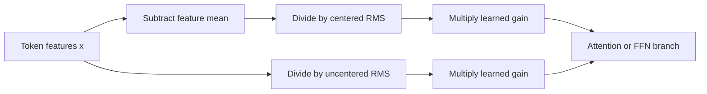

# LayerNorm and RMSNorm: a short learning guide

Normalization rescales each token's feature vector before a branch. It does not mix tokens. This can change both the branch output and the gradients used to train it.

## What changes?

Let x have d features, mean mu, and learned per-feature gain gamma. Our comparison has no normalization bias and uses epsilon1e-5.

| Operation | LayerNorm | RMSNorm |
|---|---|---|
| Center features | `z=x-mu` | `z=x` |
| Denominator | `sqrt(mean((x-mu)^2)+epsilon)` | `sqrt(mean(x^2)+epsilon)` |
| Output | `gamma*z/denominator` | `gamma*z/denominator` |

The key identity is `mean(x^2)=variance(x)+mu^2`. RMSNorm's denominator includes the mean's squared contribution. LayerNorm removes the common offset first. RMSNorm does not preserve that offset unchanged; it rescales it with the rest of x.

Learned per-feature gain can make LN's final output nonzero-mean. Centering describes the step before that gain.

For x=[1,3], unit gain and epsilon=0, LN gives[-1,1]. RMS gives approximately[0.447,1.342]. Adding2 to every feature leaves LN unchanged but changes RMS to[0.728,1.213]. These are illustrative arithmetic examples, not training evidence.

## Why gradients differ

Write `P=I-11^T/d` and `z=Px`. The denominators differ:

`r_R=sqrt(mean(x^2)+epsilon)`; `r_L=sqrt(mean(z^2)+epsilon)`.

`J_RMS=diag(gamma)*(I/r_R-xx^T/(d*r_R^3))`.

`J_LN=diag(gamma)*(P/r_L-zz^T/(d*r_L^3))`.

J tells us how a small input change affects the normalized output. LN's P removes the uniform-shift direction. RMS lacks that projection. Even when x has zero mean and outputs match, the Jacobians can differ. With nonzero epsilon, positive scaling is only approximately invariant. Neither formula guarantees nonzero whole-network gradients.

The [earlier mathematical study](rmsnorm-math-results.md) verifies68 cases with an independent Decimal audit. It is reused here, not counted as new evidence.

## What the new experiment asks

Does replacing all five gain-only LN sites with RMS improve WikiText-2 validation perplexity? Both controls keep the same attention, RoPE, ReLU/FFN32, initial parameter tensors and token starts. Both have1,068,752 parameters. Both omit the original biased baseline's80 normalization bias parameters. This isolates the normalization statistics within these controls; it does not test whether bias removal is beneficial.

Matching weights does not mean matching initial outputs: the normalization functions differ. See the [measured results and stopping decision](wikitext2-norm-results.md).

Perplexity is `exp(mean next-word negative log probability)`. Lower is better. Three seeds are three training pairs; hundreds of thousands of scored tokens are not independent training runs. The [frozen decision](../../decisions/0005-wikitext2-normalization.md) fixes the budget and adoption margin. A result cannot identify which of the five sites caused it, establish convergence, or measure speed.

[Zhang/Sennrich2019](https://arxiv.org/html/1910.07467v1) defines RMSNorm and reports results in different tasks and implementations. [Jiang et al.2023](https://arxiv.org/html/2305.14858v2) studies equivalence after network transformations. That is different from exchanging normalization modules under the same initial weights. [PyTorch2.11 RMSNorm](https://docs.pytorch.org/docs/2.11/generated/torch.nn.RMSNorm.html) supports our explicitly matched epsilon/gain conventions.
