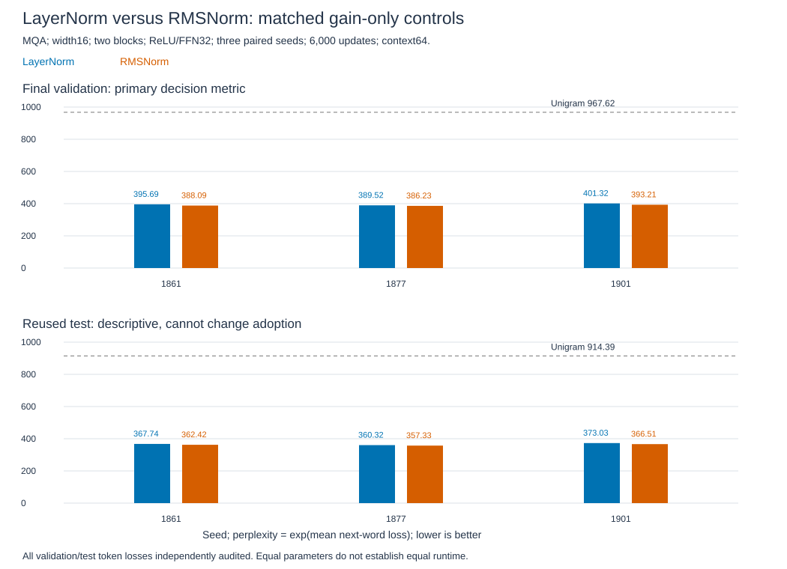

# Normalization transfer: WikiText-2 results

**RMSNorm improves every paired validation result, but misses the adoption margin.** Geometric mean validation perplexity395.48 to389.17, a1.60% reduction. The predefined target was at least2%. Reused test improves1.34%. This is a modest local gain, not evidence that LayerNorm is more accurate.

All six runs and twelve independent evaluations pass. **Study closed; original recipe retained without tuning.**

## What changed and why

LN subtracts each token's feature mean before scaling; RMS uses its uncentered second moment. Both learn per-feature gain. The [short guide](wikitext2-norm-guide.md) explains the equations, Jacobians and diagram. Removing centering changes outputs and learning gradients, but does not guarantee a quality gain.

[Decision0005](../../decisions/0005-wikitext2-normalization.md) was fixed before these evaluations. Both arms use gain-only normalization, epsilon1e-5, width16, two pre-norm blocks, MQA two query/one KV head, RoPE offset4, biased ReLU/FFN32 and untied vocabulary matrices. All five normalization sites change together. Both omit the original external baseline's80 normalization bias parameters; bias removal is not separately tested or adopted. Earlier biased-baseline scores are not paired controls.

## Method and results

Three new paired seeds1861/1877/1901. Each pair starts with identical parameter tensors and receives identical sampled token starts. Each run:6,000 default Adam.001 updates, batch8/context64,3,072,000 training targets. Six runs process18,432,000 targets. Native Windows RTX4060 Laptop, PyTorch2.11 CUDA12.8 FP32, deterministic settings, TF32 off. No warmup, clipping, dropout, tuning or checkpoint selection. All runs finish with finite loss/gradient/parameter checks.

The pinned train-only vocabulary has33,278 words. Each model has1,068,752 parameters; FFN projection costs and parameter counts match. Normalization arithmetic differs. Evaluation restarts context at each nonoverlapping64-token chunk and includes the45-token validation tail. Each checkpoint scores217,645 validation and245,568 test targets. Both official splits were used previously: this is reused benchmark evidence, not fresh confirmation.

| Seed | LN validation PPL | RMS validation PPL | RMS change | LN test PPL | RMS test PPL |
|---|---:|---:|---:|---:|---:|
|1861|395.69|388.09|-1.92%|367.74|362.42|
|1877|389.52|386.23|-0.84%|360.32|357.33|
|1901|401.32|393.21|-2.02%|373.03|366.51|
|Geometric mean|395.48|389.17|-1.60%|366.99|362.07|

PPL is `exp(mean token NLL)`. The aggregate paired ratio is `exp(mean_seed(NLL_RMS-NLL_LN))=0.984035`, not the arithmetic mean of token or seed perplexities. Seeds are the training units; individual tokens are not additional independent runs.

Bars show final scores, not convergence curves. The dotted line is the training-count unigram baseline.

## Decision and verification

Adoption requires six completed finite runs, each beating the add-one train-count unigram by.05 nats, mean validation ratio<=.98 and every ratio<=1.00. Only the2% improvement check fails. The decision was frozen and hashed before test scoring. Test cannot change it. The threshold is a research target, not a statistical significance boundary.

All six actual-vocabulary preflights pass: maximum CPU-double logit error1.55e-15, gradient error2.78e-17, CUDA logit error6.95e-7 and relative gradient error2.73e-7. Wrong-centering controls change logits by1.25 to1.97; causal-prefix checks pass. Gain-only LN exactly matches the previous forward with norm biases removed. The existing68-case normalization math/Decimal audit is reused with report/source hashes verified.

The independent CPU-double audit checks all2,779,278 validation/test token losses across twelve cells, using manual normalization/RoPE and SDPA rather than producer softmax. Maximum token NLL error1.70e-5, mean error1.19e-8, fixture logit error1.03e-5; all are within frozen tolerances. Zero argmax differences. Initialization/stream replay, optimizer counters, exact coverage, checkpoint/source hashes, unigram and independently derived validation decision all pass.

Loop time totals719.04 seconds (11.98 minutes), including periodic validation and excluding setup, checkpoint writing, final scoring and audit. This is descriptive timing, not a controlled speed comparison. Every final validation interval still improves; convergence is unproven.

## Papers, limits and stop

[Zhang/Sennrich2019, section6.1](https://arxiv.org/html/1910.07467v1) reports comparable Transformer translation quality and runtime benefits in a larger, different implementation. Our small word-prediction model shows a modest quality gain; its speed result was not reproduced. [Jiang et al.2023, section3.1](https://arxiv.org/html/2305.14858v2) recenters embeddings and branch output projections to obtain equivalence. Our unchanged-weight module swap is a different comparison.

The responsible normalization site, other scales, optimizer interactions and general superiority remain unknown. Keep the original recipe. No epsilon/bias/site sweep, extra seeds or longer training follows.

Evidence: [report](../../../results/wikitext2_norm.json), [preflight](../../../results/wikitext2_norm_verification.json), [scores and fixtures](../../../results/wikitext2_norm_scores.pt), [audit](../../../results/wikitext2_norm_audit.json), [plot data](../../../results/wikitext2_norm_plot_data.csv), [figure manifest](../../../results/wikitext2_norm_plot_manifest.json). Code: [runner](../../../experiments/wikitext2_norm.py), [independent auditor](../../../experiments/audit_wikitext2_norm.py). No further experiment is selected.
