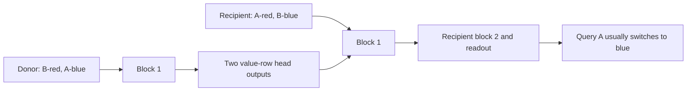

# Do value-row head outputs carry binding-related information?

**Yes, under this matched transfer intervention.** Changing only donor key tokens and transferring two value-row outputs makes recipients follow the changed binding in 99.997% of predictions. This is stronger evidence than zeroing or inspecting attention. It does not isolate a pure key-identity code.

## What changed?

Example: recipient `[A,red,B,blue,C,green,marker,A]` answers red. Donor `[B,red,A,blue,C,green,marker,A]` answers blue. Values, positions and query stay fixed. Only the keys A/B exchange positions.

Transfer both heads' summed block-1 contributions at the two affected value rows from donor into recipient. The recipient retains its own tokens and other activations. Reverse transfer puts recipient contributions into the donor. A control swaps the two unqueried keys and transfers their corresponding value-row contributions; the answer should stay unchanged.

Same five frozen models and 7,200 opened examples. Seven conditions each, no training or head selection. [Predeclared protocol](../../key-content-protocol.md).

## Math and meaning

At selected destination rows R, replace `C_0(recipient)[i]+C_1(recipient)[i]` with `C_0(donor)[i]+C_1(donor)[i]`. Keep the shared bias, residual and later computation. Each contribution is `C_h[i] = (sum_j A_h[i,j] V_h[j]) W_O,h^T`.

The donor key change can alter both A and V, and several causal context effects. Thus this intervention tests the combined head output, not key-only vectors, literal key copying, or a unique encoded feature. Token key identity and attention K are different concepts.

## Measured results

Means across five seeds. Original and changed answers are always distinct. Loss uses the answer appropriate to the condition shown.

| Condition | Original-answer agreement | Changed-answer agreement | Relevant loss, nats |
|---|---:|---:|---:|
| Ordinary recipient | 100% | 0% | .000136 (original) |
| Ordinary changed donor | 0% | 100% | .000140 (changed) |
| Ordinary answer-preserving donor | 100% | 0% | .000137 (original) |
| Self transfer | 100% | 0% | .000136 (original) |
| Changed donor into recipient | 0% | 99.997% | .000339 (changed) |
| Recipient into changed donor | 99.828% | .025% | .006235 (original) |
| Answer-preserving transfer | 99.992% | 0% | .000244 (original) |

Every ordinary endpoint is correct, so conditioning on correct endpoints retains all examples. These agreements are diagnostic predictions, not an improvement to normal task accuracy. Forward transfer deliberately makes the recipient answer according to the donor binding.

| Seed | Forward: changed answer | Reverse: original answer |
|---|---:|---:|
| 601 | 99.986% | 99.167% |
| 631 | 100% | 99.972% |
| 659 | 100% | 100% |
| 683 | 100% | 100% |
| 719 | 100% | 100% |

Forward transfer has one non-donor-answer prediction across 36,000 model/example evaluations. Reverse transfer has 62 non-original-answer predictions. Answer-preserving transfer has three errors. Retain these failures; the effect is strong, not exact.

## What this establishes, and what remains unknown

The changed output cannot be explained by different donor value tokens or positions: those were held fixed. Transferred activations carry an effect of changed keys that strongly controls the eventual binding choice. Reverse and answer-preserving controls support that interpretation.

It remains unknown whether the information is key identity itself, a relational representation, or another key-dependent feature. We replace both heads together at two rows, selected using the query. We have not isolated a single head, source token, vector component, or downstream Q/K versus V route. Similarity to a familiar retrieval circuit is not proof of that circuit.

Derived donors contain 1,179 unique mappings in each donor family; 56 overlap these models' training mappings. They are not new held-out tests. Examples share mappings and values. This is exploratory mechanistic evidence for these five models, not generalization, pruning or architecture superiority.

## Verification and evidence

All 35 conditions completed. Explicit projected contributions agree with direct library attention-output replacement within 4.09e-14. Self transfer agrees with ordinary inference within 2.49e-14. Label checks verify the intended swaps and unchanged values/query. Saved summaries reproduce exactly; checkpoint hashes are unchanged. Both implementations share PyTorch.

[Runner](../../../experiments/key_content.py), [matched inputs](../../../results/key_content_inputs.json), [raw results](../../../results/key_content.json), [saved logits](../../../results/key_content_scores.pt), [audit](../../../results/key_content_audit.json), [audit code](../../../experiments/audit_key_content.py).

This extends the [head-row evidence](../attention/head-row-results.md); the [earlier paper comparison](../attention/head-ablation-results.md#papers-and-limits) remains background, not support for these newly measured percentages. No new literature claim is made. Close this bounded content-transfer test before choosing another question.
