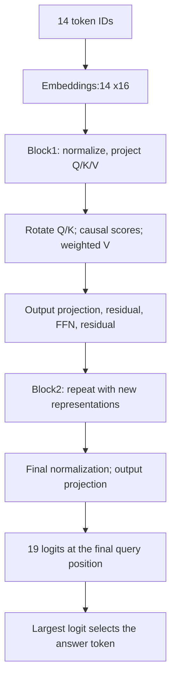

# From input pairs to a trained answer

**The input supplies the entries. Learned weights transform them into Q/K/V vectors and then an answer.** Here is one actual saved model, not another training experiment.

We trace seed1201, FFN32, on six-pair test rows0 and1 from the width study. They are an order and its reversal, selected by index without filtering predictions. Both were already evaluated. This is an educational example, not fresh confirmation. The earlier [numerical walkthrough](../foundations/numerical-walkthrough.md) used untrained fixed weights; this trace uses the trained two-block RoPE model.

## 1. What goes into the model?

| Pair number | Original order | Reversed order |
|---|---|---|
| 1 | key10 -> value15 | key5 -> value13 |
| 2 | key5 -> value12 | key9 -> value14 |
| 3 | key4 -> value17 | key2 -> value16 |
| 4 | key2 -> value16 | key4 -> value17 |
| 5 | key9 -> value14 | key5 -> value12 |
| 6 | key5 -> value13 | key10 -> value15 |

Both ask for **key5's latest value**. The original answer is **value13**; the reversed answer is **value12**. These names denote token IDs, not attention vectors.

Six pairs produce12 tokens. A marker and the queried key add two more:14 tokens total. In the original, the old value is at token position3, the latest at11, the marker at12 and the query at13. Positions here are zero-based; RoPE uses those indices plus4.

## 2. What are Q, K and V here?

| Term | Meaning |
|---|---|
| Task key/value | The literal entries above, encoded as token IDs. |
| Query token | The final key5 token asking for an answer. |
| Attention Q | A learned vector produced from a token's current representation. |
| Attention K | A learned vector compared with Q to calculate a score. |
| Attention V | A learned vector combined using attention weights. It is not a literal value token ID. |

**Every token produces Q, K and V**, including key tokens, value tokens, the marker and the final query. Each block has its own projections. Each head has8 coordinates per vector. The second block starts with representations already changed by the first block.



## 3. One measured attention calculation

For each head, `Q=Z*Wq^T+bq`, similarly K/V, where Z is the normalized representation. RoPE rotates Q/K by position. Scores are `s_ij=q_i dot k_j/sqrt(8)`. Future positions are masked, then `a_ij=exp(s_ij)/sum_visible exp(s_it)`.

For the original example, block2/head1 compares the final query with the latest value position:

`dot product =40.181895`; `score =40.181895/sqrt(8)=14.206445`; `attention weight =0.969240`.

The score becomes a weight only after comparison with **all visible scores**. That head returns the vector `h_i=sum_j a_ij*v_j`, not a token ID.

## 4. Where the final query attends

Weights below are percentages. Each row is one head; other positions receive the remaining weight.

| Block / head | Original: older value | Original: latest value | Reversed: older value | Reversed: latest value |
|---|---:|---:|---:|---:|
| 1 / 1 | 0.007% | 0.017% | 0.058% | 0.024% |
| 1 / 2 | 1.080% | 9.957% | 1.722% | 6.732% |
| 2 / 1 | 1.911% | 96.924% | 0.585% | 95.599% |
| 2 / 2 | 6.837% | 88.193% | 1.574% | 84.334% |

In both orders, block1/head1 attends most to the final query itself. Block1/head2 attends most to the latest matching **key** position. Both block2 heads attend most to the latest matching **value** position. This describes these two examples; it does not establish universal head roles.

## 5. How vectors become the answer

The two head outputs concatenate into16 coordinates and pass through an output projection. A residual addition preserves the incoming representation. The FFN transforms it, followed by another residual addition. After both blocks, final LayerNorm and the learned output matrix produce19 logits. Softmax turns logits into probabilities; argmax selects the answer.

| Input order | Correct token | Predicted token | Model probability of correct token |
|---|---|---|---:|
| Original | value13 | value13 | 99.9956% |
| Reversed | value12 | value12 | 99.9929% |

These probabilities describe the model's output, not a demonstrated calibration guarantee. The entries change with the input; no weights are updated during this trace.

## What is established, and what is not?

**Observed:** both answers are correct; the block2 query attention favors the latest matching value in both orders. The entire forward computation is recorded, including full Q/K/V, scores, weights, residuals, FFN tensors and logits.

**Not established:** that these attention peaks alone cause the answer, that each head has a fixed role, or that the query token is necessary. The task always queries the sole repeated key, so identifying that duplicate is a possible shortcut. Attention inspection is not a causal intervention.

## Verification and evidence

The trace matches the executed forward and saved logits exactly. An independent matrix-rotation/SDPA calculation agrees within3.56e-15. Masked weights are zero; attention rows sum to one within1e-12. Checkpoint, data, archived scores and executed-source hashes were checked. No training or new accuracy benchmark was run.

[Executable](../../../experiments/trained_recall_trace.py) and [full numerical trace](../../../results/trained_recall_trace.json). Reproduce with:

```powershell
.venv/Scripts/python.exe experiments/trained_recall_trace.py
```

This closes the explanatory trace. The [width comparison's reliability limits](../ffn/ffn-width-results.md) remain unchanged.


Follow-up: [fixed-context query changes](../training/query-switch-results.md) demonstrate query sensitivity across five saved models, with uneven transfer to previously untrained query types. The head-level mechanism remains unresolved.
