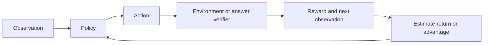

# From rewards to PPO, RLHF and GRPO

Parked by the user on 2026-10-04 while we investigate [unresolved learning mechanisms](../../assessments/learning-mechanism-agenda.md). The planned RL scope remains foundations, an applied task, and language-model training. The [context-use diagnostic](../attention/language-context-use-results.md) is complete; broader explanations of learned failures remain open. This is a future roadmap, not an active experiment or a frozen training budget.

## What changes when we use RL?

A policy chooses an action. The environment returns a reward and a new observation. Training seeks higher expected return:

$$J(\theta)=\mathbb E_{\pi_\theta}\left[\sum_{t=0}^{T-1}\gamma^t r_{t+1}\right].$$

Here gamma discounts future rewards. A value estimates future return. An advantage measures how much better an action was than its baseline. A reward is feedback; it can be noisy, delayed or poorly matched to the intended task. [Sutton and Barto](https://web.stanford.edu/class/psych209/Readings/SuttonBartoIPRLBook2ndEd.pdf), chapters 2 and 3 inspected in this 2014/2015 second-edition draft.

For a language model, an action can be a token. Its state includes the prompt and generated prefix. A reward can grade the completed answer. The Transformer supplies the policy; the RL objective changes how we train it.

## One connected path

| Stage | Learn | Evidence needed before advancing |
|---|---|---|
| 1. Exact small environment | Exploration, return, Bellman updates and delayed credit | Sampled learning compared with a random agent and an exact optimal-policy oracle |
| 2. Policy gradients and PPO | Sampling, baselines, advantage estimates and clipped updates | Independent objective/gradient checks; returns, KL, entropy and failed seeds |
| 3. Applied environment | Use the agent on a defined task | Separate reward from actual task success; fresh environments/seeds, interaction counts and resources |
| 4. Language and RLHF | Demonstrations, human preferences, reward model, policy optimization | A competent supervised baseline, held-out prompts, reward-model checks and independent task evaluation |
| 5. GRPO and named variants | Group-relative credit, normalization, length weighting and sampling | Controlled comparison on one task with a verified reward and measured rollout/training cost |

First proposed question when RL resumes: **can sampled learning recover an exactly known optimal policy with delayed terminal reward?** Use a small finite navigation environment, tabular Q-learning, random and exact-planning baselines. Track returns, optimal-policy agreement, state/action coverage and failures across seeds. Freeze transitions, rewards, episode limits, evaluation and budget before running. A bandit can be a one-step test fixture, rather than another separate study. This question develops the foundations needed for the later stages; it does not compare neural architectures.

## How the language methods relate

| Method | Mechanism | Important boundary |
|---|---|---|
| PPO | Optimize a clipped probability-ratio objective with estimated advantages | Clipping removes some update incentives; it does not impose a hard bound on every policy probability |
| RLHF | Learn from human feedback, commonly through a preference-trained reward model and policy optimization | Human-derived reward must be evaluated against held-out human/task judgments |
| RL with verifiable rewards | Grade outputs using a checkable rule, such as exact answers | Verify the checker and test reward shortcuts; this supplies different feedback from human preferences |
| Original outcome GRPO | Sample several answers per prompt; center and scale rewards within each group to obtain advantages | No learned value model in this formulation; equal-reward groups have no centered outcome learning signal |
| Dr. GRPO | Modify response-length and group-standard-deviation normalization | Its paper identifies biases in its analyzed GRPO formulation; a local benefit still needs testing |
| DAPO | Combine asymmetric clipping, dynamic sampling, token-level loss and overlong reward handling | Several changes act together; isolate one component when asking for its causal effect |

PPO's published core objective is

$$L^{\rm clip}=\mathbb E\left[\min(\rho_t\hat A_t,\operatorname{clip}(\rho_t,1-\epsilon,1+\epsilon)\hat A_t)\right],\qquad
\rho_t=\frac{\pi_\theta(a_t\mid s_t)}{\pi_{\rm old}(a_t\mid s_t)}.$$

[Schulman et al., 2017](https://arxiv.org/pdf/1707.06347), section 3, equation 7 and figure 1 inspected. Advantage estimation, value fitting and entropy terms require their own declared implementation choices.

Original outcome GRPO uses $\hat A_i=(R_i-\bar R)/\operatorname{std}(R)$ across answers to one prompt. Zero-variance groups need an explicit numerical rule. [DeepSeekMath, 2024](https://arxiv.org/html/2402.03300v3), sections 4.1.1 and 4.1.2 inspected. [InstructGPT, 2022](https://arxiv.org/html/2203.02155v1), section 3.1 inspected for the demonstration/preference/PPO pipeline. These sources describe methods, not predicted local scores.

For “GRPO++”, select an exact paper and version before implementation. [Dr. GRPO, 2025](https://arxiv.org/html/2503.20783v1), sections 3.1 and 3.2, and [DAPO, 2025](https://arxiv.org/html/2503.14476v1), section 3, are named candidates reviewed here. They are distinct algorithms. This is a targeted primary-source starting set, not an exhaustive latest-literature survey; recheck versions when freezing a comparison.

## Keep the earlier research lessons

Run evaluator and independent-audit fixtures before training. Preserve every attempt. Select recipes using declared development evidence and reserve confirmation. For RL, report environmental interactions, generated tokens, updates, effective batch, return/task success and peak memory. Rewards may rise without task quality improving. More VRAM permits a larger profile, not a larger conclusion.

The laptop has 8 GB VRAM. Profile generation plus a complete optimizer step before choosing a language-model budget. Model size, rollout group size and sequence length remain undecided. No promise of reproducing a 7B/32B paper result on this hardware is made.
