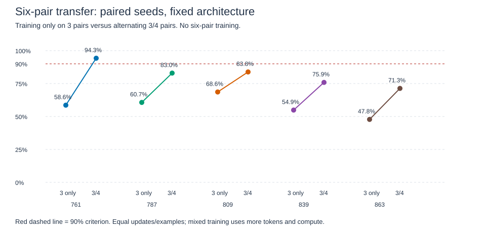

# Does broader training exposure improve length transfer?

**Broader exposure improves transfer, but fails the reliability criterion.** Six-pair mean accuracy rises from 58.11% to 81.65%; all five seeds improve, but only one reaches 90%. Reject this recipe as a reliable solution under the fixed budget. This compares training recipes, not architectures. [Decision rule](../../length-exposure-decision.md), [frozen execution protocol](../../length-exposure-protocol.md).

## What is different?

The baseline trains only on three pairs. The candidate alternates three and four pairs. Neither trains on six pairs. Both use the same two-block pre-norm architecture, five paired initializations, Adam .001, batch64, 6,000 updates and canonical position start +4. All models are newly trained; earlier length scores are not the matched baseline.

The training objectives differ: baseline estimates `E_D3[CE]`; alternating batches estimates `.5 E_D3[CE] + .5 E_D4[CE]`. Broader exposure also reduces the fraction of three-pair examples. This comparison does not separate those effects.

## Data and compute

Whole mappings are split before training, with previous recorded mappings excluded. Three-pair train/validation/test counts are 1,600/200/400; four-pair counts are 1,605/210/420. Six pairs has 420 reserved test mappings only. Each mapping supplies six orders and every query per order. Test sequence counts are 7,200/10,080/15,120. Targets and query ranks balance. Variants share mappings; familiar smaller submappings can remain.

Both recipes process 384,000 training examples per run. Baseline processes 3,072,000 tokens; mixed processes 3,456,000 (+12.5%). The attention-size proxy `sum(batch * sequence_length^2)` rises from 24,576,000 to 31,488,000 (+28.125%). This is not a measured FLOP count. Equal updates are not equal compute.

Validation is recorded every1,000 updates. Only final checkpoints enter reserved evaluation, after all training attempts. No test-based tuning or selection. Adam and RNG states are saved for recovery.

The manifest excludes 9,631 earlier three-pair mappings, 420 four-pair mappings and 420 six-pair mappings. All new splits pass the full-mapping isolation checks.

## Reserved-test results

Means over five seeds. CE is cross-entropy in nats. Mapping correctness requires every sampled order/query variant to succeed; variant counts differ by length, so this stricter metric is not directly comparable across lengths.

| Pairs | Baseline accuracy | Mixed accuracy | Baseline CE | Mixed CE | Fully correct mappings, baseline / mixed |
|---|---:|---:|---:|---:|---:|
| 3 | 100% | 100% | .000142 | .000171 | 100% / 100% |
| 4 | 74.373% | 99.992% | 1.825828 | .000444 | .238% / 99.810% |
| 6 | 58.111% | 81.652% | 3.224096 | 1.208074 | 0% / 4.381% |

Near-perfect four-pair performance is within the candidate's training-length range. Six pairs is the transfer test. Equal three-pair accuracy does not imply equal loss: the mixed mean loss is slightly higher.

| Seed | Six-pair baseline | Six-pair mixed | Paired gain | Mixed >=90% |
|---|---:|---:|---:|---|
| 761 | 58.598% | 94.253% | +35.655 points | Yes |
| 787 | 60.681% | 82.956% | +22.275 points | No |
| 809 | 68.618% | 83.823% | +15.205 points | No |
| 839 | 54.874% | 75.893% | +21.019 points | No |
| 863 | 47.784% | 71.336% | +23.552 points | No |

Each line connects matching initializations. The horizontal 90% line is the fixed candidate criterion, not a threshold selected after seeing results.

## Decision and remaining errors

| Predeclared requirement | Outcome |
|---|---|
| Every mixed seed >=90% on six pairs | Failed: four seeds below threshold |
| Mean six-pair gain >=5 points | Passed: +23.541 points |
| No seed loses six-pair accuracy | Passed: all improve |
| Every mixed seed >=99% on three pairs | Passed: all 100% |
| Mean three-pair accuracy loss <=.5 points | Passed: zero loss |
| Overall keep decision | **Reject under this budget** |

Six-pair rank accuracy is descriptive, not a causal diagnosis:

| Queried pair rank | 1 | 2 | 3 | 4 | 5 | 6 |
|---|---:|---:|---:|---:|---:|---:|
| Baseline | 95.32% | 92.52% | 68.85% | 17.01% | 25.23% | 49.75% |
| Mixed | 96.53% | 95.90% | 93.09% | 89.69% | 65.38% | 49.32% |

Gains concentrate before the final rank. The last-rank mean does not improve. We do not infer the cause or start another patching cycle from this pattern.

## What is resolved?

For this fixed recipe, exposure to four-pair examples substantially improves transfer to six pairs while preserving three-pair accuracy. It is insufficient for the all-seed reliability target. Those statements can both be true.

This does not establish general length extrapolation, equal-compute efficiency, or a better architecture. More distinct training mappings, longer inputs and changed training-length proportions are part of the candidate recipe. Their individual effects are not separated.

The [historical six-pair mean of 65.38%](final-length-results.md) came from different models, seeds, data and position-training choices. It is not the baseline for this comparison. No paper result or architectural superiority claim follows from these local percentages.

## Verification

All ten runs completed finitely. Paired initialization and potential minibatch streams match. Mapping exclusions, label/rank balance, split isolation, token counts and saved Adam step counts pass. All thirty final checkpoint/length evaluations reproduce through the explicit forward within 2.13e-13 maximum logit discrepancy; saved-logit summaries reproduce exactly. Both implementations share PyTorch. The SVG is generated from recorded data and XML-validated.

## Execution qualifications

The protocol requested elapsed time including checkpoint overhead. The implemented timer includes training and scheduled validation but excludes checkpoint serialization, initial validation and final testing. Report it only with that narrower meaning; it is not a total runtime or a fair hardware benchmark. Resume support is implemented but has not been exercised in this run.

The narrower recorded durations total 142.94 seconds for five baseline runs and 154.38 seconds for five mixed runs. Concurrent auditing and ordinary machine load can affect timing; no speed conclusion is drawn.

## Evidence

[Runner](../../../experiments/length_exposure.py), [input manifest](../../../results/length_exposure_inputs.json), [raw report](../../../results/length_exposure.json), [audit code](../../../experiments/audit_length_exposure.py).

[Saved predictions](../../../results/length_exposure_scores.pt), [audit result](../../../results/length_exposure_audit.json), [plot data](../../../results/length_exposure_plot_data.csv), [plot provenance](../../../results/length_exposure_plot_manifest.json).

**Closed.** No extra seeds, budget extension, threshold relaxation, retuning or activation-patching branch. Retain the positive transfer finding and the failed reliability criterion together.
