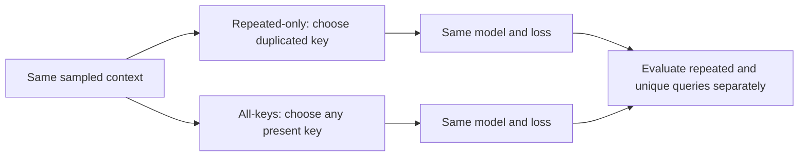

# Query exposure: what changes during learning?

**This is a training-data comparison, not a new architecture.** Both models use the same RoPE/ReLU/FFN32 network. Only the requested key and corresponding training label can differ.

## One context, several questions

```text
Context: A:red | B:blue | A:green | C:yellow
Repeated-only training: query A -> green
All-keys training:       query A -> green
                     or query B -> blue
                     or query C -> yellow
```

The original rule could be solved by finding the only duplicate key. Broader queries make that shortcut insufficient. They still require the latest value when the requested key repeats.

## Essential math

For context c, queried key q and its correct latest value y(c,q), training minimizes `-log p_theta(y(c,q) | c,q)`.

Repeated-only exposure samples `q=q_repeat(c)`. Broader exposure samples `q` uniformly from the distinct keys in c. The network and loss formula stay the same; the examples contributing gradients change.

With n pairs and one duplicate, there are n-1 distinct keys. The broader arm therefore queries the repeated key with probability `1/(n-1)`. That is 1/2 at three pairs and 1/3 at four pairs. The total number of examples stays fixed, so broader coverage trades away some repetition of the original query type.



## Why separate the scores?

An overall score mixes query types in different proportions: repeated queries are 1/2 at three pairs, 1/3 at four and 1/5 at six. Report repeated and unique accuracy separately so a gain in one cannot hide a loss in the other. All-query-context accuracy requires every available query for that context to be answered correctly.

The earlier [query-switch diagnostic](query-switch-results.md) tested frozen models on an untrained query type. This comparison tests whether deliberate exposure changes that outcome after training from scratch. A gain supports this recipe; it does not prove a specific attention mechanism.

## Data and stopping boundary

Four/six-pair families are fresh relative to the three recorded prior studies. Three-pair context splits are reused because their family space is exhausted; their test remains diagnostic. New queries do not make old contexts fresh.

The [protocol](../../query-exposure-protocol.md) fixes five paired seeds, 6,000 updates, matched context streams, separate transfer/preservation thresholds and one audit. Stop after that comparison. No extra architecture, seeds or tuning follow automatically.

Completed: [findings and audit](query-exposure-results.md). Broader questions improve transfer substantially, but one seed misses the fixed reliability threshold.
