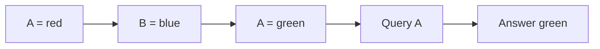

# Repeated-key recall: results

**Large gain, but the fixed reliability rule fails.** Six-pair mean accuracy rises from **57.18% to 93.51%** (+36.32 percentage points). Every paired seed improves; two RoPE seeds miss 90%. All ten runs and the independent audit completed. Comparison closed under the [frozen protocol](../../repeated-key-protocol.md).

## What the model must learn

A key can be written twice. Return its newest value. All values differ, so the older match is wrong.



The rule is `j = max{i : k_i = query}`, then `answer = v_j`. It needs both a content match and an order decision. The reversed sequence has the same pairs but the opposite answer for A.

RoPE changes the positional representation; it does not hard-code this rule. The rotation identity `(R(i)q)^T(R(j)k) = q^T R(j-i)k` makes relative distance explicit in scores. See the [positional guide](../../positional-comparison-guide.md) for the architecture diagram.

## Method and scope

Train ten new models: sinusoidal and RoPE, five paired initializations, 6,000 updates each. Same 5,088 parameters, optimizer, batches and alternating three/four-pair exposure. Six-pair sequences appear only in the test. This tests transfer of the design choice after retraining, not zero-shot transfer of old weights.

Each length has 200 test families, 36 examples per family. A family includes six orders and six cyclic value renamings. Family identities are disjoint across splits. Smaller fragments and other relabelings may remain familiar. All queries address the one repeated key; multiple repeated keys and queries to unique keys are outside this test. A solver could identify the sole duplicated key without using the query token. Success therefore does not prove query-token dependence.

| Metric | Meaning |
|---|---|
| Answer accuracy | Fraction of individual answers correct. |
| Reversal accuracy | Both a sequence and its reversal answered correctly. |
| Family accuracy | All 36 examples in a family answered correctly. |
| Obsolete-value rate | Fraction choosing the earlier matching value. Other errors need not be temporal errors. |
| Latest-position accuracy | Accuracy grouped by the later matching pair's position. Position one cannot be the later match. |
| Cross-entropy | Penalty for probability assigned to the true answer; lower is better. |

## Measured results

Each cell is test accuracy. Six-pair gain compares paired runs, not historical models.

| Seed | Sinusoidal 3 / 4 pairs, % | RoPE 3 / 4 pairs, % | Sinusoidal 6 pairs | RoPE 6 pairs | Gain, pp |
|---|---:|---:|---:|---:|---:|
| 1013 | 100.00 / 100.00 | 100.00 / 99.76 | 59.56% | 95.58% | +36.03 |
| 1031 | 100.00 / 100.00 | 100.00 / 99.99 | 57.61% | 96.89% | +39.28 |
| 1051 | 100.00 / 99.99 | 100.00 / 99.96 | 55.25% | 89.88% | +34.63 |
| 1069 | 100.00 / 100.00 | 100.00 / 99.93 | 63.35% | 95.28% | +31.93 |
| 1091 | 100.00 / 99.96 | 99.71 / 99.08 | 50.15% | 89.90% | +39.75 |

The two misses are 89.875% and 89.9028% (rounded). They remain failures under the unchanged >=90% rule. Every RoPE seed passes >=99% at both short lengths; mean short-length loss stays within the .5-point allowance.

| Six-pair mean across seeds | Sinusoidal | RoPE |
|---|---:|---:|
| Answer accuracy | 57.18% | 93.51% |
| Both-order reversal accuracy | 30.66% | 87.23% |
| All-36 family accuracy | 0.20% | 48.50% |
| Obsolete-value rate | 24.61% | 1.92% |

A mean 93.51% answer accuracy coexists with only 48.50% completely correct families. The older matching value is selected less often with RoPE, but this is a behavioral measurement, not proof of the internal mechanism.

Detailed diagnostics, all test data:

| Seed / method | CE: 3 / 4 / 6 pairs | Six-pair family / reversal / obsolete, % | Six-pair accuracy by latest position 2..6, % |
|---|---|---|---|
| 1013 / baseline | 0.00033 / 0.00093 / 2.84023 | 0.50 / 30.72 / 27.36 | 80.09 / 89.19 / 93.21 / 41.77 / 35.22 |
| 1013 / rope | 0.00022 / 0.00906 / 0.21229 | 59.50 / 91.42 / 0.49 | 87.88 / 91.94 / 93.84 / 97.22 / 98.59 |
| 1031 / baseline | 0.00010 / 0.00018 / 3.32412 | 0.00 / 31.28 / 22.68 | 86.36 / 84.98 / 73.25 / 66.26 / 21.42 |
| 1031 / rope | 0.00021 / 0.00069 / 0.13372 | 67.00 / 93.86 / 0.22 | 79.44 / 93.68 / 97.62 / 98.66 / 100.00 |
| 1051 / baseline | 0.00015 / 0.00043 / 3.14380 | 0.00 / 29.67 / 26.65 | 65.80 / 76.65 / 85.57 / 36.63 / 39.71 |
| 1051 / rope | 0.00009 / 0.00171 / 0.71998 | 47.00 / 80.03 / 2.38 | 71.65 / 84.07 / 89.57 / 92.03 / 94.72 |
| 1069 / baseline | 0.00063 / 0.00110 / 2.31422 | 0.50 / 38.75 / 17.57 | 79.65 / 76.28 / 73.04 / 48.87 / 60.11 |
| 1069 / rope | 0.00036 / 0.00295 / 0.20309 | 48.00 / 90.78 / 0.88 | 85.93 / 89.01 / 91.60 / 98.41 / 99.82 |
| 1091 / baseline | 0.00039 / 0.00160 / 3.76929 | 0.00 / 22.86 / 28.76 | 91.34 / 92.67 / 73.18 / 28.96 / 25.02 |
| 1091 / rope | 0.01055 / 0.02976 / 0.54009 | 21.00 / 80.06 / 5.64 | 76.19 / 61.26 / 89.50 / 98.10 / 99.69 |

## Controls and audit

| Check | Result |
|---|---|
| Return first matching value | 0% by construction and independent label audit: the two matching values always differ. |
| Return final pair's value | 66.67% / 49.25% / 31.58% on three/four/six-pair tests. This shortcut does not explain the learned test accuracy. |
| Data | All family identities disjoint across splits; labels balanced; each reversed example has the opposite correct matching value. |
| Matched training | Initial weights and independently regenerated minibatch hashes match within every pair; all runs complete 6,000 updates. |
| Independent forward | All 30 evaluations agree within 1.37e-13 logit error. Baseline uses library attention; RoPE uses explicit matrices and SDPA. Metrics and protocol/source/checkpoint hashes pass. |
| Fixed decision | Six-pair mean gain and every paired improvement pass; both short-length criteria pass. Every-seed six-pair >=90% fails (2/5 below threshold). |

CPU float64, one thread, PyTorch 2.14.0+cpu. Per run: 3,456,000 tokens and 31,488,000 batch-weighted squared sequence lengths, before head/layer factors. RoPE adds arithmetic despite equal parameter/token counts. Recorded loop totals: sinusoidal 198.16s; RoPE 247.09s. These include periodic validation, exclude checkpoint writes and final evaluation, and are not controlled speed benchmarks.

The unchanged positional implementation retains its [prior mathematical verification](../../../results/positional_comparison_verification.json), checked by source hash. The training loop is archived separately to preserve the earlier experiment's source; forward math and independent attention implementations are reused. Validation curves retain all scheduled steps; checkpoint files retain the latest resumable state.

## What this settles

**Observed:** RoPE has a large paired advantage on this second task after retraining, but the fixed reliability claim fails. Preserve the gains and failed criterion together. The previous unique-key success still stands.

**Unknown:** performance on other datasets, lengths, multiple repeated keys, and unrestricted queries. Five model seeds share one split; examples within families are dependent. We have not identified a causal circuit or shown general superiority. Do not infer that RoPE automatically implements recency.

**Stop:** no extra training, seed replacement or frequency tuning on these opened tests. This comparison is closed; there is no automatic follow-up experiment.

## Evidence and reproduction

[Training and curves](../../../results/repeated_key.json), [exact data](../../../results/repeated_key_data.json), [audit](../../../results/repeated_key_audit.json), [runner](../../../experiments/repeated_key.py), [audit implementation](../../../experiments/audit_repeated_key.py). Saved logits and final weights are in `results/repeated_key_scores.pt` and `results/repeated_key_checkpoints/`.

```powershell
.venv/Scripts/python.exe experiments/repeated_key.py
.venv/Scripts/python.exe experiments/audit_repeated_key.py
```

The runner resumes compatible checkpoints and leaves a completed report unchanged. Keep the recorded sources and input artifact for reproducibility.

## Paper connection

[RoFormer section3](https://arxiv.org/html/2104.09864v5) supplies the rotation construction. It does not guarantee success on this latest-write task. Our synthetic task and decision thresholds are local choices, not a reproduction of its benchmarks. The earlier [unique-key comparison](../../positional-comparison-results.md) remains a separate result.
