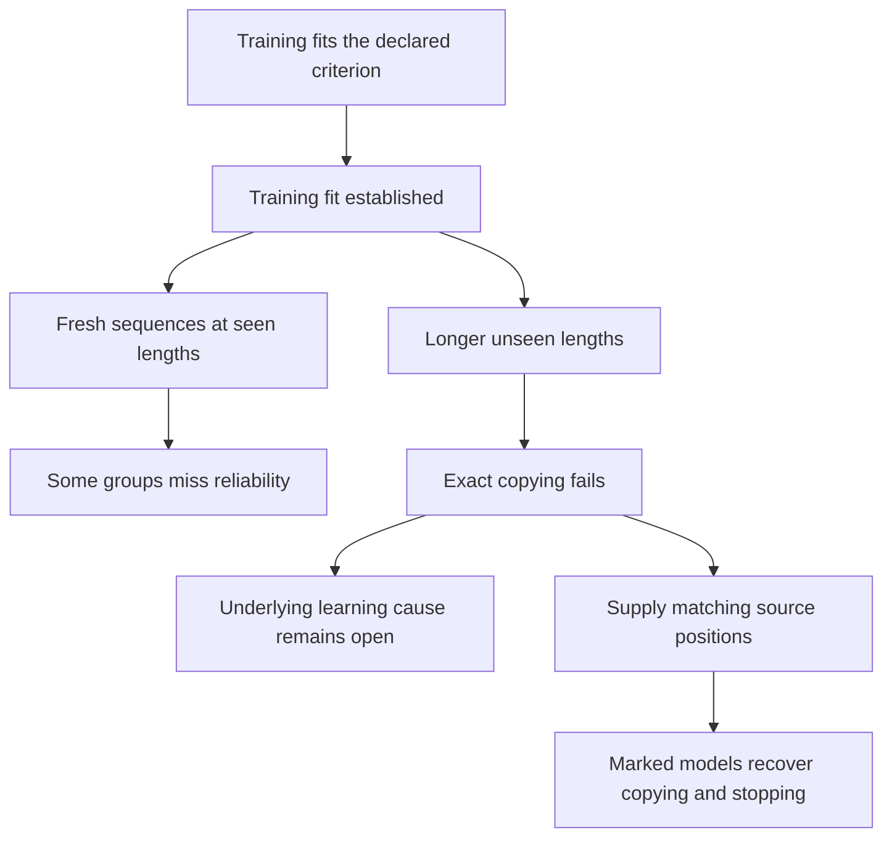

# Copying: what the combined evidence establishes

2026-10-04. Synthesis of eight completed studies; no new experiment performed by this document. Marker-trained RoPE gets every random and uniform short test correct, but native longer copying remains weak. Supplying matching source positions now recovers 100% full copying at lengths 8/10 in all tested seeds/groups. This establishes a useful learned content path under imposed alignment, not a learned copy algorithm. Earlier unmarked ambiguity, objective failures and exposure gains remain valid. Close the copy branch without further tuning or routing subdivisions.

## Evidence in order

Percentages are means across three seeds. Content exact requires all source symbols; full exact also requires immediate EOS.

| Study | Six-symbol result | Eight-symbol result | Supported conclusion |
|---|---|---|---|
| [Original training](../topics/benchmarks/encoder-decoder-copy-results.md), lengths3/4 | Ordinary full: 0% | Ordinary full: 0% | Training copying is perfect; longer transfer fails |
| [Suppress early EOS](../topics/benchmarks/copy-stopping-results.md), original checkpoints | Content: 1.56%; full: 0.52% | Content/full: 0% | Early stopping alone is insufficient to explain away the failure |
| [Force aligned cross-attention](../topics/benchmarks/copy-aligned-routing-results.md), original checkpoints, early EOS blocked | Content: 55.99%; full: 25.78% | Content: 27.86%; full: 1.04% | Selecting matching source values allows partial recovery |
| [Broader training exposure](../topics/benchmarks/copy-length-exposure-results.md), fresh paired runs | Ordinary full: short0%, mixed92.71% | Ordinary full: both0% | New inputs at a mixed-arm training length improve substantially; extrapolation remains weak |
| [EOS/content-only training](../topics/benchmarks/copy-eos-training-results.md), fresh pairs on the opened broader-length pools | Oracle content: 98.44% / 95.57% | Oracle content: 1.56% / 1.30% | Removing terminal EOS targets gives small mixed long-input changes, not the required content benefit |
| [Sinusoidal/RoPE positions](../topics/benchmarks/copy-rope-results.md), fresh pairs with unchanged EOS targets | Ordinary full: 92.97% / 90.89% | Ordinary full: 0% / 1.04% | Both fit gates pass, but RoPE benefit and reliability fail; a separate uniform-source witness exposes a representation limit |
| [Training with source EOS](../topics/benchmarks/copy-marker-training-results.md), new matched sinusoidal/RoPE pairs | Ordinary full: 95.83% / 100% | Ordinary full: 0.78% / 10.42% | Both fit gates pass; RoPE learns reliable short copying, but longer-copy benefit and extrapolation fail |
| [Supply matching source positions](../topics/benchmarks/copy-marker-alignment-results.md), saved marked RoPE models | Native/aligned full: 100% / 100% | Native/aligned full: 10.42% / 100% | Learned content and stopping succeed under supplied alignment; native transfer remains weak |

The first three rows use the same original models. The fourth uses new seeds, pools and budgets. Its matched short arm supplies its control. The fifth changes training objectives on opened pools. The sixth and seventh compare positions there; both seventh-study arms receive the marker. The eighth intervenes on the seventh's saved RoPE models, with no training. Comparing historical marked/unmarked scores does not isolate a marker effect. At length 10, the eighth changes ordinary copying from 2.34% to 100% under supplied alignment, leaving the original 2.34% native score valid.

## Three distinct questions

Training fit tests whether the recipe mastered its supplied examples. Seen-length generalization tests different examples at familiar lengths. Extrapolation tests longer lengths. A perfect training score cannot settle the latter two. Here the new mixed arm has 100% training fit, but six-symbol repeated-group test accuracy falls to 84.38% in one seed. Both new arms fail their seen-length reliability rule.

## Why routing and EOS differ

Attention computes \(h_j=\sum_t P_{jt}v_t\). Forcing \(P_{jt}=\mathbf1[t=j]\) changes the content supplied to the downstream decoder. Blocking EOS changes the final token choice. These interventions act at different stages.

For logits z, \(p(\mathrm{EOS})/p(y)=\exp[z(\mathrm{EOS})-z(y)]\). EOS can beat the correct symbol even when the content path contains useful information. Conversely, removing EOS cannot repair a wrong highest-scoring content symbol. The residual path, normalization and FFN also remain active after attention selection.

**Observed:** both content and stopping errors survive the original interventions. **Unresolved:** whether EOS training, positional interactions, learned routing or other factors explain the length boundary. The experiments do not assign a unique cause or prove lost encoder information.

## What broader exposure changes

The newer arms match 5.04M target tokens each. Mixed replaces some short sequences with longer sequences and uses more unique training inputs. Sequence count, EOS frequency and attention work differ. The passed support-benefit rule supports this training package. It does not isolate positional diversity, establish equal compute or constitute an architectural improvement.

All eight studies have saved evidence and independent checks. The newer audits match every primary generated sequence and teacher argmax. The EOS study's evaluation/audit implementation failures and recovery are documented separately, without retraining. Numerical agreement does not establish universal generalization. Prediction counts are not independent training seeds. Both positional comparisons use opened pools and new matched controls; scores across studies do not isolate a treatment.

## EOS objective question, now tested

**Does training to predict EOS weaken content extrapolation?** Blocking EOS after training did not test how its training targets affect the representations learned. The [six-run objective comparison](../topics/benchmarks/copy-eos-training-results.md) now tests removing its terminal targets with unchanged content coefficients and shared oracle length.

Both arms fit training content perfectly. Content-only lowers mean raw content CE but loses seen-length reliability and fails the required longer-input gain. Terminal EOS supervision is not the only obstacle removable by this intervention. Its effect on internal representations, and the remaining length-failure cause, are still unidentified. These results concern oracle content, not ordinary generation or learning when to stop.

[Newman et al. (2020), sections 1 and 3](https://arxiv.org/html/2010.07174v1) use this training distinction and an oracle-length evaluation on different tasks. Their findings motivate the question; they do not answer it for our checkpoints or establish their hidden-state mechanisms here.

## Positional representation, now tested

The [six-run sinusoidal/RoPE comparison](../topics/benchmarks/copy-rope-results.md) keeps EOS supervision and compares positions directly. Both training-fit gates pass, with RoPE's weakest training group at 99.22%, but seen-length reliability and its longer-copy benefit fail. Ordinary length 10 is zero in both arms; oracle means are 0.26%/0%. Decoder-only retrieval improvements therefore do not establish a copy-task winner.

A posthoc boundary check supplies a concrete structural explanation for one input class. With identical source symbols, Q/K-only positions change weights but cannot change an average of identical V vectors. This encoder-decoder variant returns identical next-token logits for different source lengths at the same prefix, even when one correct label is EOS and the other is a content symbol. All 48 saved-checkpoint probes confirm it. This does not identify the contribution of that boundary to the original varied-content errors or reject variants with positional values/source end markers. See the [short proof and guide](../topics/benchmarks/copy-rope-guide.md#a-limit-of-this-particular-variant).

The [saved-checkpoint source-marker diagnostic](../topics/benchmarks/copy-source-end-marker.md) breaks all 48 tested RoPE uniform-source collisions, while masked and same-symbol controls retain them. Only 5/48 marker pairs give both correct labels. This establishes a distinction route, not learned stopping or a quality repair. It remains a diagnostic addition to the sixth study; the marker-trained comparison below adds the seventh.

## Available information versus learned use

The [marker-present learning comparison](../topics/benchmarks/copy-marker-training-results.md) supplies source EOS throughout training while preserving decoder copy targets. All six runs fit every training example. RoPE also gets every random test sequence and uniform probe at lengths 3/4/5/6 correct; sinusoidal fails its all-group short reliability rule.

Both longer extrapolation rules still fail. RoPE ordinary length 8/10 means are 10.42%/2.34%; oracle content 14.06%/4.17%. Excluding EOS therefore does not solve the remaining content predictions. Its uniform 8/10 means 58.33%/50% are much higher, but the weakest seed is 12.50% at both lengths. Input structure and seed reliability matter; the cause is open.

The short result establishes learned correct answers in the marked format. Accuracy does not prove position-aligned attention or a learned end-marker circuit. Since both arms are marked, this comparison cannot isolate the marker's training effect against historical unmarked runs. The exact uniform overlap and opened pools also prevent fresh-confirmation claims. All 120 cells pass independent equations; no further training is selected.

## Final diagnostic: content works under supplied alignment

The [marked-model alignment diagnostic](../topics/benchmarks/copy-marker-alignment-results.md) changes only cross-attention weights in both heads. Each decoder row reads the corresponding encoder position, including source EOS at termination. Learned V projections, residuals, normalization, FFN and readout stay active. Ordinary generation uses its own prefix and allows EOS normally.

All 768 random length 8/10 sequence evaluations become fully correct; every short control and uniform probe is also 100%. Shifting the selected position by one gives 0% full copying. Both declared conditional-recovery rules pass. All 72 cells pass independent equations with zero prediction changes.

Correct-prefix tests locate many native errors at early content positions: 316/344 failed length-8 sequences first fail within positions 1–3, and 366/375 length-10 failures within positions 1–5. The error is not confined to newly encountered decoder positions. Supplying alignment is sufficient for these checkpoints' recovery, but it changes both position choice and mixture sharpness. It does not separate Q from K, explain training's failure to learn transferable routing, isolate marker training, or establish a deployable solution.

Close the copy branch here. Preserve the useful-content finding, native transfer failures, proven unmarked boundary and remaining learning questions together. No objective-weight tuning, head/token subdivisions or position/length/LR grid is selected.
